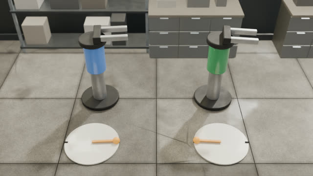
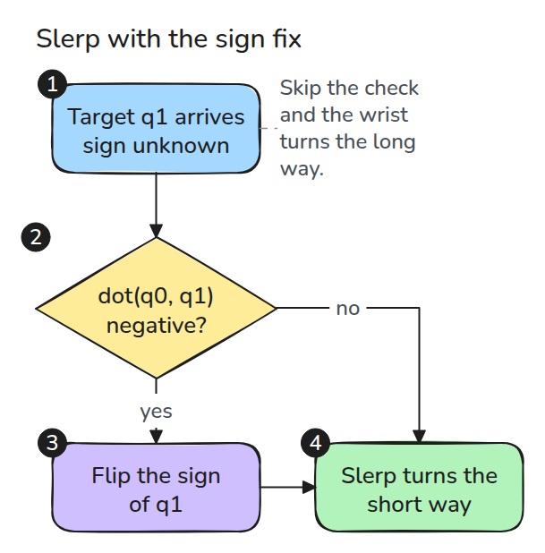

# Axis-Angle and Quaternions

> Learn why a robot wrist can spin a whole turn the long way round, and the one-line check that stops it.

**Type:** Build   **Prerequisites:** 01/01 Rotations and SE(3)   **Time:** ~15 minutes

## In Plain Words

A robot wrist is told to turn a tiny bit left. Turning almost a full circle to the right would end up facing nearly the same way. A quaternion is four numbers naming an orientation. Flip the sign of all four and it names the same orientation. So the code may flip the sign of the goal orientation to keep the turn short.

## Key Terms

- **Orientation**: which way something faces.
- **Quaternion**: four numbers, with squares adding up to one, that name an orientation.
- **Slerp**: a smooth, even-speed turn between two orientations.
- **Dot product**: multiply matching numbers of two quaternions and add them up. Negative means the smooth turn between them would take the long way round.
- **Radian (rad)**: an angle unit where one full turn is about 6.28.

## The Problem

A robot wrist, told to correct a tiny error, spins almost a full turn the long way round. The target arrived with a flipped sign and the code trusted it.

## The Concept

One sign slip makes the wrist take the long way.

[](../assets/clip-example.mp4)

*Same final pose. Green turned one extra full turn.*

Every orientation has two quaternions: call one q, and the other, with all four signs flipped, is -q.


*q and -q are different numbers that give the same turn.*

The fix: take the dot product of the two quaternions. If it is negative, the smooth turn (slerp) goes the long way, even for close orientations. Flip the target's sign first: same orientation, short turn.



*If the check says negative, flip the sign for the short way.*


*Without the fix the wrist sweeps almost a full turn. With it, a small one.*

<details><summary>The math (optional)</summary>

A turn of angle `t` about axis `k` is the quaternion `(cos(t/2), sin(t/2) k)`. A turn of 0.1 about z gives `q = (0.9988, 0, 0, 0.0500)`; adding a full turn (`t = 0.1 + 2pi`) gives `-q = (-0.9988, 0, 0, -0.0500)`. The dot product of `q0 = (1, 0, 0, 0)` and `-q` is -0.9988: negative means the slerp would take the long way, so flip. Without the fix the wrist sweeps 354.3 degrees; with it 5.7 (0.1 rad). The clip's needles show half angles 0.05 and pi + 0.05. SciPy lists a quaternion's four numbers in a different order than this lesson, so check the order when you switch libraries.

</details>

## Build It

`rodrigues` turns an axis and angle into a rotation matrix. `slerp` turns smoothly between orientations; its `fix` option flips the sign when the dot product is negative.

```python
def rodrigues(axis, angle):
    k = _unit(axis)
    K = np.array([[0, -k[2], k[1]], [k[2], 0, -k[0]], [-k[1], k[0], 0]])
    return np.eye(3) + np.sin(angle) * K + (1 - np.cos(angle)) * K @ K

def slerp(q0, q1, t, fix=True):
    d = float(q0 @ q1)
    if fix and d < 0:
        q1, d = -q1, -d
    om = np.arccos(min(d, 1.0))
    return (np.sin((1 - t) * om) * q0 + np.sin(t * om) * q1) / np.sin(om)
```

```bash
cd robotics-engineering-from-scratch
python3 -m pytest phases/01-math-foundations/03-axis-angle-and-quaternions -q
```

## Use It

SciPy, a Python add-on, has `Rotation.from_quat` and `Slerp`, which do this.

Sources: Craig, *Introduction to Robotics*, 3rd ed., ch. 2 (Euler parameters; section number not verified).

## Ship It

`outputs/skill-quaternion-sign-check.md` reviews code that interpolates orientations.

## Exercises

1. Run `slerp` with `fix=False` and watch the long way.
2. Negate a quaternion and check the rotation matrix is the same.
3. Move the target a little at a time and find where the dot product first turns negative.
