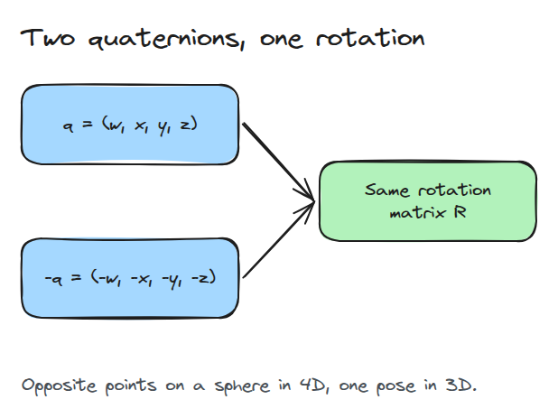
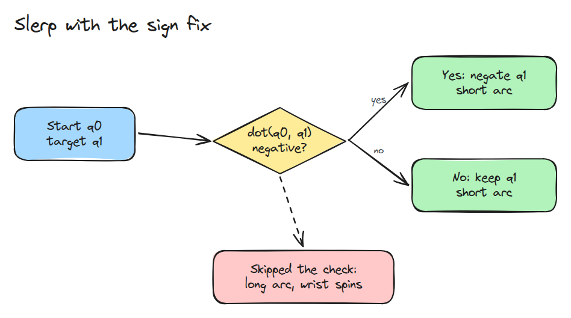
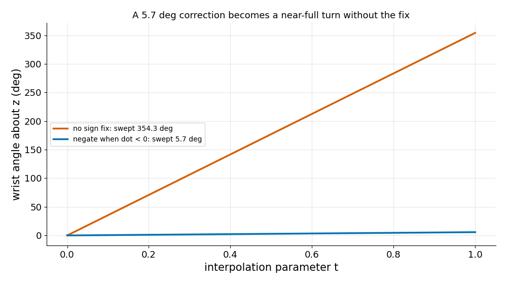

# 축-각과 Quaternion

> 모든 회전에는 quaternion이 두 개 있고 부호를 무시하는 보간기는 손목을 한 바퀴 돌려 버릴 수 있습니다.

**유형:** 만들기   **선수 지식:** 01/01 회전과 SE(3)   **시간:** 약 15분

## 문제

손목에 0.1 rad의 작은 오차를 고치라고 했는데 거의 한 바퀴를 반대 방향으로 돌았습니다. 목표 quaternion의 부호가 반대로 도착했고 부호가 반대여도 같은 자세를 뜻합니다. 보간기는 부호를 그대로 믿고 먼 쪽으로 돌아갔습니다.

## 개념



*4차원 단위 구 위의 반대편 두 점이 3x3 회전 행렬 하나로 사상됩니다.*

Rodrigues 공식은 축 `k`와 각도를 행렬로 바꿉니다. `R = I + sin(t) K + (1 - cos(t)) K^2`이고 `K`는 `k`의 외적 행렬입니다.

단위 quaternion은 `(cos(t/2), sin(t/2) k)`입니다. `t`와 `t + 2pi`가 `q`와 `-q`를 주므로 회전마다 quaternion이 두 개입니다(double cover).



*`dot(q0, q1)`이 음수이면 보간 전에 `q1`의 부호를 뒤집습니다. 회전은 그대로이고 짧은 호를 탑니다.*



*출발과 목표는 같습니다. 보정이 없으면 손목이 354.3도를 돌고 보정이 있으면 5.7도를 돕니다.*

## 만들기

```python
def rodrigues(axis, angle):
    k = _unit(axis)
    K = np.array([[0, -k[2], k[1]], [k[2], 0, -k[0]], [-k[1], k[0], 0]])
    return np.eye(3) + np.sin(angle) * K + (1 - np.cos(angle)) * K @ K

def slerp(q0, q1, t, fix=True):
    d = float(q0 @ q1)
    if fix and d < 0:
        q1, d = -q1, -d
    om = np.arccos(min(d, 1.0))
    return (np.sin((1 - t) * om) * q0 + np.sin(t * om) * q1) / np.sin(om)
```

전체 파일에는 `quat_mul`, `quat_to_R`, `R_to_quat`이 더 들어 있습니다.

```bash
cd robotics-engineering-from-scratch
python3 -m pytest phases/01-math-foundations/03-axis-angle-and-quaternions -q
```

## 실제 도구로 보기

SciPy의 `Rotation.from_quat`과 `Slerp`가 같은 일을 합니다.

SciPy는 quaternion을 scalar-last `(x, y, z, w)`로 저장하고 마지막 테스트가 여기서 쓴 scalar-first `(w, x, y, z)`와 맞는지 확인합니다. 라이브러리 경계를 넘을 때마다 성분 순서를 확인하세요.

출처: Craig, *Introduction to Robotics*, 3판, 2장(Euler parameters, 절 번호는 확인하지 못했습니다).

## 결과물

`outputs/skill-quaternion-sign-check.md`는 자세를 보간하거나 비교하는 코드를 리뷰합니다.

## 연습 문제

1. `q_inv = (w, -x, -y, -z)`일 때 `quat_mul(q, q_inv)`가 항등 회전임을 보이세요.
2. z축 0 rad에서 출발할 때 `dot`가 0을 지나는 목표 각도를 찾으세요.
3. 각도 `2*arccos(|dot|)`를 보정 유무에 따른 경로 각도와 비교하세요.
