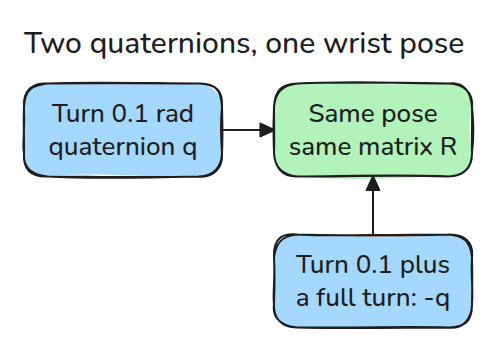
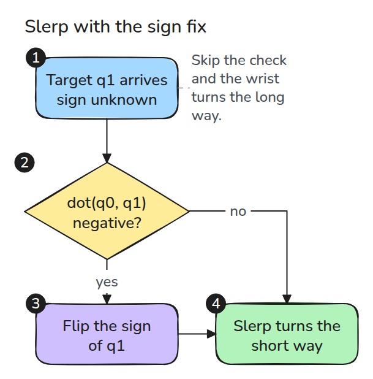
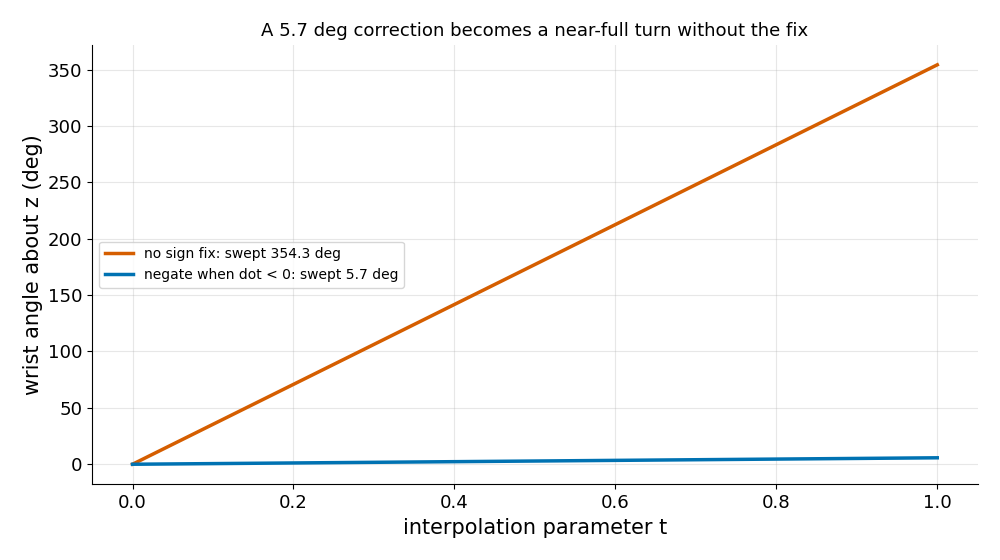

# 축-각과 Quaternion

> 로봇 손목이 왜 한 바퀴를 돌아가 버리는지, 그리고 그것을 막는 한 줄짜리 검사를 알게 됩니다.

**유형:** 만들기   **선수 지식:** 01/01 회전과 SE(3)   **시간:** 약 15분

## 쉽게 말하면

로봇 손목이 왼쪽으로 아주 조금 돌라는 명령을 받아요. 오른쪽으로 거의 한 바퀴를 돌아도 같은 방향에 닿아서 도착 방향만으로는 경로가 정해지지 않아요.

quaternion은 자세를 나타내는데 q와 그 반대인 -q가 같은 자세예요. 두 자세 사이를 매끄럽게 돌리는 slerp는 필요할 때 부호를 뒤집어 짧게 돌게 해요.

## 핵심 용어

- **Quaternion**: 자세를 나타내는 숫자 네 개입니다. 단위 quaternion은 길이가 1입니다.
- **Axis-angle**: 어떤 선을 축으로 얼마나 돌지를 각도로 적은 회전입니다.
- **Slerp**: 두 자세 사이를 같은 속도로 매끄럽게 돌리는 방법입니다.
- **Interpolator**: 시작 값과 목표 값 사이를 매끄럽게 움직이는 코드입니다.
- **Dot product**: 두 목록의 대응하는 성분끼리 곱해 더한 값으로 두 quaternion이 얼마나 닮았는지 알려 줍니다.
- **Radian (rad)**: 각도의 단위로 한 바퀴가 약 6.28입니다.

## 문제

로봇 손목에 0.1 rad의 작은 오차를 고치라고 했는데 거의 한 바퀴를 반대 방향으로 돌았습니다.

목표 quaternion의 부호가 반대로 도착했고 부호가 반대여도 같은 자세를 뜻합니다. 보간기는 그 부호를 그대로 믿고 먼 쪽으로 돌아갔습니다.

## 개념

로봇은 자세 사이를 매끄럽게 돌리는 일을 늘 하고 부호 하나가 어긋나면 손목이 먼 쪽으로 돕니다.

단위 축 `k`와 각도 `t`는 Rodrigues 공식 `R = I + sin(t) K + (1 - cos(t)) K^2`으로 회전 행렬이 됩니다. `I`는 아무것도 하지 않는 행렬이고 `K`는 벡터 `v`를 `k x v`로 바꿉니다.

단위 quaternion은 같은 회전을 숫자 네 개에 담습니다. `(cos(t/2), sin(t/2) k)`입니다.

z축으로 0.1을 돌리면 `q = (0.9988, 0, 0, 0.0500)`입니다. 한 바퀴를 더해 `t = 0.1 + 2pi`로 만들면 손목은 제자리에 오지만 부호가 모두 뒤집혀 `-q = (-0.9988, 0, 0, -0.0500)`이 됩니다.

회전마다 quaternion이 두 개입니다.


*파란 손목은 0.1을, 초록 손목은 0.1 + 2pi를 돌리는데 두 gripper는 같은 자세로 끝납니다. 바늘은 반각 0.05와 pi + 0.05를 보여 줍니다.*



*4차원 구 위의 서로 반대편 점 두 개가 회전 행렬 하나에 대응합니다.*

`q0 = (1, 0, 0, 0)`에서 `-q`까지의 dot product는 -0.9988입니다. 음수는 반대편이라는 뜻이므로 slerp가 부호를 뒤집어야 합니다.



*`dot(q0, q1)`이 음수이면 보간 전에 `q1`의 부호를 뒤집습니다. 회전은 그대로이고 짧은 호를 탑니다.*



*출발과 목표는 같습니다. 보정이 없으면 손목이 354.3도를 돌고 보정이 있으면 5.7도(0.1 rad)를 돕니다.*

## 만들기

```python
def rodrigues(axis, angle):
    k = _unit(axis)
    K = np.array([[0, -k[2], k[1]], [k[2], 0, -k[0]], [-k[1], k[0], 0]])
    return np.eye(3) + np.sin(angle) * K + (1 - np.cos(angle)) * K @ K

def slerp(q0, q1, t, fix=True):
    d = float(q0 @ q1)
    if fix and d < 0:
        q1, d = -q1, -d
    om = np.arccos(min(d, 1.0))
    return (np.sin((1 - t) * om) * q0 + np.sin(t * om) * q1) / np.sin(om)
```

전체 파일에는 `quat_mul`, `quat_to_R`, `R_to_quat`이 더 들어 있습니다.

```bash
cd robotics-engineering-from-scratch
python3 -m pytest phases/01-math-foundations/03-axis-angle-and-quaternions -q
```

## 실제 도구로 보기

SciPy의 `Rotation.from_quat`과 `Slerp`가 같은 일을 합니다. SciPy는 quaternion을 scalar-last `(x, y, z, w)`로 저장하고 마지막 테스트가 여기서 쓴 scalar-first `(w, x, y, z)`와 맞는지 확인합니다.

라이브러리 경계를 넘을 때마다 성분 순서를 확인하세요.

출처: Craig, *Introduction to Robotics*, 3판, 2장(Euler parameters, 절 번호는 확인하지 못했습니다).

## 결과물

`outputs/skill-quaternion-sign-check.md`는 자세를 보간하거나 비교하는 코드를 리뷰합니다.

## 연습 문제

1. `q_inv = (w, -x, -y, -z)`일 때 `quat_mul(q, q_inv)`가 항등 회전임을 보이세요.
2. z축 0 rad에서 출발할 때 `dot`가 0을 지나는 지점을 찾으세요.
3. `2*arccos(|dot|)`를 보정 유무에 따른 경로 각도와 비교하세요.
