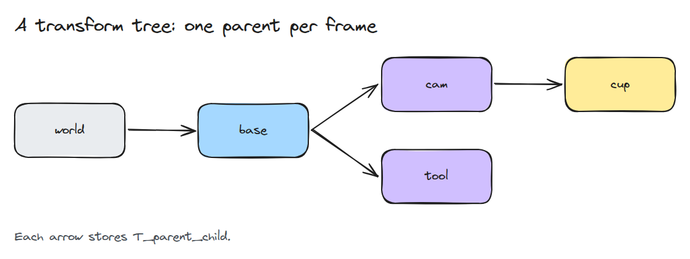
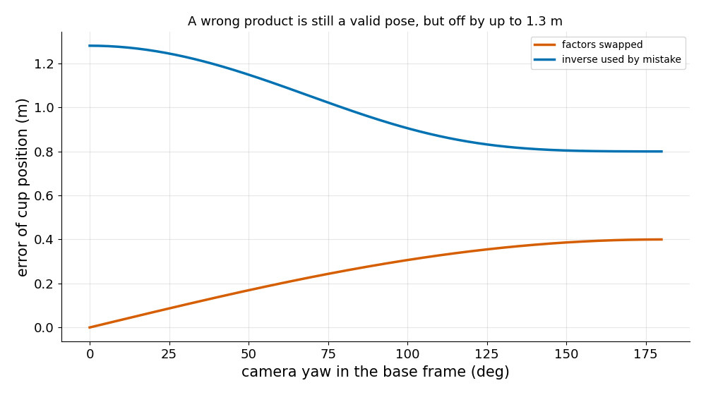

# Frames and Transform Trees

> Learn a naming habit that stops you mixing up which part's view a position is measured from.

**Type:** Build   **Prerequisites:** 01/01 Rotations and SE(3)   **Time:** ~15 minutes

## In Plain Words

A camera on a mast reports a cup's position from its own view, but the arm needs it from its base. A transform tree stores how each part (frame) sits in its parent; multiply the transforms along the chain to convert.

## Key Terms

- **Frame**: a set of x, y, z directions attached to a part, such as the camera or the base.
- **Transform tree**: a map where each frame hangs off exactly one parent frame.
- **`T_to_from`**: a transform that converts coordinates from the `from` frame into the `to` frame.
- **Common ancestor**: the nearest frame above two frames on the tree, where their paths meet.
- **Cycle**: a loop in which a frame becomes its own ancestor.
- **tf2**: the ROS 2 library that stores a transform tree.

## The Problem

A camera sees a cup, and the arm needs the cup's position from its own base. Someone multiplies the transforms in the wrong order, or inverts the wrong one, and the answer is a valid-looking spot in the wrong place.

## The Concept

Each part of a robot sees the world from its own spot, so every reading must be converted. The habit that prevents mistakes is to name every transform with both ends, `T_to_from`: it converts from the second frame into the first, and neighbouring names cancel like fractions.



*Each arrow is one transform. The camera and the hand both hang off the base.*

To see the cup from the hand, climb from the hand and from the cup up to a shared parent, then come down one side.


*Climb both frames up to the base, then come down.*


*Three views of the same cup.*



*A swapped order or a stray inverse can put the cup far off.*

<details><summary>The math (optional)</summary>

In `T_a_b @ T_b_c = T_a_c` the inner names cancel. The camera sits at (0.5, 0, 0.4) in the base frame, turned around, and sees the cup at (0.2, 0, 0.5), so in the base frame the cup is at (0.3, 0, 0.9). A hand at (0.3, 0, 0.7) sees it at (0, 0, 0.2). A swapped product is off by up to 0.4 m, a stray inverse by up to 1.3 m.

</details>

## Build It

`add()` refuses a second parent or a loop. `lookup()` climbs from both frames to the first shared parent and multiplies the transforms on the way.

```python
def lookup(self, to, frm):
    up_to, up_from = self._up(to), self._up(frm)
    common = next((f for f in up_from if f in up_to), None)
    if common is None:
        raise ValueError(f"{to} and {frm} are in different trees")
    return invert_T(self._to_ancestor(to, common)) @ self._to_ancestor(frm, common)
```

```bash
cd robotics-engineering-from-scratch
python3 -m pytest phases/01-math-foundations/04-frames-and-transform-trees -q
```

## Use It

ROS 2's `tf2` keeps the same tree, and its `lookup_transform` takes the target first. Compare it with `TFTree.lookup`.

Sources: signature checked in `tf2_ros/buffer.py` of the local ROS 2 Jazzy install.

## Ship It

`outputs/skill-frame-naming-review.md` audits transform products and frame names.

## Exercises

1. Add a new frame under the camera and check the chain still works.
2. Make `lookup` list the frames it passes.
3. Try to add a second parent and read the error.
