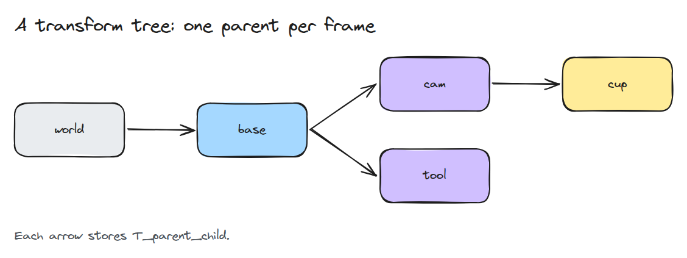
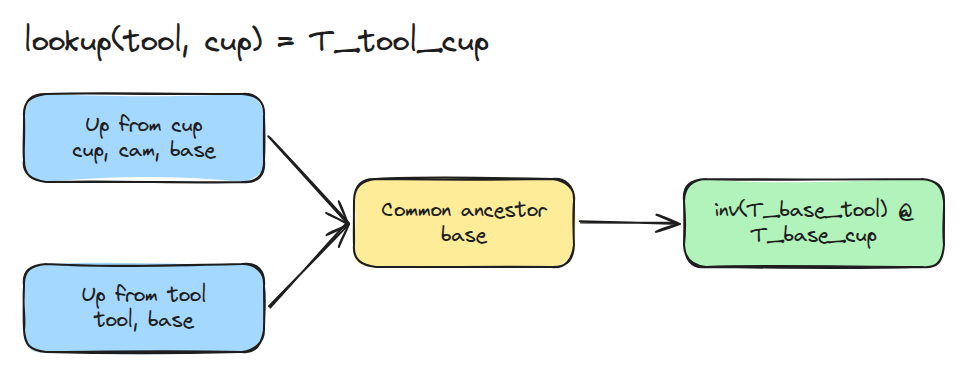
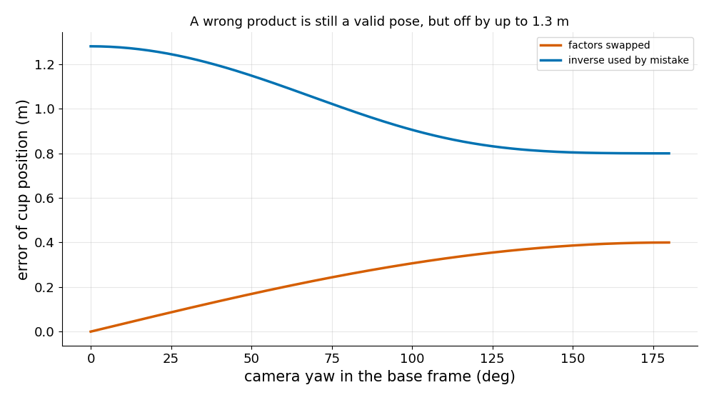

# Frames and Transform Trees

> Name every transform `T_to_from`, and let the tree find the path between any two frames.

**Type:** Build   **Prerequisites:** 01/01 Rotations and SE(3)   **Time:** ~15 minutes

## The Problem

A camera sees a cup, and the base needs the cup. Someone writes `T_cam_cup @ T_base_cam`, or inverts the wrong matrix, because the names `cam` and `base` carry no direction. Both results are valid poses in the wrong place, and no error is raised.

## The Concept



*Each arrow stores `T_parent_child`, which maps coordinates in the child into the parent.*

`T_to_from` converts coordinates from `from` into `to`. In a product the inner names cancel: `T_a_b @ T_b_c = T_a_c`. If the inner names differ, the product is wrong.



*To get `T_tool_cup`, climb from both frames to `base`, then use `inv(T_base_tool) @ T_base_cup`.*



*With the camera at (0.5, 0, 0.4) in the base frame and the cup at (0.2, 0, 0.5) in the camera frame, a swapped product is off by up to 0.4 m and a stray inverse by up to 1.3 m.*

## Build It

```python
def lookup(self, to, frm):
    up_to, up_from = self._up(to), self._up(frm)
    common = next((f for f in up_from if f in up_to), None)
    if common is None:
        raise ValueError(f"{to} and {frm} are in different trees")
    return invert_T(self._to_ancestor(to, common)) @ self._to_ancestor(frm, common)
```

`add()` rejects a second parent and any cycle. `_to_ancestor()` multiplies stored transforms on the way up.

```bash
cd robotics-engineering-from-scratch
python3 -m pytest phases/01-math-foundations/04-frames-and-transform-trees -q
```

## Use It

ROS 2 `tf2` keeps the same structure: one parent per frame, lookups through a common ancestor, and `lookup_transform(target, source, time)` taking the target first. Compare its result with `TFTree.lookup` on the same tree.

Sources: signature checked in `tf2_ros/buffer.py` of the local ROS 2 Jazzy install.

## Ship It

`outputs/skill-frame-naming-review.md` audits transform products and frame names in a code review.

## Exercises

1. Add a `static_cam_cup` frame under `cam` and check the chain still cancels.
2. Make `lookup` return the list of frames it visited.
3. Add `time` to each edge and say what interpolation `lookup` would need.
