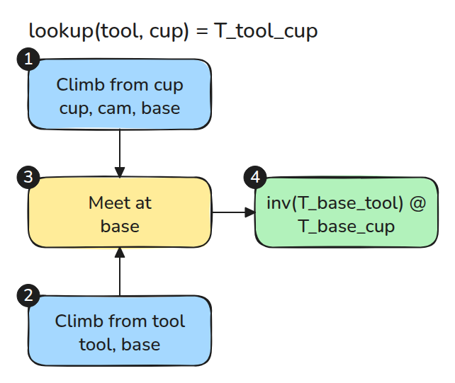
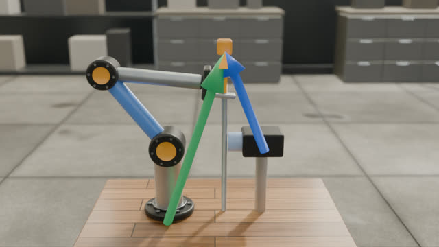

# Frames and Transform Trees

> Learn a naming habit that stops you mixing up which part's view a position is measured from.

**Type:** Build   **Prerequisites:** 01/01 Rotations and SE(3)   **Time:** ~15 minutes

## In Plain Words

A camera on a mast reports a cup's position from its own view, but the arm needs it from its base. Each part's place is stored relative to the part it hangs from. Multiplying these placements along the chain from one part to the other converts a position between their views.

## Key Terms

- **Frame**: a set of x, y, z directions attached to a part, such as the camera or the base.
- **Transform**: the numbers that convert a position from one frame's view to another's.
- **Transform tree**: a map where each frame hangs off exactly one parent frame.
- **Transform name (`T_to_from`)**: a name that tells which frame a transform converts from and which it converts into.
- **Shared parent**: the nearest frame above two frames on the tree, where their paths meet.
- **tf2**: the ROS 2 library that stores a transform tree.

## The Problem

The arm needs the cup's position from its own base. Someone multiplies in the wrong order, or turns the wrong one around (inverts it), and gets a valid-looking spot in the wrong place.

## The Concept

Each part of a robot sees the world from its own spot, so every reading must be converted. Name every transform with both ends, like `T_base_cam`: it turns a position seen by the camera into one seen by the base. Neighbouring names cancel like fractions: base-from-camera times camera-from-cup gives base-from-cup.


*Each arrow is one transform; camera and hand hang off the base.*

To see the cup from the hand, start with the cup as the camera sees it, climb to the shared parent (the base), then come down to the hand.



*Climb to the base, then come down.*

[](../assets/clip-example.mp4)

*The same cup from three views: three different position numbers.*


*Swapping the order, or turning one transform around by mistake, can put the cup far off.*

<details><summary>The math (optional)</summary>

`T_to_from` converts from the second frame into the first, and in `T_a_b @ T_b_c = T_a_c` the inner names cancel. The camera sits at (0.5, 0, 0.4) in the base frame, turned around, and sees the cup at (0.2, 0, 0.5), so in the base frame the cup is at (0.3, 0, 0.9). A hand at (0.3, 0, 0.7) sees it at (0, 0, 0.2). A swapped product is off by up to 0.4 m, a stray inverse by up to 1.3 m.

</details>

## Build It

`add()` refuses a second parent or a loop. `lookup()` climbs to the first shared parent, multiplying on the way.

```python
def lookup(self, to, frm):
    up_to, up_from = self._up(to), self._up(frm)
    common = next((f for f in up_from if f in up_to), None)
    if common is None:
        raise ValueError(f"{to} and {frm} are in different trees")
    return invert_T(self._to_ancestor(to, common)) @ self._to_ancestor(frm, common)
```

```bash
cd robotics-engineering-from-scratch
python3 -m pytest phases/01-math-foundations/04-frames-and-transform-trees -q
```

## Use It

ROS 2's `tf2` keeps the same tree, and its `lookup_transform` takes the frame you want the answer in first. Compare it with `TFTree.lookup`.

Sources: signature checked in `tf2_ros/buffer.py` of the local ROS 2 Jazzy install.

## Ship It

`outputs/skill-frame-naming-review.md` audits transform products and frame names.

## Exercises

1. Add a frame under the camera.
2. Make `lookup` list the frames it passes.
3. Add a second parent and read the error.
