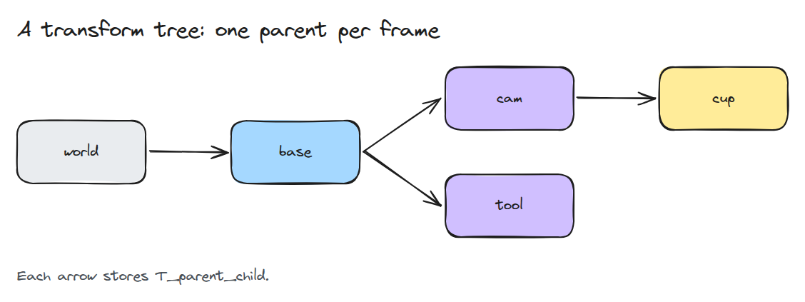
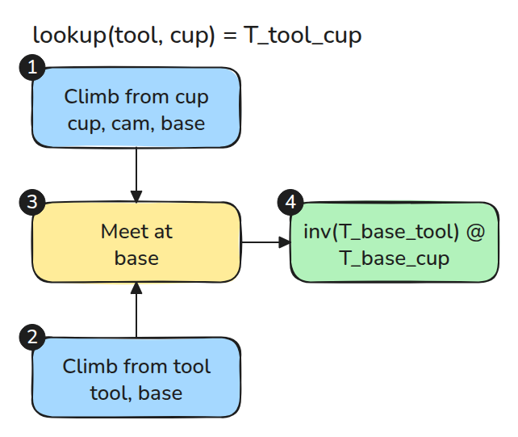
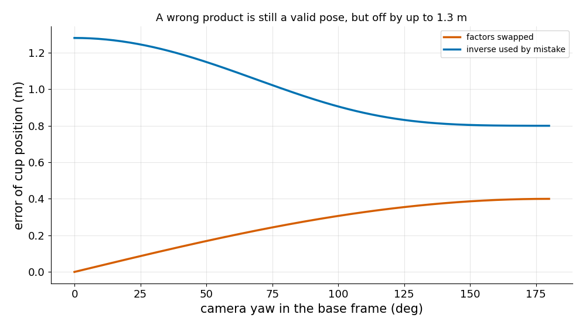

# Frame과 Transform 트리

> 모든 transform을 `T_to_from`으로 이름 짓고 두 frame 사이의 경로는 트리가 찾게 합니다.

**유형:** 만들기   **선수 지식:** 01/01 회전과 SE(3)   **시간:** 약 15분

## 쉽게 말하면

사탕이 책상 위 도시락 안에 있어요. 교실 문에서 본 사탕의 위치를 알려면 책상 위치와 도시락의 위치와 방향을 함께 알아야 해요. 도시락을 돌리면 안에 든 사탕도 방 기준으로는 다른 방향에 놓여요.

transform tree는 이런 부모와 자식의 관계를 저장해요. 카메라가 본 컵을 로봇 tool의 frame으로 옮기려면 공통 frame까지 두 경로를 잇고 tool 쪽 경로를 거꾸로 가요.
frame 이름을 맞춰야 변환을 올바르게 이어 붙일 수 있어요.

## 문제

카메라는 컵을 보고 base는 컵의 위치가 필요합니다. 누군가 `T_cam_cup @ T_base_cam`을 쓰거나 엉뚱한 행렬에 inverse를 씌웁니다.

`cam`과 `base`라는 이름에 방향이 없기 때문입니다. 두 결과 모두 엉뚱한 곳을 가리키는 유효한 pose이고 에러는 나지 않습니다.

## 개념



*화살표마다 `T_parent_child`가 저장되어 있고 이는 child의 좌표를 parent의 좌표로 옮깁니다.*

`T_to_from`은 `from`의 좌표를 `to`의 좌표로 바꿉니다. 곱에서는 안쪽 이름이 상쇄됩니다. `T_a_b @ T_b_c = T_a_c`입니다. 안쪽 이름이 다르면 그 곱은 틀린 것입니다.



*`T_tool_cup`을 구하려면 두 frame에서 `base`까지 올라간 뒤 `inv(T_base_tool) @ T_base_cup`을 씁니다.*



*카메라가 base frame의 (0.5, 0, 0.4)에 있고 컵이 카메라 frame의 (0.2, 0, 0.5)에 있을 때, 곱의 순서를 바꾸면 최대 0.4 m, inverse를 잘못 쓰면 최대 1.3 m 어긋납니다.*

## 만들기

```python
def lookup(self, to, frm):
    up_to, up_from = self._up(to), self._up(frm)
    common = next((f for f in up_from if f in up_to), None)
    if common is None:
        raise ValueError(f"{to} and {frm} are in different trees")
    return invert_T(self._to_ancestor(to, common)) @ self._to_ancestor(frm, common)
```

`add()`는 두 번째 부모와 순환을 거부합니다. `_to_ancestor()`는 올라가는 길에 저장된 transform을 곱합니다.

```bash
cd robotics-engineering-from-scratch
python3 -m pytest phases/01-math-foundations/04-frames-and-transform-trees -q
```

## 실제 도구로 보기

ROS 2 `tf2`도 같은 구조입니다. frame마다 부모가 하나이고 공통 조상을 거쳐 조회하며 `lookup_transform(target, source, time)`은 target을 먼저 받습니다. 같은 트리에서 그 결과를 `TFTree.lookup`과 비교해 보세요.

출처: 이 시그니처는 로컬 ROS 2 Jazzy 설치의 `tf2_ros/buffer.py`에서 확인했습니다.

## 결과물

`outputs/skill-frame-naming-review.md`는 코드 리뷰에서 transform 곱과 frame 이름을 점검합니다.

## 연습 문제

1. `cam` 아래에 `static_cam_cup` frame을 추가하고 사슬이 여전히 상쇄되는지 확인하세요.
2. `lookup`이 지나간 frame 목록을 돌려주게 하세요.
3. 각 edge에 `time`을 넣고 `lookup`에 어떤 보간이 필요한지 말해 보세요.
