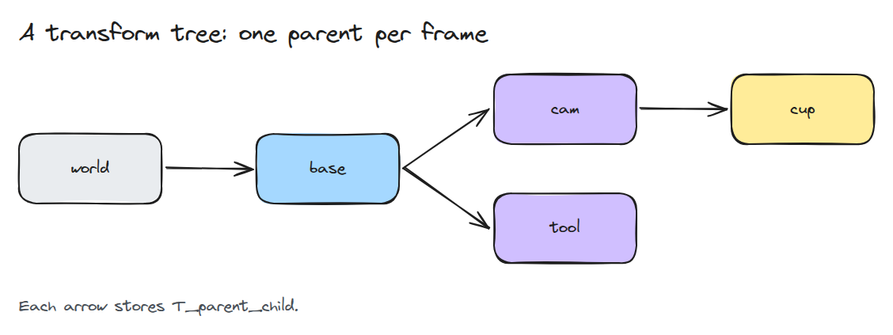
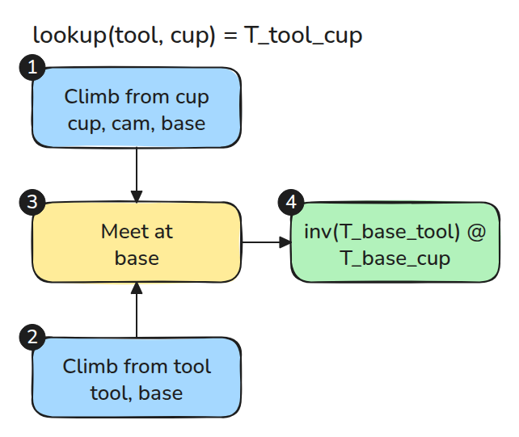
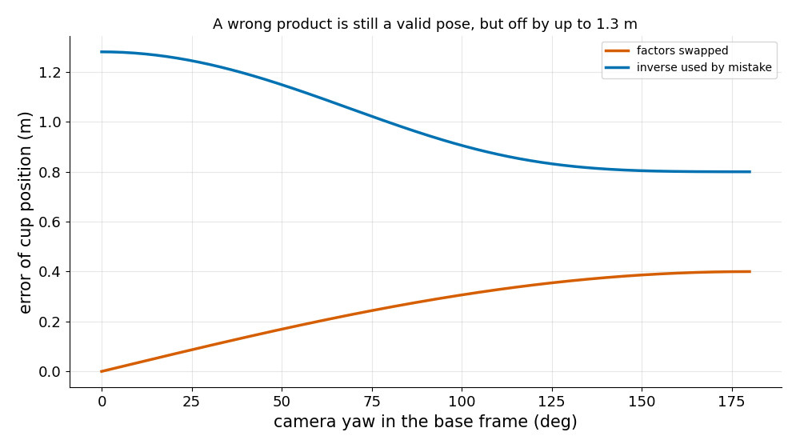

# Frame과 Transform 트리

> 위치가 어느 부품의 시점에서 잰 것인지 헷갈리지 않게 해 주는 이름 짓기 습관을 알게 됩니다.

**유형:** 만들기   **선수 지식:** 01/01 회전과 SE(3)   **시간:** 약 15분

## 쉽게 말하면

마스트에 달린 카메라는 컵의 위치를 카메라 자신의 시점에서 알려 주지만 팔에는 자기 base에서 잰 위치가 필요해요.

각 부품의 자리는 그 부품이 매달린 부품을 기준으로 저장돼요. 이 자리들을 한 부품에서 다른 부품까지 사슬을 따라 곱하면 한 부품의 시점에서 잰 위치를 다른 부품의 시점으로 바꿀 수 있어요.

## 핵심 용어

- **Frame**: 카메라나 base 같은 부품에 붙은 x, y, z 방향의 묶음입니다.
- **Transform**: 위치를 한 frame의 시점에서 다른 frame의 시점으로 바꿔 주는 숫자들입니다.
- **Transform tree**: 모든 frame이 부모 frame 하나에 매달린 지도입니다.
- **Transform name (`T_to_from`)**: transform이 어느 frame에서 어느 frame으로 바꾸는지 알려 주는 이름입니다.
- **Shared parent**: 트리에서 두 frame의 위쪽으로 가장 가까운 frame입니다. 두 경로가 이곳에서 만납니다.
- **tf2**: transform 트리를 저장하는 ROS 2 라이브러리입니다.

## 문제

팔은 자기 base에서 잰 컵의 위치가 필요합니다. 누군가 transform을 잘못된 순서로 곱하거나 엉뚱한 것을 거꾸로 돌리면(inverse) 그럴듯해 보이지만 잘못된 위치가 나옵니다.

## 개념

로봇의 부품은 저마다 자기 자리에서 세상을 보므로 모든 측정값을 바꿔 주어야 합니다. 모든 transform에 `T_base_cam`처럼 양 끝의 이름을 붙입니다. 이 transform은 카메라가 본 위치를 base가 본 위치로 바꿔 줍니다.

이웃한 이름은 분수처럼 약분됩니다. base-from-camera에 camera-from-cup을 곱하면 base-from-cup이 됩니다.



*화살표 하나가 transform 하나입니다. 카메라와 손은 둘 다 base에 달려 있습니다.*

손에서 본 컵을 구하려면 카메라가 본 컵에서 시작해 공통 부모(base)까지 올라간 다음 손까지 내려옵니다.



*base까지 올라갔다가 내려옵니다.*


*같은 컵을 세 시점에서 본 모습입니다. 위치 숫자가 세 가지로 다르게 나옵니다.*



*순서를 바꾸거나 transform 하나를 실수로 뒤집으면 컵이 멀리 어긋날 수 있습니다.*

<details><summary>The math (optional)</summary>

`T_to_from`은 두 번째 frame의 값을 첫 번째 frame의 값으로 바꿉니다. `T_a_b @ T_b_c = T_a_c`에서는 안쪽 이름이 약분됩니다.
카메라는 base frame의 (0.5, 0, 0.4)에서 반대쪽을 향해 있고 컵이 (0.2, 0, 0.5)에 보입니다. 그러면 base frame에서 컵은 (0.3, 0, 0.9)에 있습니다.
(0.3, 0, 0.7)에 있는 손에게는 컵이 (0, 0, 0.2)로 보입니다. 곱의 순서를 바꾸면 최대 0.4 m, inverse를 잘못 쓰면 최대 1.3 m 어긋납니다.

</details>

## 만들기

`add()`는 두 번째 부모와 고리를 거부합니다. `lookup()`은 두 frame에서 처음 만나는 공통 부모까지 올라가며 transform을 곱합니다.

```python
def lookup(self, to, frm):
    up_to, up_from = self._up(to), self._up(frm)
    common = next((f for f in up_from if f in up_to), None)
    if common is None:
        raise ValueError(f"{to} and {frm} are in different trees")
    return invert_T(self._to_ancestor(to, common)) @ self._to_ancestor(frm, common)
```

```bash
cd robotics-engineering-from-scratch
python3 -m pytest phases/01-math-foundations/04-frames-and-transform-trees -q
```

## 실제 도구로 보기

ROS 2의 `tf2`도 같은 트리를 저장하고 `lookup_transform`은 답을 얻고 싶은 frame을 먼저 받습니다. 그 결과를 `TFTree.lookup`과 비교해 보세요.

출처: 이 시그니처는 로컬 ROS 2 Jazzy 설치의 `tf2_ros/buffer.py`에서 확인했습니다.

## 결과물

`outputs/skill-frame-naming-review.md`는 코드 리뷰에서 transform 곱과 frame 이름을 점검합니다.

## 연습 문제

1. 카메라 아래에 새 frame을 추가하세요.
2. `lookup`이 지나간 frame 목록을 돌려주게 하세요.
3. 두 번째 부모를 추가해 보고 오류를 읽어 보세요.
