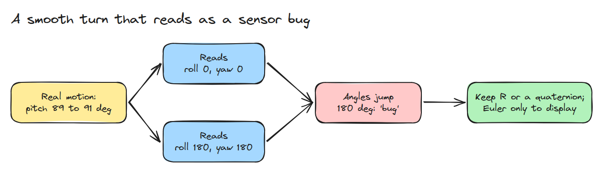
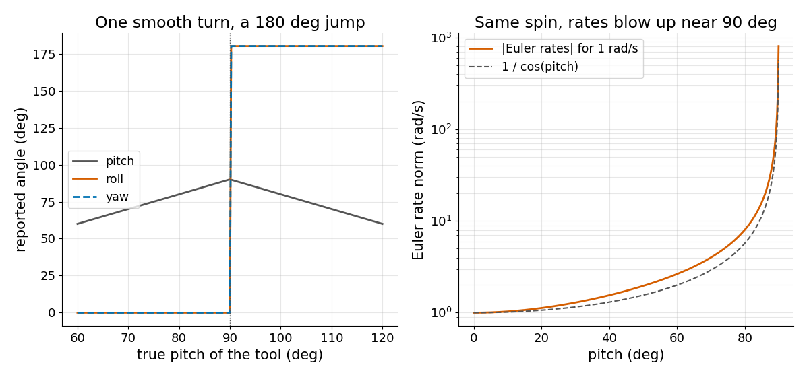

# Euler Angles and Gimbal Lock

> Learn why roll, pitch and yaw numbers suddenly jump when a tool tilts straight down.

**Type:** Build   **Prerequisites:** 01/01 Rotations and SE(3), 01/03 Axis-Angle and Quaternions   **Time:** ~15 minutes

## In Plain Words

A camera sits in three nested rings that turn it about the vertical, tilt it, and roll it about its viewing line. Tilted straight down, two rings twist the view about one line.

Near that pose the same view has two ring settings. The code that reads the ring angles reports only one, so yaw and roll jump while the camera moves smoothly.

## Key Terms

- **Euler angles**: three turns applied in a fixed order, named roll, pitch and yaw.
- **Roll, pitch, yaw**: turns about the forward axis, the side axis and the vertical axis.
- **Gimbal lock**: a pose where two rings line up and one direction of turning is lost.
- **Euler rates**: how fast each ring is turning.
- **Determinant (`det`)**: one number computed from a matrix; zero means the matrix flattens space.
- **Low-pass filter**: a smoother that blurs fast changes.

## The Problem

A camera on a robot reports roll, pitch and yaw. As it tilts through straight down, roll and yaw jump by 180 degrees or the controller asks for huge joint speeds.

## The Concept

Many robot sensors report orientation as three angles, and near one pose those three numbers stop making sense.

Yaw is about the vertical z axis, pitch about the side y axis, roll about the forward x axis. In `R = Rz(yaw) Ry(pitch) Rx(roll)` roll acts first.


*At pitch 90 degrees (gimbal lock) the roll ring lines up with the yaw ring.*

Then roll `+a` equals yaw `-a`; only `yaw - roll` matters, so one direction is lost.


*Left: roll ring +1.2 rad. Right: yaw ring -1.2 rad. The amber fins end aligned.*

Reading angles back from `R` gives pitch between -90 and 90 degrees, so past 90 it switches to a second spelling (`other_spelling()`) with roll and yaw 180 degrees away.



*Roll and yaw flip by 180 degrees while the tool moves smoothly.*

Euler rates need a matrix `E` with `det E = cos(pitch)`, 0 at 90 degrees, so some spins have none.



*Left: pitch sweep from 60 to 120 degrees. Right: for a 1 rad/s world-x spin at yaw 0, Euler rates grow like 1 / cos(pitch).*

## Build It

```python
def euler_to_R(roll, pitch, yaw):
    return _rot(2, yaw) @ _rot(1, pitch) @ _rot(0, roll)
```

`R_to_euler()` reads pitch from `-R[2, 0]`. Within 1e-9 of lock it returns `locked=True` with roll 0. `euler_rates()` raises at gimbal lock.

```bash
cd robotics-engineering-from-scratch
python3 -m pytest phases/01-math-foundations/05-euler-angles-and-gimbal-lock -q
python3 phases/01-math-foundations/05-euler-angles-and-gimbal-lock/code/main.py
```

## Use It

Compare `R_to_euler()` with SciPy's `Rotation.as_euler("ZYX")`. SciPy warns at gimbal lock, so compare rotations.

## Ship It

`outputs/skill-euler-angle-audit.md` checks for Euler angles in control, logging and filters.

## Exercises

1. Find a second `(roll, yaw)` pair giving the same `R` at pitch 90 degrees.
2. At yaw 0 and pitch 89.9 degrees, find the largest Euler rate for a 1 rad/s world-x spin.
3. Compare a low-pass filter on angles with a slerp on `R`.
