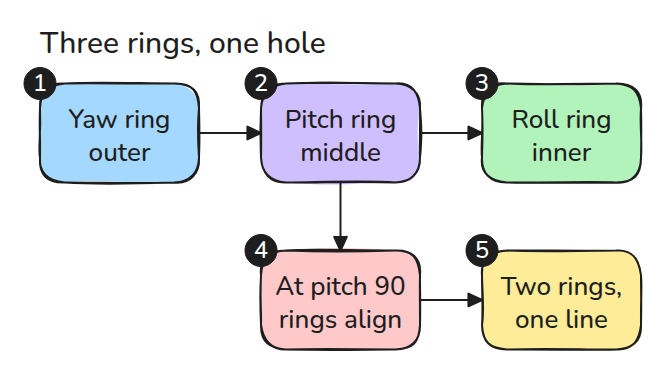

# Euler Angles and Gimbal Lock

> Learn why roll, pitch and yaw numbers suddenly jump when a tool tilts straight down.

**Type:** Build   **Prerequisites:** 01/01 Rotations and SE(3), 01/03 Axis-Angle and Quaternions   **Time:** ~15 minutes

## In Plain Words

A camera sits in three nested rings that turn it about the vertical, tilt it, and roll it about its viewing line. Tilted straight down, two rings twist the view about one line.

Near that pose the same view has two ring settings. The code that reads the ring angles reports only one, so yaw and roll jump while the camera moves smoothly.

## Key Terms

- **Euler angles**: three turns applied in a fixed order, named roll, pitch and yaw.
- **Roll, pitch, yaw**: turns about the forward axis, the side axis and the vertical axis.
- **Gimbal lock**: a pose where two rings line up and one direction of turning is lost.
- **Euler rates**: how fast each ring is turning.
- **Determinant (`det`)**: one number computed from a matrix; zero means the matrix flattens space.
- **Low-pass filter**: a smoother that blurs fast changes.

## The Problem

A camera on a robot reports three angles, roll, pitch and yaw. As it tilts through straight down, two of the numbers suddenly jump, or the controller asks the joints to spin impossibly fast.

## The Concept

Many robot sensors report orientation as three angles, and near one pose those three numbers stop making sense. Picture the camera in three rings; when it looks straight down, two rings line up and turn the view about the same line.



*Straight down, two rings line up and a direction is lost.*


*Two different ring settings, one identical view.*

The code that reads the angles back must pick one of the two settings, and it switches as the camera passes through, so the numbers jump even though the camera moves smoothly.


*Roll and yaw flip.*


*Near straight down, the needed ring speeds shoot up.*

<details><summary>The math (optional)</summary>

At pitch 90 degrees roll `+a` equals yaw `-a`, so only `yaw - roll` matters. Reading angles back gives pitch between -90 and 90 degrees, so past 90 it switches to a second spelling with roll and yaw 180 degrees away. The rate matrix has determinant `cos(pitch)`, which is 0 at 90 degrees. The plot sweeps pitch from 60 to 120 degrees; for a 1 rad/s spin at yaw 0 the rates grow like 1 / cos(pitch). The clip turns the roll ring +1.2 rad and the yaw ring -1.2 rad. `locked=True` is reported within 1e-9 of the lock.

</details>

## Build It

`euler_to_R` builds a rotation from three angles. `R_to_euler()` reads them back and reports `locked=True` near the lock, and `euler_rates()` refuses to run there.

```python
def euler_to_R(roll, pitch, yaw):
    return _rot(2, yaw) @ _rot(1, pitch) @ _rot(0, roll)
```

```bash
cd robotics-engineering-from-scratch
python3 -m pytest phases/01-math-foundations/05-euler-angles-and-gimbal-lock -q
python3 phases/01-math-foundations/05-euler-angles-and-gimbal-lock/code/main.py
```

## Use It

Compare `R_to_euler()` with SciPy's `Rotation.as_euler("ZYX")`. SciPy warns at the lock, so compare the rotations, not the angles.

## Ship It

`outputs/skill-euler-angle-audit.md` checks for Euler angles in control, logging and filters.

## Exercises

1. Tilt the camera to 89 degrees and then 90 and watch the output.
2. Find a second pair of roll and yaw that gives the same rotation at pitch 90 degrees.
3. Compare a smoothing filter on the angles with a smooth turn between the rotations.
