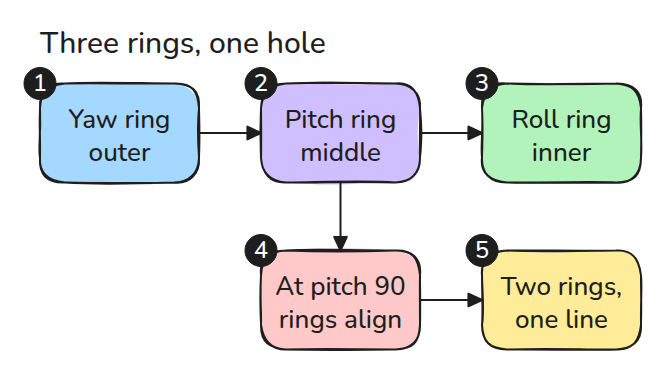
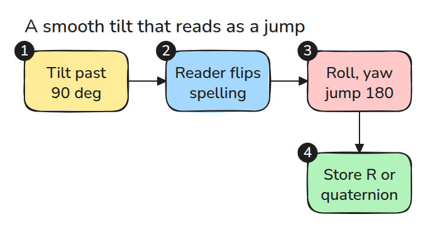
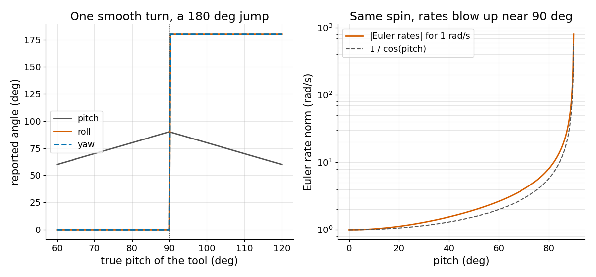

# Euler Angles and Gimbal Lock

> Roll, pitch and yaw are three numbers in a fixed order, and near pitch 90 degrees that order has a hole.

**Type:** Build   **Prerequisites:** 01/01 Rotations and SE(3), 01/03 Axis-Angle and Quaternions   **Time:** ~15 minutes

## In Plain Words

A camera sits in three nested rings: the outer turns about the vertical line, the middle tilts it, the inner rolls it about its viewing line. Tilt it straight down and the outer and inner rings line up, so both twist the view about one line and none can swing it sideways.

Near that pose the same view has two ring settings. The code that reads the ring angles reports only one, so it switches as the camera crosses, and yaw and roll jump while the camera moves smoothly.

## The Problem

A wrist or camera reports roll, pitch and yaw. As the tool tilts through vertical, roll and yaw suddenly jump by 180 degrees, or the controller asks for huge joint speeds. The angle format is the problem, not the sensor.

## The Concept

Euler angles describe a pose with three ring turns: yaw about the vertical z axis, pitch about the side y axis, roll about the camera's forward x axis. In `R = Rz(yaw) Ry(pitch) Rx(roll)` the rightmost matrix, roll, acts first.



*Follow the numbers. At pitch 90 degrees (gimbal lock) the roll ring lines up with the yaw ring.*

Then the camera looks straight down: the roll axis points down and the yaw axis up, so both rings turn about one vertical line, and roll `+a` equals yaw `-a`. So only `yaw - roll` matters: one direction is lost.


*Each rig is a camera in three rings. The left turns its roll ring +1.2 rad, the right its yaw ring -1.2 rad, and the amber fins end up pointing the same way.*

The code that reads angles back from `R` reports pitch between -90 and 90 degrees. Every orientation also has a second spelling (`other_spelling()`) with pitch past 90 and roll and yaw 180 degrees away, so past 90 the reader switches spellings.



*Follow the arrows: roll and yaw flip by 180 degrees while the tool moves smoothly.*

Euler rates (how fast each ring turns) become the camera's world angular velocity through a 3x3 matrix `E` with `det E = cos(pitch)`. At 90 degrees the determinant is 0, so `E` flattens to a plane (rank 2) and spins out of it have no Euler rates.



*Left: a pitch sweep from 60 to 120 degrees. Right: for a 1 rad/s world-x spin at yaw 0, Euler rates grow like 1 / cos(pitch).*

## Build It

```python
def euler_to_R(roll, pitch, yaw):
    return _rot(2, yaw) @ _rot(1, pitch) @ _rot(0, roll)
```

`R_to_euler()` reads pitch from `-R[2, 0]`, then roll and yaw from the other entries. When `|R[2, 0]|` is within 1e-9 of 1 it returns `locked=True` with roll 0 (only `yaw - roll` at +90 degrees, `yaw + roll` at -90, is defined). `euler_rates()` solves with `E` and raises at gimbal lock.

```bash
cd robotics-engineering-from-scratch
python3 -m pytest phases/01-math-foundations/05-euler-angles-and-gimbal-lock -q
python3 phases/01-math-foundations/05-euler-angles-and-gimbal-lock/code/main.py
```

## Use It

Compare `R_to_euler()` with `scipy.spatial.transform.Rotation.as_euler("ZYX")`. SciPy warns at gimbal lock, so compare rotations, not angles.

## Ship It

`outputs/skill-euler-angle-audit.md` checks a system for Euler angles in control, logging and filters.

## Exercises

1. Find a second `(roll, yaw)` pair with the same `R` at pitch 90 degrees.
2. At yaw 0 and pitch 89.9 degrees, compute `E` and the largest Euler rate for a 1 rad/s world-x spin.
3. Smooth the angles with a low-pass filter across the jump, then smooth `R` with a slerp, and compare.
