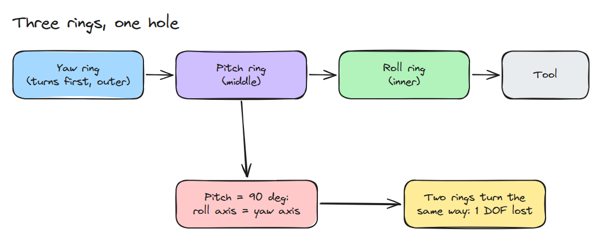
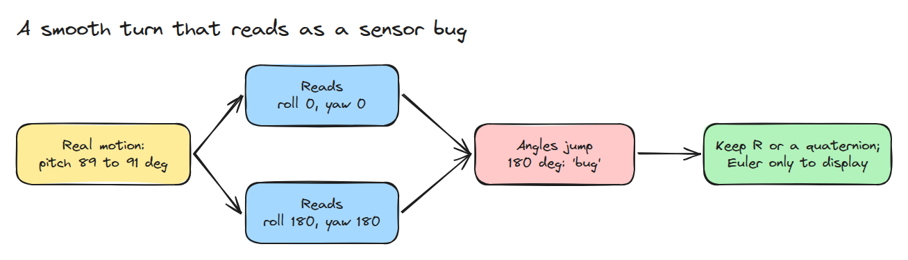
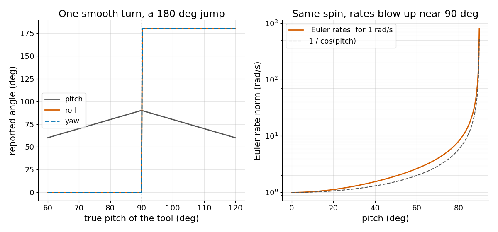

# Euler 각도와 Gimbal Lock

> roll, pitch, yaw는 순서가 정해진 숫자 세 개이고 pitch가 90도 근처에 가면 그 순서에 구멍이 생깁니다.

**유형:** 만들기   **선수 지식:** 01/01 회전행렬과 SE(3), 01/03 축각과 Quaternion   **시간:** 약 15분

## 쉽게 말하면

휴대전화 카메라를 수직 위로 향해 보세요. 방의 수직축으로 도는 회전과 카메라가 향한 축을 중심으로 비트는 회전이 같은 축을 써요. 둘로 서로 다른 방향 변화를 표현할 수 없게 돼요.

Euler angles도 pitch가 수직에 이르면 roll과 yaw가 묶여요. 그 근처에서는 실제로 조금 돌아도 표시 각도가 크게 바뀔 수 있어요. 수직을 지나갈 때 휴대전화는 부드럽게 움직이는데
각도 값은 갑자기 뛸 수도 있어요.

## 문제

손목이나 카메라가 roll, pitch, yaw를 보고합니다. 도구가 수직 위로 기울어 지나가면 roll과 yaw가 갑자기 180도 튀거나 제어기가 엄청나게 빠른 관절 속도를 요구합니다. 센서는 멀쩡하고 문제는 각도 형식에 있습니다.

## 개념



*yaw, pitch, roll은 세 개의 고리입니다. pitch가 90도이면 roll 고리가 yaw 고리와 나란해져서 둘이 같은 방향으로 돕니다.*



*모든 자세에는 표기가 두 가지 있습니다. 90도를 지나는 순간 읽는 쪽이 표기를 바꾸므로 도구는 매끄럽게 움직이는데 roll과 yaw는 180도 뒤집힙니다.*

ZYX 순서를 씁니다. `R = Rz(yaw) Ry(pitch) Rx(roll)`입니다. Euler rate를 월드 각속도로 보내는 사상은 3x3 행렬 `E`이고 `det E = cos(pitch)`입니다. 90도에서는 rank가 2가 되어서 어떤 회전은 어떤 Euler rate로도 만들 수 없습니다.



*왼쪽은 pitch를 60도에서 120도까지 돌린 결과로 90도에서 roll과 yaw가 180도 튑니다. 오른쪽은 yaw 0에서 world-x 축으로 1 rad/s 회전할 때 Euler rate의 norm이 1 / cos(pitch)처럼 커지는 모습입니다.*

## 만들기

```python
def euler_to_R(roll, pitch, yaw):
    return _rot(2, yaw) @ _rot(1, pitch) @ _rot(0, roll)
```

`R_to_euler()`는 pitch를 `-R[2, 0]`에서 읽고 roll과 yaw를 나머지 성분에서 읽습니다.

`|R[2, 0]|`가 1에서 1e-9 이내이면 `locked=True`를 돌려주고 roll을 0으로 둡니다. pitch +90도에서는 `yaw - roll`만, -90도에서는 `yaw + roll`만 정해지기 때문입니다.

`other_spelling()`은 같은 회전의 두 번째 표기를 줍니다. `euler_rates()`는 `E`로 풀고 gimbal lock에서는 예외를 냅니다.

```bash
cd robotics-engineering-from-scratch
python3 -m pytest phases/01-math-foundations/05-euler-angles-and-gimbal-lock -q
python3 phases/01-math-foundations/05-euler-angles-and-gimbal-lock/code/main.py
```

## 실제 도구로 보기

`R_to_euler()`를 `scipy.spatial.transform.Rotation.as_euler("ZYX")`와 비교하세요. SciPy는 gimbal lock에서 경고를 냅니다. 각도가 같은지가 아니라 두 결과가 같은 회전인지를 확인합니다.

## 결과물

`outputs/skill-euler-angle-audit.md`는 제어, 로그, 필터에 Euler 각도를 쓰는 곳이 있는지 점검합니다.

## 연습 문제

1. pitch 90도에서 같은 `R`을 주는 다른 `(roll, yaw)` 쌍을 찾으세요.
2. yaw 0, pitch 89.9도에서 `E`를 계산하고 world-x 축으로 1 rad/s 회전할 때 가장 큰 Euler rate를 구하세요.
3. 점프 구간에서 각도에 low-pass filter를 걸고 `R`에는 slerp를 건 뒤 결과를 비교하세요.
