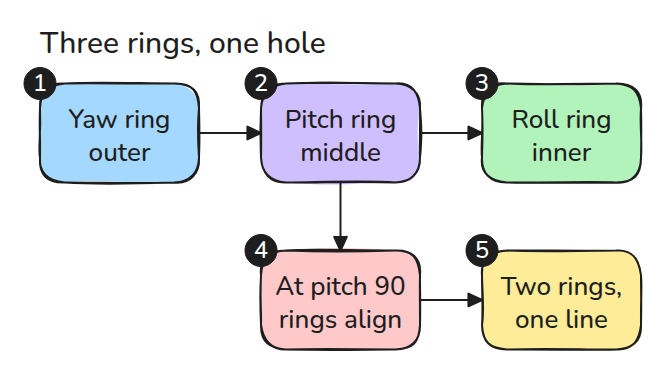
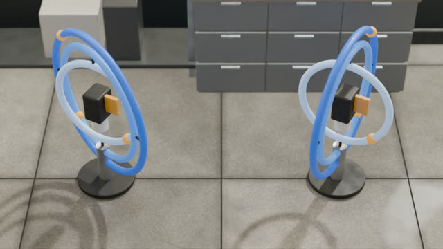
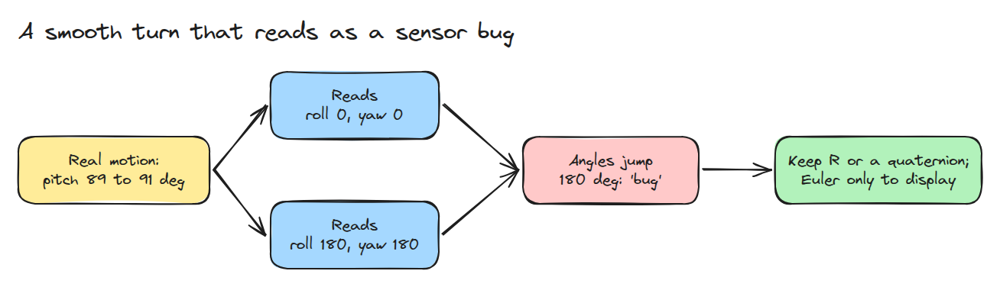
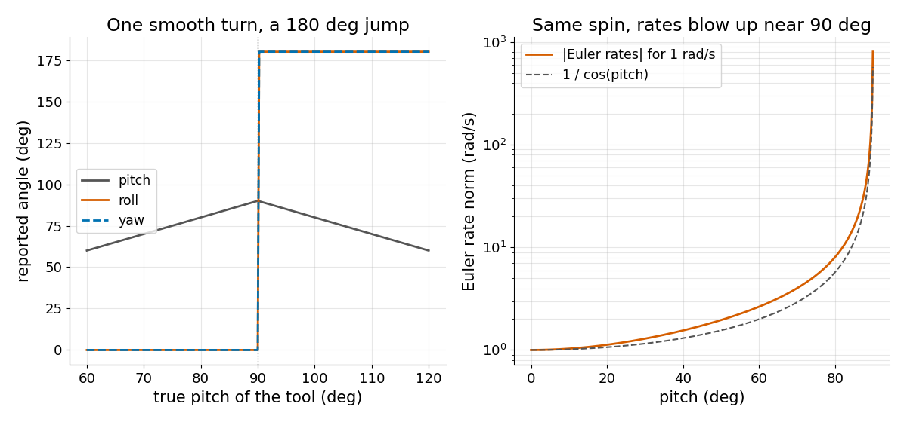

# Euler 각도와 Gimbal Lock

> 도구가 바로 아래로 기울면 roll, pitch, yaw 숫자가 왜 갑자기 튀는지 알게 됩니다.

**유형:** 만들기   **선수 지식:** 01/01 회전과 SE(3), 01/03 축-각과 Quaternion   **시간:** 약 15분

## 쉽게 말하면

카메라가 겹쳐진 고리 세 개(gimbal, 자이로스코프 장난감 같은 것) 안에 있어요. 고리 하나는 카메라를 수직선 둘레로 돌리고 하나는 기울이고 하나는 보는 선을 축으로 굴려요. 바로 아래로 기울이면 고리 두 개가 같은 선을 축으로 화면을 돌리게 되어 방향 하나가 사라져요.

그 자세 근처에서는 같은 화면을 두 가지 다른 고리 설정으로 만들 수 있어요. 각도를 읽는 코드는 그중 하나를 고르기 때문에 yaw와 roll 값이 갑자기 뛰어요.

## 핵심 용어

- **Euler angles**: 정해진 순서로 적용하는 회전 세 개로 roll, pitch, yaw라고 부릅니다.
- **Roll, pitch, yaw**: 앞쪽 축, 옆쪽 축, 수직 축을 도는 회전입니다.
- **Gimbal**: 어느 방향으로든 돌 수 있게 해 주는 겹쳐진 고리 세 개입니다.
- **Gimbal lock**: 고리 두 개가 나란해져서 돌릴 수 있는 방향 하나를 잃은 자세입니다.
- **Euler rates**: 각 고리가 돌고 있는 속도입니다.

## 문제

로봇에 달린 카메라가 roll, pitch, yaw 세 각도를 보고합니다. 바로 아래로 기울어지는 순간 숫자 둘이 갑자기 튀거나 팔 제어 프로그램이 관절을 말도 안 되게 빠르게 돌리라고 요구합니다.

## 개념

많은 로봇 센서가 자세를 각도 세 개로 알려 주는데 한 자세 근처에서는 그 세 숫자가 의미를 잃습니다. 카메라가 고리 세 개 안에 있다고 해 보세요(첫 번째 그림 참고). 바로 아래를 보면 고리 두 개가 한 줄로 서서 같은 선을 축으로 화면을 돌립니다.



*바로 아래를 보면 고리 두 개가 나란해져서 돌릴 수 있는 방향 하나를 잃습니다.*

[](../assets/clip-example.mp4)

*고리 설정은 두 가지인데 화면은 똑같습니다.*

각도를 다시 읽는 코드는 두 설정 중 하나를 골라야 하는데 카메라가 그 자세를 지나는 순간 고르는 쪽이 바뀝니다. 그래서 카메라는 매끄럽게 움직이는데 숫자는 튑니다. 바로 아래 근처에서 매끄럽게 돌려면 고리가 점점 더 빨리 돌아야 합니다.



*카메라는 매끄럽게 도는데 바로 아래 자세에서 roll과 yaw 숫자가 뒤집힙니다.*



*바로 아래 근처에서는 필요한 고리 속도가 치솟습니다.*

<details><summary>The math (optional)</summary>

pitch가 90도이면 roll `+a`는 yaw `-a`와 같아서 `yaw - roll`만 의미가 있습니다. 각도를 다시 읽으면 pitch는 -90도에서 90도 사이로만 나오므로 90도를 넘으면 roll과 yaw가 180도 떨어진 두 번째 표기로 바뀝니다.
rate 행렬의 determinant(행렬이 방향을 잃으면 0이 되는 숫자 하나)는 `cos(pitch)`이고 90도에서 0입니다. 그림은 pitch를 60도에서 120도까지 돌립니다. yaw 0에서 1 rad/s로 회전하면 rate가 1 / cos(pitch)처럼 커집니다.
영상은 roll 고리를 +1.2 rad, yaw 고리를 -1.2 rad 돌립니다. `locked=True`는 `|sin(pitch)|`가 1에서 1e-9 이내라는 뜻이고 lock에서 약 0.00005 rad 떨어진 곳까지 해당합니다.

</details>

## 만들기

`euler_to_R`은 각도 세 개로 회전을 만듭니다. `R_to_euler()`는 각도를 다시 읽고 lock 근처에서 `locked=True`를 돌려주며 `euler_rates()`는 거기서 실행을 거부합니다.

```python
def euler_to_R(roll, pitch, yaw):
    return _rot(2, yaw) @ _rot(1, pitch) @ _rot(0, roll)
```

```bash
cd robotics-engineering-from-scratch
python3 -m pytest phases/01-math-foundations/05-euler-angles-and-gimbal-lock -q
python3 phases/01-math-foundations/05-euler-angles-and-gimbal-lock/code/main.py
```

## 실제 도구로 보기

`R_to_euler()`를 SciPy(Python 도구)의 `as_euler`와 비교하세요. SciPy는 lock에서 경고를 내므로 각도가 아니라 회전을 비교합니다.

## 결과물

`outputs/skill-euler-angle-audit.md`는 제어와 로그에 Euler 각도를 쓰는 곳이 있는지 점검합니다.

## 연습 문제

1. 카메라를 89도로 기울이고 이어서 90도로 기울여 보세요.
2. pitch 90도에서 roll과 yaw를 다르게 줘 보고 `euler_to_R`로 회전이 같은지 확인하세요.
3. 세 각도를 평균 내는 것과 레슨 01/03의 매끄러운 회전(slerp)을 비교하세요.
