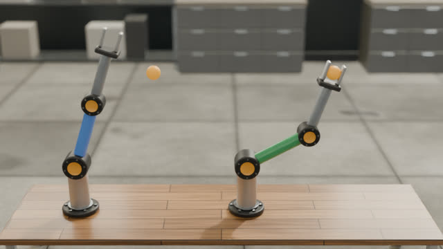

# DH Tables vs URDF Origins

> Learn why a robot-arm table copied from a book can give wrong positions with no warning.

**Type:** Build   **Prerequisites:** 01/02 Forward Kinematics   **Time:** ~15 minutes

## In Plain Words

A DH table lists how each link of a desk arm sits on the one before it. There are two rules for reading it, called conventions: slide then turn, or turn then slide.

With the elbow straight both readings put the hand in the same place. Bend the elbow and the hands part, with no error message.

## Key Terms

- **DH table**: a Denavit-Hartenberg table, one row of four numbers (two lengths and two angles) per joint, describing an arm.
- **Convention**: an agreed rule for reading a table; two conventions can read the same numbers differently.
- **Twist (`alpha`)**: how far the line the next joint turns about is tilted compared with this one's.
- **Forward kinematics (FK)**: computing where the hand is from the joint angles.
- **Joint offset (URDF origin)**: in the robot description file, how far a joint sits from the part before it and how much it is turned.
- **Zero pose**: the arm with every joint angle at 0.

## The Problem

You copy a robot arm's DH table, a table of numbers describing its links, from a textbook. The zero pose looks right, so you move on. Later the arm misses its target at most other poses, with no error.

## The Concept

The table decides where your code thinks the hand is. There are two ways to read it: slide along the link then turn, or turn then slide. With the elbow straight both give the same hand position, so the mistake hides.


*The table read one way, read the other way, and the robot file (URDF): all three should agree.*


*Nothing checks the four numbers, so a wrong reading looks normal.*


*Left: one table, two readings. Right: the error appears when the elbow bends.*

[](../assets/clip-example.mp4)

*Blue reads the table wrongly and drifts from green.*

<details><summary>The math (optional)</summary>

A row has four numbers: link length `a`, twist `alpha`, slide `d` and joint angle `theta`. Craig's convention (Ch. 3, Sec. 3.4) puts `a(i-1)` and `alpha(i-1)` on row `i`; the other puts `a(i)` and `alpha(i)` there. Example arm: 0.4 m and 0.3 m, Craig rows `(0, 0, 0, 0)` and `(0.4, 0, 0, 0)`. A 0.5 rad shoulder turn leaves the hands together; a 0.8 rad elbow bend parts them by 0.31 m.

</details>

## Build It

The two conventions are called Craig and standard. Each multiplies the same four moves in a different order.

```python
def dh_craig(a, alpha, d, th):    return rx(alpha) @ tr(a,0,0) @ rz(th) @ tr(0,0,d)
def dh_standard(a, alpha, d, th): return rz(th) @ tr(0,0,d) @ tr(a,0,0) @ rx(alpha)
```

`craig_to_standard()` converts a Craig table into a standard one. `craig_to_urdf()` converts it into robot-file offsets.

```bash
cd robotics-engineering-from-scratch
python3 -m pytest phases/02-manipulator-kinematics/01-dh-vs-urdf-origins -q
python3 phases/02-manipulator-kinematics/01-dh-vs-urdf-origins/code/main.py
```

## Use It

A URDF loader or MuJoCo model reads offsets, so convert a datasheet's DH table first, then compare hand positions at five random poses.

## Ship It

`outputs/skill-dh-convention-check.md` checks any DH table you did not derive.

## Exercises

1. Bend the elbow in the demo and watch the two readings part.
2. Find a pose where the wrong reading is right anyway.
3. Given two hand positions measured on a real arm, find which reading (slide first or turn first) matches them.
