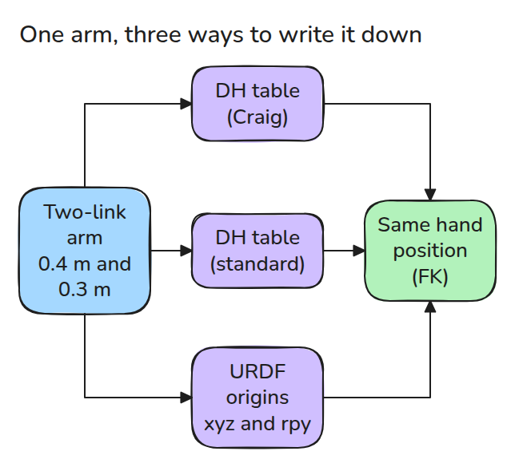
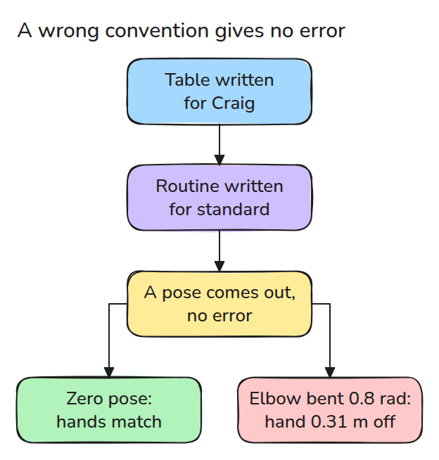
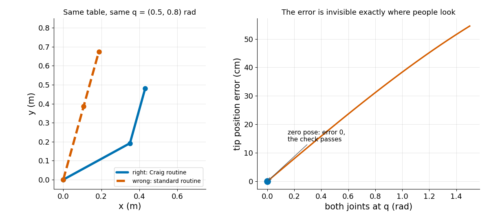

# DH Tables vs URDF Origins

> A table fed to the wrong DH convention returns a wrong pose without any error.

**Type:** Build   **Prerequisites:** 01/02 Forward Kinematics   **Time:** ~15 minutes

## In Plain Words

A DH table lists how each link of a bench arm sits on the one before it. Two conventions, meaning two rules for reading the table, differ in order. One reads a row as "slide along the link, then turn the joint". The other reads "turn, then slide".

Turning first swings the link around with the joint. Sliding first does not. With the elbow straight nothing swings, so both readings put the hand in the same place. Bend the elbow and the hands part, with no error message.

## The Problem

You copy a DH table from a textbook into your kinematics code. The zero pose, every joint angle 0, looks right, so you move on. Weeks later the arm misses the target at most other poses, and no error ever appeared.

## The Concept

A DH table has one row of four numbers per joint: `a` (link length), `alpha` (twist: how far the next axis tilts), `d` (slide along the joint axis) and `theta` (joint angle). All three give the same forward kinematics (FK), the hand position computed from the joint angles.



*Three descriptions of one arm give one FK.*

Craig's textbook convention (Ch. 3, Sec. 3.4) puts `a(i-1)` and `alpha(i-1)` on row `i` (joint `i`), so the link comes before the joint turn. The other convention puts `a(i)` and `alpha(i)` there, so the same arm needs a table shifted by one row.

A URDF joint (URDF: the robot file format ROS reads) has an origin, a position `xyz` and rotation `rpy` (roll, pitch, yaw) relative to its parent, then turns about its axis.

Follow the arrows: no error appears.



*Any four numbers per row are accepted, so a wrong table goes unnoticed.*

Next, follow the right-hand curve away from the zero pose.



*One table, two routines, two arms (left). Error against pose (right).*

The 0.4 m and 0.3 m arm has Craig rows `(a, alpha, d, theta)` of `(0, 0, 0, 0)` and `(0.4, 0, 0, 0)`, plus the 0.3 m forearm as a last slide. Row 2 says: slide 0.4 m along the upper link, then turn the elbow. The standard routine turns the elbow first, so the upper link swings with it. A shoulder turn of 0.5 rad leaves the hands together, but an elbow bend of 0.8 rad parts them by 0.31 m, whatever the shoulder does. Watch the blue hand leave the ball.


*Blue: wrong routine. Green: Craig's. They part when the elbow bends.*

## Build It

Each routine multiplies four single turns or slides per row.

```python
def dh_craig(a, alpha, d, th):    return rx(alpha) @ tr(a,0,0) @ rz(th) @ tr(0,0,d)
def dh_standard(a, alpha, d, th): return rz(th) @ tr(0,0,d) @ tr(a,0,0) @ rx(alpha)
```

`craig_to_standard()` shifts `(a, alpha)` up one row and keeps the first pair as a base transform. `craig_to_urdf()` folds `d` into the origin, and raises if a theta offset would be dropped.

```bash
cd robotics-engineering-from-scratch
python3 -m pytest phases/02-manipulator-kinematics/01-dh-vs-urdf-origins -q
python3 phases/02-manipulator-kinematics/01-dh-vs-urdf-origins/code/main.py
```

## Use It

A URDF loader or MuJoCo model reads origins, so convert a datasheet's DH table first, then compare tip poses with your DH code at five random poses.

## Ship It

`outputs/skill-dh-convention-check.md` is a checklist for any DH table you did not derive yourself.

## Exercises

1. Add a theta offset to `craig_to_urdf()` by converting `Rx(alpha) Rz(offset)` to roll, pitch and yaw.
2. Find a pose where the wrong convention happens to be right again, and explain why.
3. Write a check that detects a convention mismatch from two measured tip positions.
