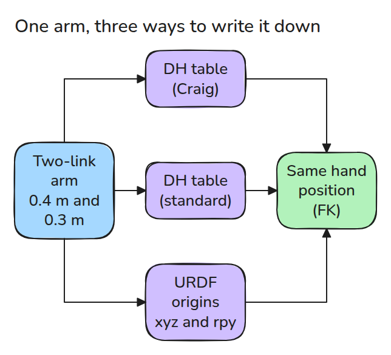
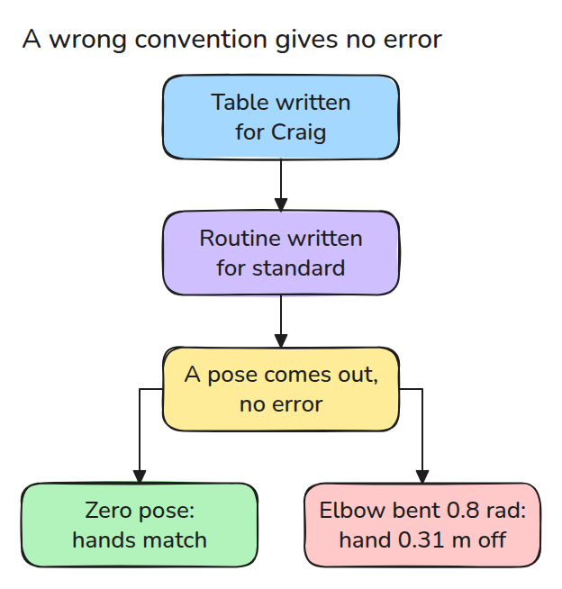
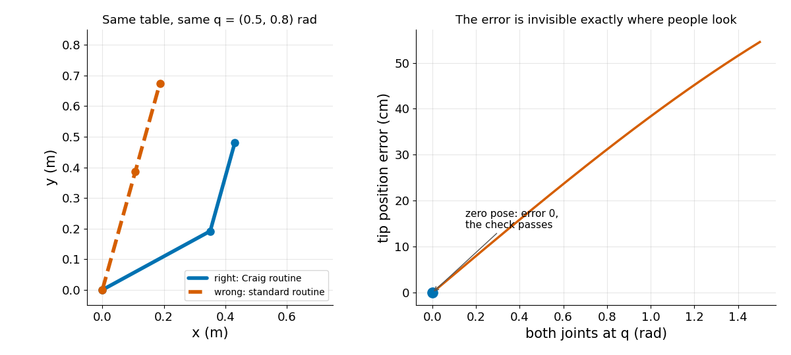

# DH Tables vs URDF Origins

> Learn why a robot-arm table copied from a book can give wrong positions with no warning.

**Type:** Build   **Prerequisites:** 01/02 Forward Kinematics   **Time:** ~15 minutes

## In Plain Words

A DH table lists how each link of a bench arm sits on the one before it. Two conventions, meaning two rules for reading it, differ in order: slide then turn, or turn then slide.

With the elbow straight both readings put the hand in the same place. Bend the elbow and the hands part, with no error message.

## Key Terms

- **DH table**: a Denavit-Hartenberg table, one row of four numbers per joint, describing an arm.
- **Convention**: an agreed rule for reading a table; two conventions can read the same numbers differently.
- **Twist (`alpha`)**: how far the next joint axis tilts relative to this one.
- **Forward kinematics (FK)**: computing the hand's pose from the joint angles.
- **URDF origin**: in the robot file ROS reads, a joint's position (`xyz`) and rotation (`rpy`: roll, pitch, yaw) relative to its parent.
- **Zero pose**: the arm with every joint angle at 0.

## The Problem

You copy a robot arm's DH table from a textbook. The zero pose looks right, so you move on. Later the arm misses its target at most other poses, with no error.

## The Concept

The table decides where your code thinks the hand is.

A DH table has one row of four numbers per joint: `a` (link length), `alpha` (twist), `d` (slide along the joint axis) and `theta` (joint angle).



*Three descriptions of one arm give one FK.*

Craig's textbook convention (Ch. 3, Sec. 3.4) puts `a(i-1)` and `alpha(i-1)` on row `i`, so the link comes first. The other puts `a(i)` and `alpha(i)` there, shifting the table by one row.



*Any four numbers per row are accepted.*



*One table, two routines, two arms (left). Error against pose (right).*

The 0.4 m and 0.3 m arm has Craig rows `(a, alpha, d, theta)` of `(0, 0, 0, 0)` and `(0.4, 0, 0, 0)`. Row 2 says slide 0.4 m, then turn the elbow; the standard routine turns first, so the upper link swings. A 0.5 rad shoulder turn leaves the hands together, but a 0.8 rad elbow bend parts them by 0.31 m.


*Blue: wrong routine. Green: Craig's. They part when the elbow bends.*

## Build It

Each routine multiplies four single turns or slides per row.

```python
def dh_craig(a, alpha, d, th):    return rx(alpha) @ tr(a,0,0) @ rz(th) @ tr(0,0,d)
def dh_standard(a, alpha, d, th): return rz(th) @ tr(0,0,d) @ tr(a,0,0) @ rx(alpha)
```

`craig_to_standard()` shifts `(a, alpha)` up one row. `craig_to_urdf()` folds `d` into the origin and raises if a theta offset would be dropped.

```bash
cd robotics-engineering-from-scratch
python3 -m pytest phases/02-manipulator-kinematics/01-dh-vs-urdf-origins -q
python3 phases/02-manipulator-kinematics/01-dh-vs-urdf-origins/code/main.py
```

## Use It

A URDF loader or MuJoCo model reads origins, so convert a datasheet's DH table first, then compare tip poses at five random poses.

## Ship It

`outputs/skill-dh-convention-check.md` checks any DH table you did not derive.

## Exercises

1. Support a theta offset in `craig_to_urdf()` by converting `Rx(alpha) Rz(offset)` to `rpy`.
2. Find a pose where the wrong convention is right anyway.
3. Detect a convention mismatch from two measured tip positions.
