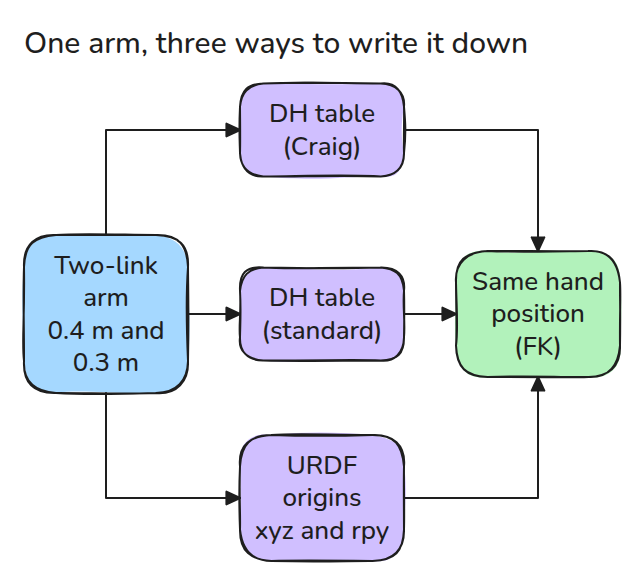
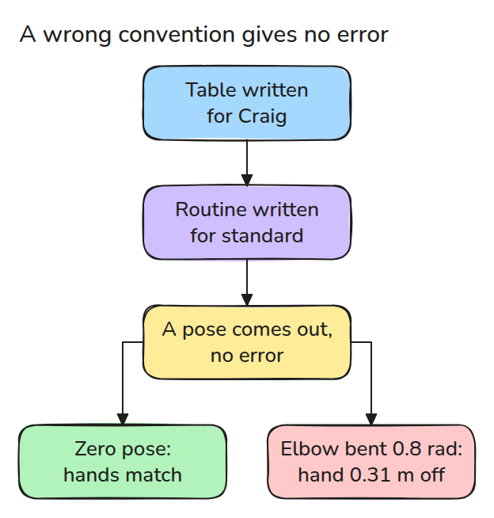
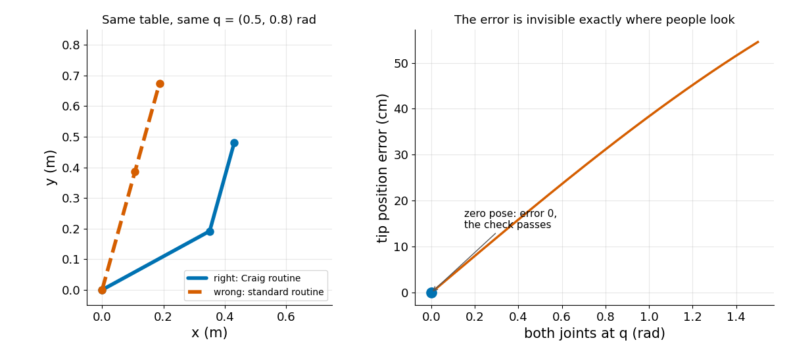

# DH 표와 URDF origin

> 표를 잘못된 DH convention에 넣으면 에러 없이 틀린 pose가 나옵니다.

**유형:** 만들기   **선수 지식:** 01/02 순기구학   **시간:** 약 15분

## 쉽게 말하면

DH 표는 작업대 위 로봇 팔에서 link마다 앞 link에 어떻게 이어지는지 적은 표예요. 이 표를 읽는 규칙을 convention이라고 하는데 두 가지가 순서에서 달라요. 하나는 한 행을 "link를 따라 이동한 다음 joint를 돌린다"로 읽어요.
다른 하나는 "돌리고 나서 이동한다"로 읽어요.

먼저 돌리면 link가 joint와 함께 휘둘려요. 먼저 이동하면 그렇지 않아요. 팔꿈치를 편 상태에서는 휘둘릴 것이 없어서 두 방식이 손을 같은 자리에 둬요. 팔꿈치를 굽히면 두 손이 갈라지는데 에러 메시지는 나오지 않아요.

## 문제

교재의 DH 표를 kinematics 코드에 그대로 옮겼습니다. 모든 joint 각도가 0인 zero pose가 맞아 보여서 넘어갔습니다. 몇 주 뒤 대부분의 다른 pose에서 팔이 목표를 빗나가는데 그동안 에러는 한 번도 나지 않았습니다.

## 개념

DH 표는 joint마다 숫자 네 개로 된 행이 하나씩 있습니다. `a`(link 길이), `alpha`(비틀림, 다음 축이 얼마나 기울었는지), `d`(joint 축을 따라 미는 거리), `theta`(joint 각도)입니다.
세 방식 모두 같은 forward kinematics(FK), 즉 joint 각도에서 계산한 손 위치를 냅니다.



*한 팔의 세 가지 표기는 같은 FK를 냅니다.*

교재 Craig의 convention(3장 3.4절)은 `i`행(`i`번 joint)에 `a(i-1)`과 `alpha(i-1)`을 두어서 link가 joint 회전보다 먼저 옵니다.
다른 convention은 `a(i)`와 `alpha(i)`를 두므로 같은 팔도 표가 한 행씩 어긋납니다.

URDF의 joint(URDF는 ROS 도구가 읽는 로봇 파일 형식입니다)는 origin을 가집니다. origin은 부모에 대한 위치 `xyz`와 회전 `rpy`(roll, pitch, yaw)이고 joint는 그다음 자기 축으로 돕니다.

화살표를 따라가 보세요. 에러는 나오지 않습니다.



*한 행에 숫자 네 개만 있으면 받아들여서 틀린 표도 알아채지 못합니다.*

이어서 오른쪽 곡선을 zero pose에서 멀어지는 쪽으로 따라가 보세요.



*표 하나와 routine 둘이 팔 둘을 만듭니다(왼쪽). pose에 따른 오차입니다(오른쪽).*

0.4 m, 0.3 m 팔의 Craig 행은 `(a, alpha, d, theta)`가 `(0, 0, 0, 0)`과 `(0.4, 0, 0, 0)`이고 0.3 m 아래팔은 마지막 이동으로 붙습니다.
2행은 위 link를 따라 0.4 m 이동한 다음 팔꿈치를 돌리라는 뜻입니다.
standard routine은 팔꿈치를 먼저 돌리므로 위 link가 팔꿈치와 함께 휘둘립니다. 어깨를 0.5 rad 돌리면 두 손은 같은 자리에 있지만 팔꿈치를 0.8 rad 굽히면 어깨가 어떻든 0.31 m 벌어집니다. 파란 손이 공에서 떨어지는 순간을 보세요.


*파랑은 틀린 routine이고 초록은 Craig의 routine입니다. 팔꿈치가 굽혀질 때 갈라집니다.*

## 만들기

각 routine은 한 행마다 회전이나 이동 네 개를 곱합니다.

```python
def dh_craig(a, alpha, d, th):    return rx(alpha) @ tr(a,0,0) @ rz(th) @ tr(0,0,d)
def dh_standard(a, alpha, d, th): return rz(th) @ tr(0,0,d) @ tr(a,0,0) @ rx(alpha)
```

`craig_to_standard()`는 `(a, alpha)`를 한 행 위로 옮기고 첫 쌍을 base transform으로 남깁니다. `craig_to_urdf()`는 `d`를 origin에 넣고 theta offset이 버려질 상황이면 예외를 냅니다.

```bash
cd robotics-engineering-from-scratch
python3 -m pytest phases/02-manipulator-kinematics/01-dh-vs-urdf-origins -q
python3 phases/02-manipulator-kinematics/01-dh-vs-urdf-origins/code/main.py
```

## 실제 도구로 보기

URDF loader나 MuJoCo 모델은 origin을 읽으므로 datasheet의 DH 표는 먼저 변환하고 tip pose를 내 DH 코드와 무작위 pose 다섯 곳에서 비교하세요.

## 결과물

`outputs/skill-dh-convention-check.md`는 직접 유도하지 않은 DH 표를 받았을 때 쓰는 점검표입니다.

## 연습 문제

1. `Rx(alpha) Rz(offset)`을 roll, pitch, yaw로 바꿔서 `craig_to_urdf()`에 theta offset을 지원하세요.
2. 틀린 convention이 우연히 다시 맞는 pose를 찾고 이유를 설명하세요.
3. 측정한 tip 위치 두 개로 convention 불일치를 찾아내는 검사를 쓰세요.
