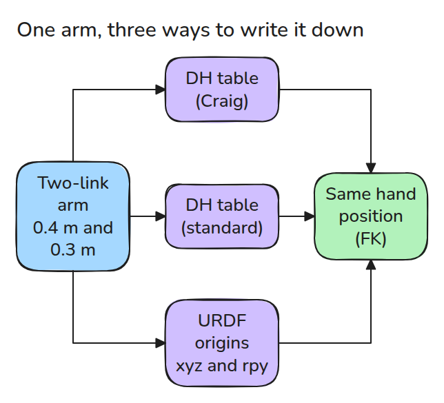
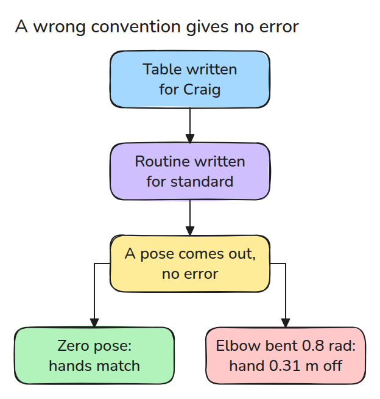
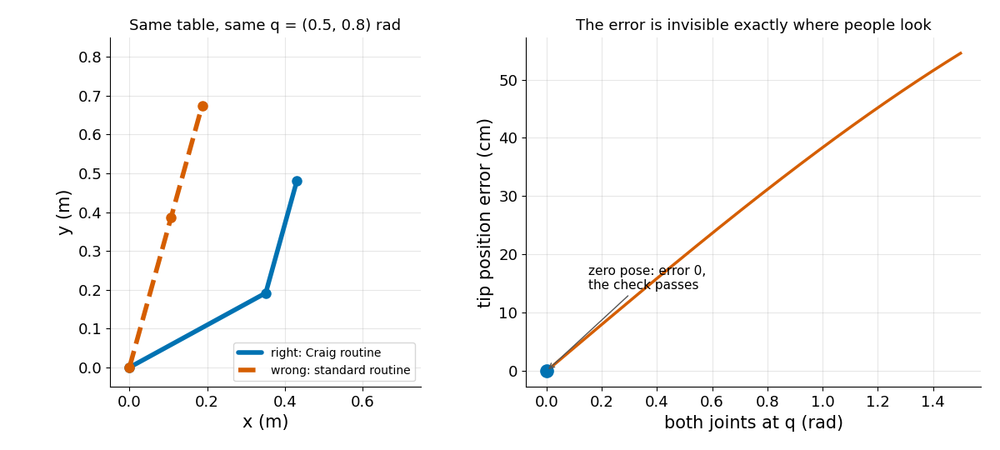

# DH 표와 URDF origin

> 책에서 베낀 로봇 팔 표가 왜 아무 경고 없이 틀린 위치를 줄 수 있는지 알게 됩니다.

**유형:** 만들기   **선수 지식:** 01/02 순기구학   **시간:** 약 15분

## 쉽게 말하면

DH 표는 작업대 위 로봇 팔에서 link마다 앞 link에 어떻게 이어지는지 적은 표예요. 이 표를 읽는 규칙을 convention이라고 하는데 두 가지가 순서에서 달라요. 이동한 다음 돌리거나 돌린 다음 이동해요.

팔꿈치를 편 상태에서는 두 방식이 손을 같은 자리에 둬요. 팔꿈치를 굽히면 두 손이 갈라지는데 에러 메시지는 나오지 않아요.

## 핵심 용어

- **DH table**: Denavit-Hartenberg 표로 joint마다 숫자 네 개짜리 행 하나씩 두어 팔을 설명합니다.
- **Convention**: 표를 읽는 약속입니다. 같은 숫자도 convention에 따라 다르게 읽힙니다.
- **Twist (`alpha`)**: 다음 joint 축이 이 축에 대해 얼마나 기울었는지입니다.
- **Forward kinematics (FK)**: joint 각도로부터 손의 pose를 계산하는 것입니다.
- **URDF origin**: ROS가 읽는 로봇 파일에서 부모에 대한 joint의 위치(`xyz`)와 회전(`rpy`: roll, pitch, yaw)입니다.
- **Zero pose**: 모든 joint 각도가 0인 팔의 자세입니다.

## 문제

교재에 나온 로봇 팔의 DH 표를 kinematics 코드에 그대로 옮겼습니다. zero pose가 맞아 보여서 넘어갔습니다.

나중에 대부분의 다른 pose에서 팔이 목표를 빗나가는데 에러는 없습니다.

## 개념

이 표가 코드가 생각하는 각 부품의 위치를 정하므로 잘못 읽으면 실제 손이 다른 곳에 갑니다.

DH 표는 joint마다 숫자 네 개로 된 행이 하나씩 있습니다. `a`(link 길이), `alpha`(비틀림), `d`(joint 축을 따라 미는 거리), `theta`(joint 각도)입니다. 세 방식 모두 같은 FK를 냅니다.



*한 팔의 세 가지 표기는 같은 FK를 냅니다.*

교재 Craig의 convention(3장 3.4절)은 `i`행에 `a(i-1)`과 `alpha(i-1)`을 두어서 link가 먼저 옵니다. 다른 convention은 `a(i)`와 `alpha(i)`를 두므로 표가 한 행씩 어긋납니다.

URDF의 joint는 origin을 가진 다음 자기 축으로 돕니다.



*한 행에 숫자 네 개만 있으면 받아들여서 틀린 표도 알아채지 못합니다.*



*표 하나와 routine 둘이 팔 둘을 만듭니다(왼쪽). pose에 따른 오차입니다(오른쪽).*

0.4 m, 0.3 m 팔의 Craig 행은 `(a, alpha, d, theta)`가 `(0, 0, 0, 0)`과 `(0.4, 0, 0, 0)`입니다.

2행은 0.4 m 이동한 다음 팔꿈치를 돌리라는 뜻인데 standard routine은 먼저 돌리므로 위 link가 휘둘립니다. 어깨를 0.5 rad 돌리면 두 손은 같은 자리에 있지만 팔꿈치를 0.8 rad 굽히면 0.31 m 벌어집니다.


*파랑은 틀린 routine이고 초록은 Craig의 routine입니다. 팔꿈치가 굽혀질 때 갈라집니다.*

## 만들기

각 routine은 한 행마다 회전이나 이동 네 개를 곱합니다.

```python
def dh_craig(a, alpha, d, th):    return rx(alpha) @ tr(a,0,0) @ rz(th) @ tr(0,0,d)
def dh_standard(a, alpha, d, th): return rz(th) @ tr(0,0,d) @ tr(a,0,0) @ rx(alpha)
```

`craig_to_standard()`는 `(a, alpha)`를 한 행 위로 옮기고 첫 쌍을 base transform으로 남깁니다. `craig_to_urdf()`는 `d`를 origin에 넣고 theta offset이 버려질 상황이면 예외를 냅니다.

```bash
cd robotics-engineering-from-scratch
python3 -m pytest phases/02-manipulator-kinematics/01-dh-vs-urdf-origins -q
python3 phases/02-manipulator-kinematics/01-dh-vs-urdf-origins/code/main.py
```

## 실제 도구로 보기

URDF loader나 MuJoCo 모델은 origin을 읽으므로 datasheet의 DH 표는 먼저 변환하고 tip pose를 내 DH 코드와 무작위 pose 다섯 곳에서 비교하세요.

## 결과물

`outputs/skill-dh-convention-check.md`는 직접 유도하지 않은 DH 표를 받았을 때 쓰는 점검표입니다.

## 연습 문제

1. `Rx(alpha) Rz(offset)`을 roll, pitch, yaw로 바꿔서 `craig_to_urdf()`에 theta offset을 지원하세요.
2. 틀린 convention이 우연히 맞는 pose를 찾고 이유를 설명하세요.
3. 측정한 tip 위치 두 개로 convention 불일치를 찾아내는 검사를 쓰세요.
