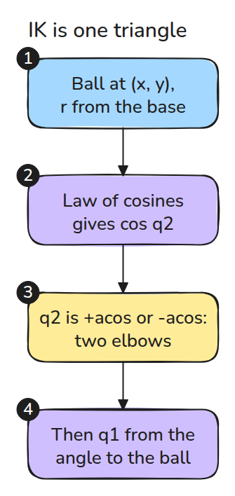
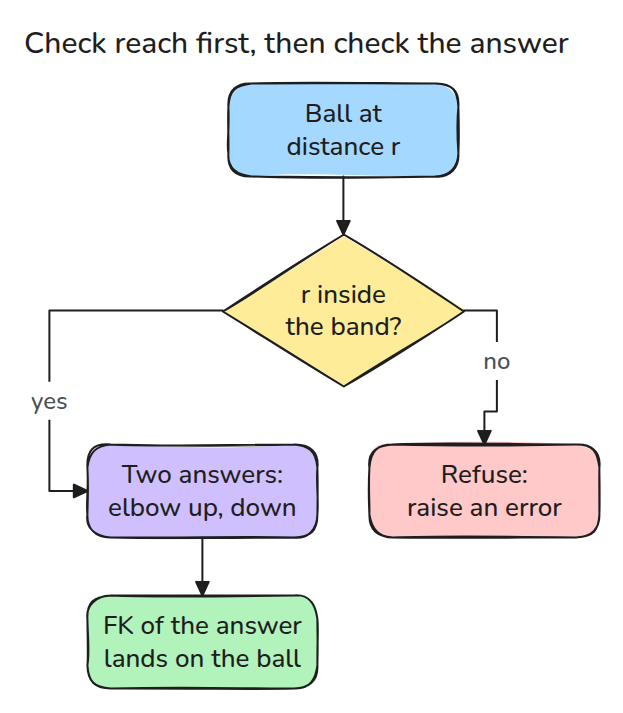
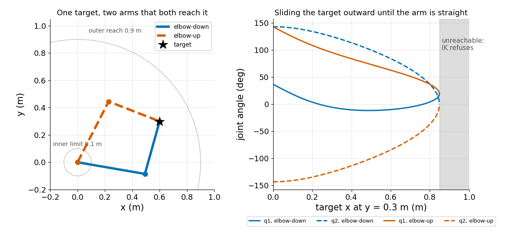

# Inverse Kinematics of a Two-Link Arm

> Reaching a point is a triangle with two answers and a hard edge. Test every answer with FK.

**Type:** Build   **Prerequisites:** 01/02 Forward Kinematics, 02/01 DH vs URDF Origins   **Time:** ~15 minutes

## In Plain Words

A bench arm has two links, and its hand must touch a ball. Base, elbow and ball form a triangle. Two sides are the links, whose lengths are fixed. The third side is the straight line from base to ball. The elbow can sit on either side of it, so there are two ways to reach the ball.

Slide the ball outward and that side grows until the arm is straight. Past that, nothing reaches. Inverse kinematics (IK) finds joint angles for a target. Forward kinematics (FK) checks them.

## The Problem

You ask the arm to touch a point and `acos` (inverse cosine) returns `nan` (not a number), or the arm folds the wrong way and hits the table. A target slightly past full stretch is easy to produce, and a solver that hides it sends the arm to the wrong place.

## The Concept

The first picture lists the steps. `q1` is the shoulder angle from the x axis. `q2` is the elbow angle, 0 when the arm is straight.



*A triangle with sides L1, L2 and r. The law of cosines (an angle from three sides) gives the size of q2.*

The law of cosines gives `cos q2 = (r² - L1² - L2²) / (2 L1 L2)`. The sign of `q2` is a free choice: positive is elbow down, negative is elbow up. One target has two arms that reach it, merging at full stretch (Craig, Ch. 4).



*Targets outside the band from `|L1 - L2|` to `L1 + L2` are refused. Every answer is confirmed by FK.*

The outer edge is full stretch. At the inner edge the arm is fully folded, so a target 0.05 m away is refused too.



*Left: both arms touch the target. Right: the two branches meet at the outer edge, then no answer exists.*

Take the target (0.6, 0.3) m for the 0.5 m and 0.4 m arm. Then `r = 0.67` m and `cos q2 = (0.45 - 0.25 - 0.16) / 0.4 = 0.1`, so `q2 = 1.47` rad (84°) for elbow down or `-1.47` rad for elbow up. Swing the target around the base at the same `r`. The triangle keeps its shape, so only `q1` follows. Watch the dark line, whose length never changes.


*Blue: elbow down. Green: elbow up. The target circles at 0.67 m and `q2` stays ±1.47 rad.*

## Build It

Law of cosines first, then the target angle minus the triangle's inner angle.

```python
c2 = (x*x + y*y - l1*l1 - l2*l2) / (2*l1*l2)
if abs(c2) > 1 + tol: raise ValueError("unreachable")
s2 = np.sqrt(1 - c2*c2) * (1 if elbow == "down" else -1)
q2 = np.arctan2(s2, c2)
q1 = np.arctan2(y, x) - np.arctan2(l2*s2, l1 + l2*c2)
```

A small tolerance keeps rounding noise at the boundary from becoming a false refusal. The tests run `fk(ik(p))` on 200 targets per branch.

```bash
cd robotics-engineering-from-scratch
python3 -m pytest phases/02-manipulator-kinematics/02-inverse-kinematics-2link -q
python3 phases/02-manipulator-kinematics/02-inverse-kinematics-2link/code/main.py
```

## Use It

Arms with more joints use a numerical solver. Compare it with this closed form on a two-link model, and check that it reports unreachable targets.

## Ship It

`outputs/skill-ik-answer-check.md` is the check every IK answer must pass before a controller sees it.

## Exercises

1. Add a joint limit `|q2| < 2.8` and make `ik` pick the other elbow when one is out of range.
2. Plot the whole reachable band as a heat map of the number of valid answers.
3. Show what happens to `q1` when `L1 = L2` and the target is the base.
