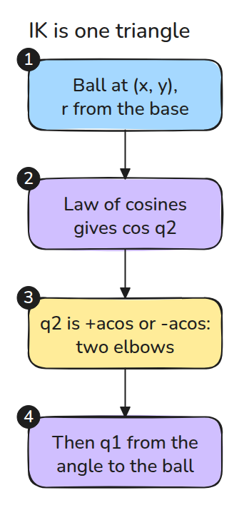
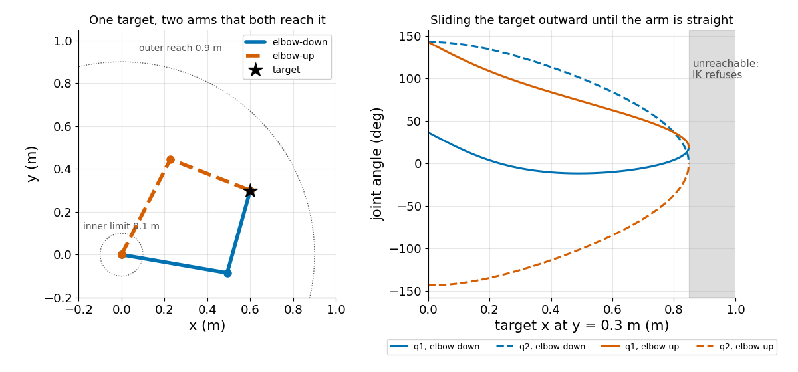
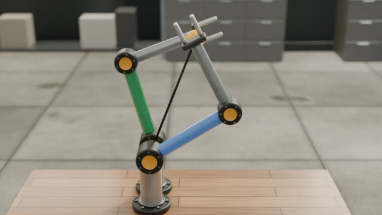

# Inverse Kinematics of a Two-Link Arm

> Learn how to find the joint angles that put an arm's hand on a point, or learn that it cannot reach.

**Type:** Build   **Prerequisites:** 01/02 Forward Kinematics, 02/01 DH vs URDF Origins   **Time:** ~15 minutes

## In Plain Words

A desk arm has two links, and its hand must touch a ball. Base, elbow and ball form a triangle, and the elbow can sit on either side of the base-to-ball line, giving two ways to reach it.

Past full stretch nothing reaches. Inverse kinematics (IK) finds joint angles for a target; forward kinematics (FK) checks them.

## Key Terms

- **Inverse kinematics (IK)**: finding joint angles that put the hand on a target.
- **Elbow down / elbow up**: the two arm shapes that reach the same target.
- **Law of cosines**: a rule that gives a triangle's angle from its three side lengths.
- **Reach band**: the ring of targets the arm can touch: no closer than the difference of the two link lengths and no farther than their sum.
- **Not-a-number (`nan`)**: what a calculation gives when it has no answer, such as asking for the angle whose cosine is 2.
- **Tolerance**: a tiny allowed error, so rounding noise is not treated as a failure.

## The Problem

You ask a robot arm to touch a point, and the math fails with `nan`, or the arm folds the wrong way. A solver that hides an out-of-reach target sends the arm to the wrong place.

## The Concept

A robot told where to reach must work out the joint angles. For two links this is a triangle: the links are two sides, and the line from base to target is the third.



*Base, elbow and target form a triangle.*

The triangle can bend either way, so there are two answers: elbow up and elbow down. A target too far, or too close, has none.


*Refuse out-of-reach targets, and check every answer.*



*Both elbows reach; at full stretch they merge.*

[](../assets/clip-example.mp4)

*The target circles; the elbow angle stays the same.*

<details><summary>The math (optional)</summary>

The law of cosines gives `cos q2 = (r² - L1² - L2²) / (2 L1 L2)`; positive `q2` is elbow down, negative elbow up (Craig, Ch. 4). `q1` is the shoulder angle, `q2` the elbow angle, 0 when straight. A target 0.05 m from the base is refused. Links 0.5 m and 0.4 m, target (0.6, 0.3) m: `r = 0.67` m, `cos q2 = 0.1`, `q2 = ±1.47` rad (84°).

</details>

## Build It

The code uses the law of cosines for the elbow. For the shoulder, it takes the direction to the target and subtracts the triangle's angle at the base.

```python
c2 = (x*x + y*y - l1*l1 - l2*l2) / (2*l1*l2)
if abs(c2) > 1 + tol: raise ValueError("unreachable")
c2 = np.clip(c2, -1.0, 1.0)
s2 = np.sqrt(1 - c2*c2) * (1 if elbow == "down" else -1)
q2 = np.arctan2(s2, c2)
q1 = np.arctan2(y, x) - np.arctan2(l2*s2, l1 + l2*c2)
```

A small tolerance stops rounding noise from causing a false refusal; `np.clip` keeps the root real. Tests run `fk(ik(p))` on 200 targets for each elbow choice.

```bash
cd robotics-engineering-from-scratch
python3 -m pytest phases/02-manipulator-kinematics/02-inverse-kinematics-2link -q
python3 phases/02-manipulator-kinematics/02-inverse-kinematics-2link/code/main.py
```

## Use It

Bigger arms use numerical solvers; compare one with this formula.

## Ship It

`outputs/skill-ik-answer-check.md` checks every IK answer before it moves the arm.

## Exercises

1. Ask for targets just inside and just outside the reach.
2. Switch between elbow up and elbow down.
3. Reject any answer with elbow angle above 2.8 rad and use the other elbow shape instead.
