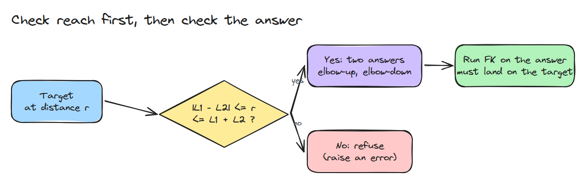

# Inverse Kinematics of a Two-Link Arm

> Learn how to find the joint angles that put an arm's hand on a point, or learn that it cannot reach.

**Type:** Build   **Prerequisites:** 01/02 Forward Kinematics, 02/01 DH vs URDF Origins   **Time:** ~15 minutes

## In Plain Words

A bench arm has two links, and its hand must touch a ball. Base, elbow and ball form a triangle, and the elbow can sit on either side of the base-to-ball line, giving two ways to reach it.

Past full stretch nothing reaches. Inverse kinematics (IK) finds joint angles for a target; forward kinematics (FK) checks them.

## Key Terms

- **Inverse kinematics (IK)**: finding joint angles that put the hand on a target.
- **Elbow down / elbow up**: the two arm shapes that reach the same target.
- **Law of cosines**: a rule that gives a triangle's angle from its three side lengths.
- **Reach band**: the ring of targets the arm can touch, between `|L1 - L2|` and `L1 + L2` from the base.
- **`nan`**: "not a number", the result of an impossible calculation such as `acos` of a value above 1.
- **Tolerance**: a tiny allowed error, so rounding noise is not treated as a failure.

## The Problem

You ask a robot arm to touch a point and `acos` returns `nan`, or the arm folds the wrong way. A solver that hides an out-of-reach target sends the arm to the wrong place.

## The Concept

A robot is told where to reach and must work out the joint angles.

`q1` is the shoulder angle from the x axis. `q2` is the elbow angle, 0 when the arm is straight.


*Sides L1, L2, r.*

The law of cosines gives `cos q2 = (r² - L1² - L2²) / (2 L1 L2)`. Positive `q2` is elbow down, negative elbow up. Two arms reach one target, merging at full stretch (Craig, Ch. 4).



*Targets outside the band are refused. FK confirms every answer.*

At the inner edge the arm is fully folded, so a target 0.05 m away is refused.


*Left: both arms touch the target. Right: the branches meet at full stretch.*

A target (0.6, 0.3) m for the 0.5 m and 0.4 m arm has `r = 0.67` m and `cos q2 = (0.45 - 0.25 - 0.16) / 0.4 = 0.1`, so `q2 = ±1.47` rad (84°).


*Blue: elbow down. Green: elbow up. The target circles at 0.67 m and `q2` stays ±1.47 rad.*

## Build It

```python
c2 = (x*x + y*y - l1*l1 - l2*l2) / (2*l1*l2)
if abs(c2) > 1 + tol: raise ValueError("unreachable")
s2 = np.sqrt(1 - c2*c2) * (1 if elbow == "down" else -1)
q2 = np.arctan2(s2, c2)
q1 = np.arctan2(y, x) - np.arctan2(l2*s2, l1 + l2*c2)
```

A small tolerance stops rounding noise at the edge causing a false refusal. Tests run `fk(ik(p))` on 200 targets per branch.

```bash
cd robotics-engineering-from-scratch
python3 -m pytest phases/02-manipulator-kinematics/02-inverse-kinematics-2link -q
python3 phases/02-manipulator-kinematics/02-inverse-kinematics-2link/code/main.py
```

## Use It

Arms with more joints use numerical solvers; compare one with this closed form.

## Ship It

`outputs/skill-ik-answer-check.md` is the check an IK answer must pass before a controller sees it.

## Exercises

1. Add a limit `|q2| < 2.8`; pick the other elbow when needed.
2. Plot the reachable band as a heat map of valid answers.
3. Show what `q1` does when `L1 = L2` and the target is the base.
