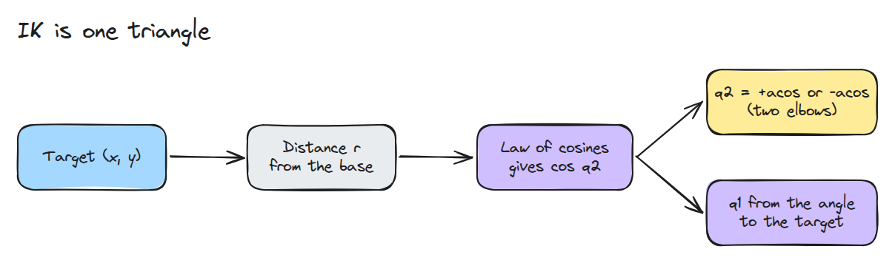
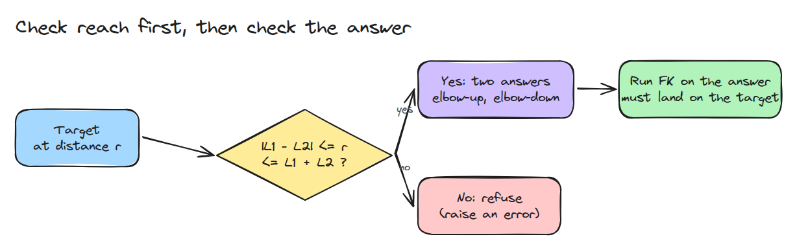
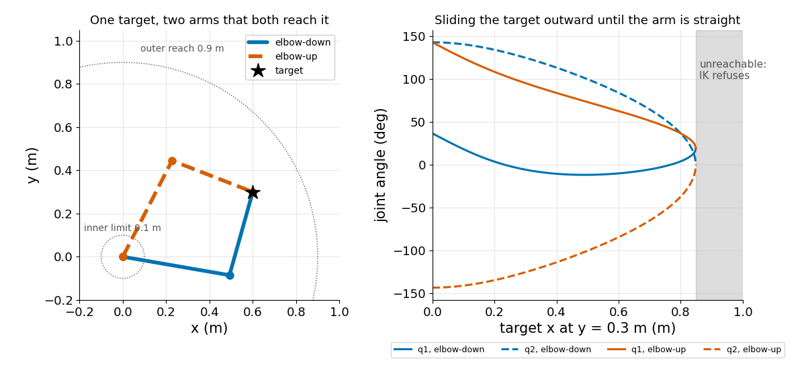

# 2링크 팔의 역기구학

> 한 점에 닿는 문제는 답이 두 개이고 한계선이 있는 삼각형이며 믿을 수 있는 검사는 답에 FK를 돌려 보는 것뿐입니다.

**유형:** 만들기   **선수 지식:** 01/02 순기구학, 02/01 DH 표와 URDF origin   **시간:** 약 15분

## 문제

팔에게 한 점을 건드리라고 했는데 `acos`가 `nan`을 돌려주거나 팔이 엉뚱한 방향으로 접혀 책상에 부딪힙니다. 완전히 뻗은 길이를 조금 넘는 목표는 쉽게 만들어집니다. 그것을 숨기는 solver는 팔을 요청하지 않은 곳으로 보냅니다.

## 개념



*base와 elbow와 목표는 변이 L1, L2, r인 삼각형을 이룹니다. 코사인 법칙이 q2를 부호만 빼고 알려 줍니다.*

그 부호가 elbow입니다. 목표 하나에 닿는 팔이 둘이고 완전히 뻗으면 둘이 하나로 합쳐집니다(Craig 4장, solvability와 대수적 해 대 기하적 해).



*`|L1 - L2|`에서 `L1 + L2`까지의 띠 밖에 있는 목표는 거부합니다. 모든 답은 FK로 확인합니다.*



*왼쪽은 두 팔이 모두 목표에 닿는 모습입니다. 오른쪽은 목표를 바깥으로 밀 때 두 해가 가장자리에서 만나고 그 너머에는 답이 없는 모습입니다.*

## 만들기

코사인 법칙을 먼저 쓰고 목표 방향 각도에서 삼각형 안쪽 각도를 뺍니다.

```python
c2 = (x*x + y*y - l1*l1 - l2*l2) / (2*l1*l2)
if abs(c2) > 1 + tol: raise ValueError("unreachable")
s2 = np.sqrt(1 - c2*c2) * (1 if elbow == "down" else -1)
q2 = np.arctan2(s2, c2)
q1 = np.arctan2(y, x) - np.arctan2(l2*s2, l1 + l2*c2)
```

작은 tolerance는 경계에서 반올림 잡음이 가짜 거부로 바뀌는 것을 막습니다. 테스트는 elbow마다 목표 200개에 `fk(ik(p))`를 돌립니다.

```bash
cd robotics-engineering-from-scratch
python3 -m pytest phases/02-manipulator-kinematics/02-inverse-kinematics-2link -q
python3 phases/02-manipulator-kinematics/02-inverse-kinematics-2link/code/main.py
```

## 실제 도구로 보기

joint가 더 많은 팔은 수치 solver를 씁니다. 2링크 모델에서 이 해석해와 비교하세요. 그리고 solver가 도달 불가 목표에 최선의 추측을 돌려주지 않고 도달 불가라고 알리는지 확인하세요.

## 결과물

`outputs/skill-ik-answer-check.md`는 IK 답이 controller에 가기 전에 통과해야 하는 검사입니다.

## 연습 문제

1. joint 한계 `|q2| < 2.8`을 넣고 한쪽 elbow가 범위를 벗어나면 `ik`가 다른 쪽을 고르게 하세요.
2. 도달 가능한 띠 전체를 유효한 답의 개수로 칠한 heat map으로 그리세요.
3. `L1 = L2`이고 목표가 base일 때 `q1`이 어떻게 되는지 보이세요.
