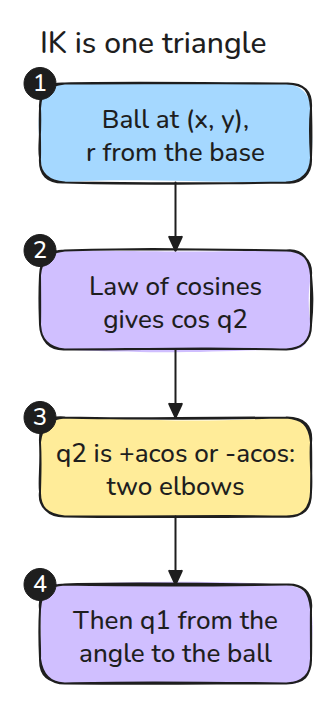
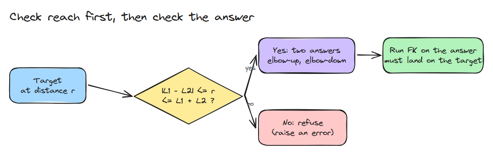
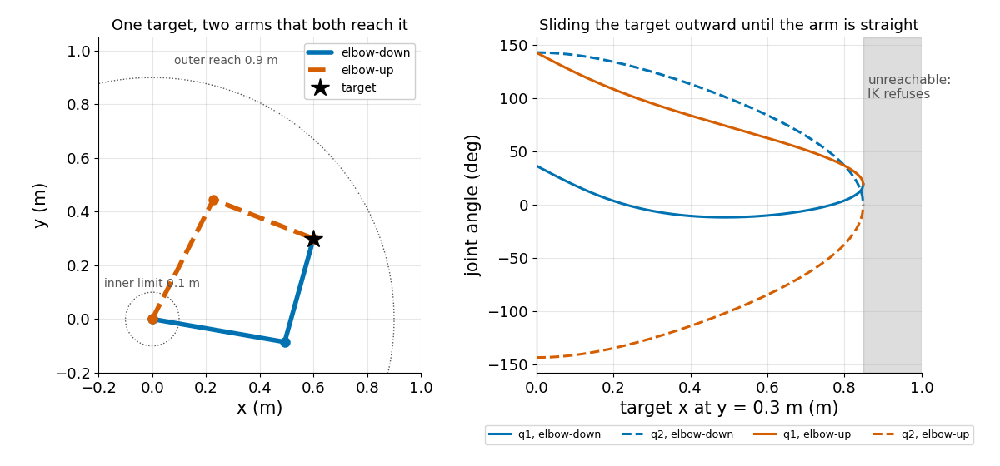

# 2링크 팔의 역기구학

> 팔의 손이 한 점에 닿게 하는 joint 각도를 구하는 법과, 닿을 수 없는 경우를 알아내는 법을 알게 됩니다.

**유형:** 만들기   **선수 지식:** 01/02 순기구학, 02/01 DH 표와 URDF origin   **시간:** 약 15분

## 쉽게 말하면

작업대 위 로봇 팔은 link가 두 개이고 손이 공에 닿아야 해요. base와 팔꿈치와 공이 길이가 정해진 삼각형을 이뤄요. 팔꿈치는 base에서 공까지 이은 선의 양쪽 어느 쪽에든 놓일 수 있어서 닿는 방법이 두 가지예요.

공을 바깥으로 밀어서 팔이 쭉 펴지면 그보다 멀리는 닿지 않아요. inverse kinematics(IK)는 목표에 맞는 joint 각도를 구하고 forward kinematics(FK)는 그 각도를 확인해요.

## 핵심 용어

- **Inverse kinematics (IK)**: 손이 목표에 놓이도록 joint 각도를 구하는 일입니다.
- **Elbow down / elbow up**: 같은 목표에 닿는 두 가지 팔 모양입니다.
- **Law of cosines**: 삼각형의 세 변 길이로부터 각도를 구하는 규칙입니다.
- **Reach band**: base에서 `|L1 - L2|`부터 `L1 + L2`까지의 거리에 있어 팔이 닿을 수 있는 띠입니다.
- **`nan`**: "숫자가 아님"이라는 뜻으로 1보다 큰 값의 `acos`처럼 불가능한 계산의 결과입니다.
- **Tolerance**: 반올림 잡음을 실패로 보지 않도록 허용하는 아주 작은 오차입니다.

## 문제

로봇 팔에게 한 점을 건드리라고 했는데 계산이 `nan`(숫자가 아님)으로 실패하거나 팔이 엉뚱한 방향으로 접힙니다. 닿을 수 없는 목표를 숨기는 solver는 팔을 엉뚱한 곳으로 보냅니다.

## 개념

로봇은 어디에 닿으라는 말을 듣고 joint 각도를 스스로 계산해야 합니다. link가 둘이면 삼각형입니다. link 둘이 두 변이고 base에서 목표까지 이은 선이 나머지 한 변입니다.



*base와 팔꿈치와 목표가 삼각형을 이룹니다.*

삼각형은 양쪽으로 접힐 수 있어서 답이 둘입니다. elbow up과 elbow down입니다. 너무 멀거나 너무 가까운 목표에는 답이 없습니다.



*닿지 않는 목표는 거부하고 모든 답을 확인합니다.*



*두 elbow가 모두 닿고 완전히 뻗으면 하나로 합쳐집니다.*


*목표가 원을 돌아도 elbow 각도는 그대로입니다.*

<details><summary>The math (optional)</summary>

코사인 법칙은 `cos q2 = (r² - L1² - L2²) / (2 L1 L2)`를 줍니다. `q2`가 양수면 elbow down이고 음수면 elbow up입니다(Craig 4장). `q1`은 어깨 각도이고 `q2`는 팔꿈치 각도이며 곧게 펴졌을 때 0입니다.
base에서 0.05 m 떨어진 목표는 거부합니다. link 0.5 m와 0.4 m에서 목표 (0.6, 0.3) m는 `r = 0.67` m이고 `cos q2 = 0.1`이며 `q2 = ±1.47` rad(84°)입니다.

</details>

## 만들기

코드는 팔꿈치에 코사인 법칙을 쓰고 어깨는 목표 방향 각도에서 삼각형의 안쪽 각도를 뺍니다.

```python
c2 = (x*x + y*y - l1*l1 - l2*l2) / (2*l1*l2)
if abs(c2) > 1 + tol: raise ValueError("unreachable")
s2 = np.sqrt(1 - c2*c2) * (1 if elbow == "down" else -1)
q2 = np.arctan2(s2, c2)
q1 = np.arctan2(y, x) - np.arctan2(l2*s2, l1 + l2*c2)
```

작은 tolerance는 반올림 잡음 때문에 가짜 거부가 나는 것을 막습니다. 테스트는 elbow마다 목표 200개에 `fk(ik(p))`를 돌립니다.

```bash
cd robotics-engineering-from-scratch
python3 -m pytest phases/02-manipulator-kinematics/02-inverse-kinematics-2link -q
python3 phases/02-manipulator-kinematics/02-inverse-kinematics-2link/code/main.py
```

## 실제 도구로 보기

joint가 더 많은 팔은 수치 solver를 씁니다. 하나를 골라 이 해석해와 비교해 보세요.

## 결과물

`outputs/skill-ik-answer-check.md`는 IK 답이 controller에 가기 전에 통과해야 하는 검사입니다.

## 연습 문제

1. 닿는 범위 바로 안쪽과 바로 바깥쪽 목표를 줘 보세요.
2. elbow up과 elbow down을 바꿔 보세요.
3. 팔꿈치를 2.8 rad로 제한하고 필요하면 다른 elbow를 고르게 하세요.
