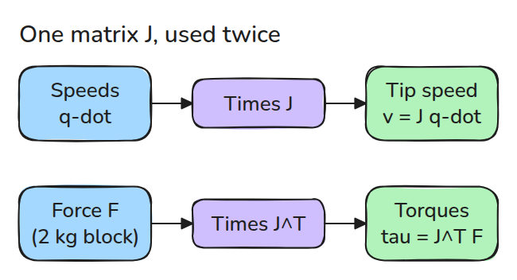
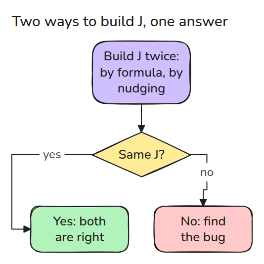
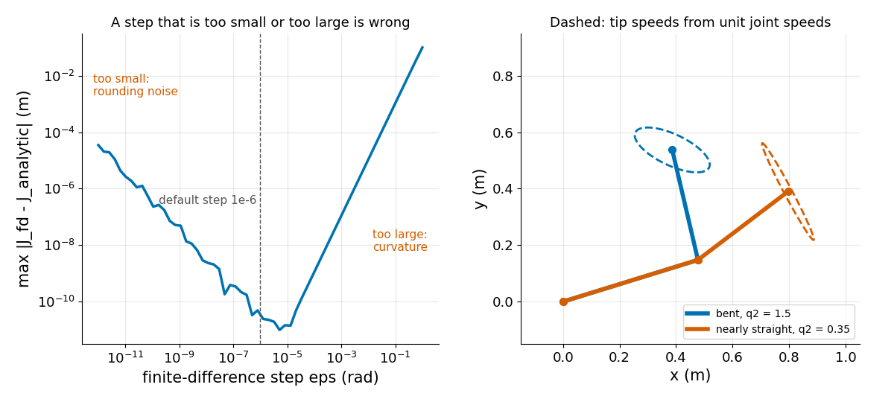

# The Jacobian: Joint Speeds, Tip Speeds and Forces

> J maps joint speeds to tip speed, and J transposed maps tip force to joint torque.

**Type:** Build   **Prerequisites:** 02/01 DH vs URDF Origins, 02/02 Inverse Kinematics   **Time:** ~15 minutes

## In Plain Words

Turn a bench arm's shoulder steadily and the tip (the end of the arm) swings around it, at right angles to the line from shoulder to tip. The farther the tip is from the shoulder, the faster it moves for the same turn. The elbow does the same, so the tip's velocity depends on the pose.

The Jacobian tabulates this for the current pose, turning joint speeds into tip velocity. Its transpose turns a push on the tip into the torque each motor needs to resist it.

## The Problem

You want the tip to move in a straight line at 0.1 m/s, but the joint speeds that do it depend on the pose. You also need each motor's push when the tip pushes on something. Both need the same matrix, and a Jacobian with one wrong sign passes every pose-only test, because those check positions, not velocities.

## The Concept

In the first picture `J` works both ways: `q-dot` joint speeds, `v` tip speed, `F` tip force, `tau` motor torques (twisting forces).



*Speeds go through J. Forces come back through the transpose of the same J.*

Column `j` of `J` is the tip velocity when only joint `j` turns at one unit of speed (Craig, Ch. 5, Sec. 5.7). Tip power `F . (J q-dot)` must equal joint power `tau . q-dot` (a dot multiplies matching entries and adds). Moving `J` across the dot swaps its rows and columns, the transpose `J^T`, so `tau = J^T F` (Sec. 5.9 and 5.10).

`J` can be differentiated by hand, or built by nudging each joint a small step and watching the tip (finite difference).



*Both ways start from FK. If they disagree, one has a bug.*

Next: step-size error (left), tip-speed ellipses (right).



*Left: the error has a minimum, with rounding noise below it and curvature above it. Right: a bent arm gives a fat tip-speed ellipse and a nearly straight arm a thin one.*

A 2 kg block hangs at the tip, so the motors push up with `F = 2 * 9.81 = 19.6` N (the lesson's test). Torque is force times lever distance. Stretched flat, the tip is 0.9 m out and the shoulder needs 19.6 x 0.9 = 17.7 N m (newton-metres). With the tip nearly over the base, `tau = J^T F` gives about 1 N m. Watch the shoulder bar grow.


*Red arrow: `F`. Amber bars over the motors: `|tau|`, 0.03 m tall per N m.*

## Build It

Two ways to build `J`:

```python
J = np.array([[-l1*s1 - l2*s12, -l2*s12], [l1*c1 + l2*c12, l2*c12]])
col = (fk(q + dq, L) - fk(q - dq, L)) / (2 * eps)   # one column per joint
```

Then `v = J @ qd` and `tau = J.T @ F`.

```bash
cd robotics-engineering-from-scratch
python3 -m pytest phases/02-manipulator-kinematics/03-jacobian-and-velocity -q
python3 phases/02-manipulator-kinematics/03-jacobian-and-velocity/code/main.py
```

## Use It

Physics engines and ROS 2 libraries return a Jacobian for a chosen arm point. Compare it with this one on a two-link model, and finite-difference-check any Jacobian you did not write.

## Ship It

`outputs/skill-jacobian-check.md` is the finite-difference and power-balance check for any Jacobian.

## Exercises

1. Plot `|J q_dot|` for unit joint speeds against `q2` and find where it is smallest.
2. Add a third link and check that `J` has three columns that still match finite differences.
3. Show that the finite-difference step 1e-6 is also fine for `q` near 1000 rad, or find where it is not.
