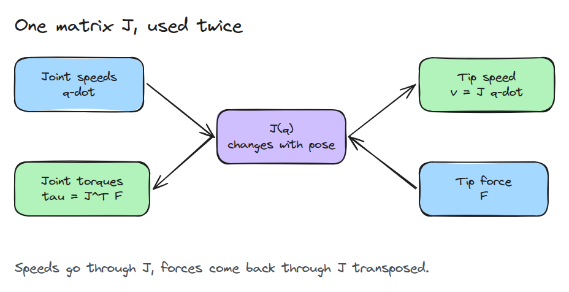
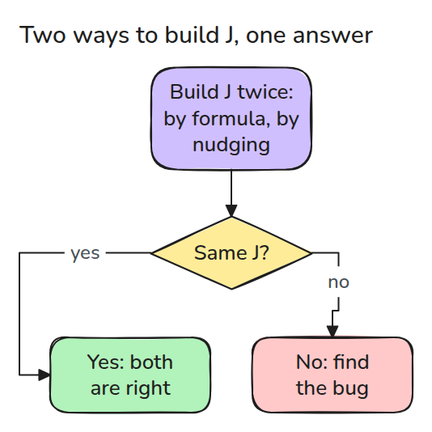
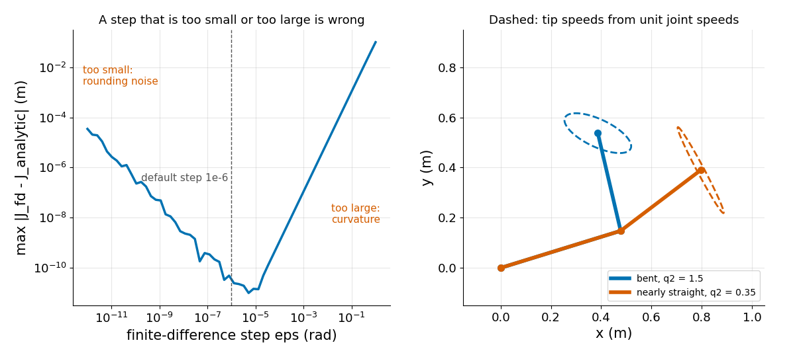

# The Jacobian: Joint Speeds, Tip Speeds and Forces

> Learn how joint speeds set the hand's speed, and how a push on the hand turns into motor torque.

**Type:** Build   **Prerequisites:** 02/01 DH vs URDF Origins, 02/02 Inverse Kinematics   **Time:** ~15 minutes

## In Plain Words

Turn a bench arm's shoulder steadily and the tip swings around it, faster the farther it is from the shoulder, so the tip's velocity depends on the pose.

The Jacobian tabulates this for the current pose: joint speeds in, tip velocity out. Its transpose turns a push on the tip into the torque each motor needs to resist it.

## Key Terms

- **Jacobian (`J`)**: a matrix that turns joint speeds into tip velocity for the current pose.
- **Tip**: the end of the arm, where the hand or tool sits.
- **Torque (`tau`)**: a twisting force, such as a motor's push on a joint.
- **Transpose (`J^T`)**: the same matrix with its rows and columns swapped.
- **Finite difference**: estimating a slope by nudging an input a small step and watching the output.
- **Dot product (`.`)**: multiply matching entries of two lists and add them up.

## The Problem

You want a robot arm's hand to move in a straight line, and to know how hard each motor must push when the hand presses on something. Both need one table of numbers, and one wrong sign in it passes every test that only checks positions.

## The Concept

To move a hand straight or press on a table, each joint needs the right speed and force. The Jacobian is a table, recalculated for the current pose, that turns joint speeds into hand speed. Flipped on its side, the same table turns a push on the hand into the push each motor must make.



*Speeds go through the table; forces come back through the flipped table.*



*Two ways to build it must agree.*



*A bent arm moves its hand easily every way; a straight arm does not.*


*The stretched arm needs far more shoulder torque.*

<details><summary>The math (optional)</summary>

`v = J @ qd` and `tau = J^T F` (Craig, Ch. 5, Sec. 5.7, 5.9, 5.10). Tip power `F . (J q-dot)` equals joint power `tau . q-dot`. A 2 kg block gives `F = 2 * 9.81 = 19.6` N. Stretched flat the tip is 0.9 m out and the shoulder needs 19.6 x 0.9 = 17.7 N m; nearly over the base it needs about 1 N m. The step size has a best value between rounding noise and curvature. The clip draws 0.03 m of bar per N m. The straight move is 0.1 m/s.

</details>

## Build It

Two ways to build the table: a formula, and nudging each joint a little and watching the hand.

```python
J = np.array([[-l1*s1 - l2*s12, -l2*s12], [l1*c1 + l2*c12, l2*c12]])
col = (fk(q + dq, L) - fk(q - dq, L)) / (2 * eps)   # one column per joint
```

Then speeds go through `J @ qd` and forces through `J.T @ F`.

```bash
cd robotics-engineering-from-scratch
python3 -m pytest phases/02-manipulator-kinematics/03-jacobian-and-velocity -q
python3 phases/02-manipulator-kinematics/03-jacobian-and-velocity/code/main.py
```

## Use It

Physics engines and ROS 2 libraries return Jacobians; compare one with this on a two-link arm.

## Ship It

`outputs/skill-jacobian-check.md` is a finite-difference and power-balance check.

## Exercises

1. Compare the two builds at a few poses.
2. Hang a heavier block and see the torque change.
3. Straighten the arm and watch the easy directions shrink.
