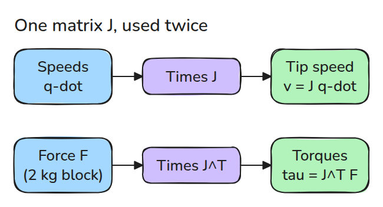
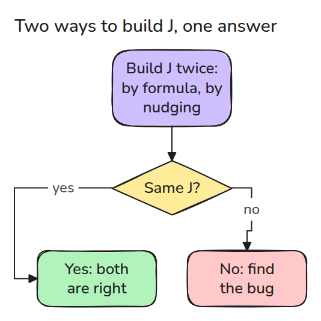
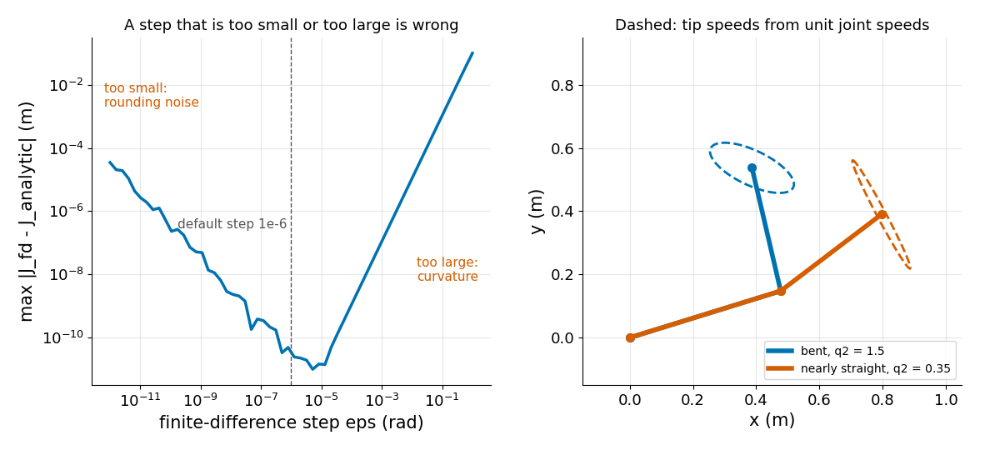

# Jacobian: joint 속도, tip 속도, 힘

> J는 joint 속도를 tip 속도로 바꾸고 J의 transpose는 tip 힘을 joint 토크로 바꿉니다.

**유형:** 만들기   **선수 지식:** 02/01 DH 표와 URDF origin, 02/02 역기구학   **시간:** 약 15분

## 쉽게 말하면

작업대 위 로봇 팔의 어깨를 일정하게 돌리면 tip(팔의 끝)은 어깨를 중심으로 휘어 돌아요. 이때 tip은 어깨에서 tip까지 이은 선과 직각으로 움직여요.
tip이 어깨에서 멀수록 같은 회전에도 더 빨리 움직여요. 팔꿈치도 마찬가지라서 tip의 속도는 자세에 따라 달라져요.

Jacobian은 현재 자세에서 이 관계를 표로 만든 것이에요. joint 속도를 tip 속도로 바꿔 줘요. transpose는 tip을 미는 힘을 받아서 각 모터가 버티는 데 필요한 torque로 바꿔요.

## 문제

tip을 0.1 m/s로 직선 이동시키고 싶은데 그렇게 하는 joint 속도는 자세에 따라 달라집니다. tip이 무언가를 밀 때 각 모터가 얼마나 밀어야 하는지도 알아야 합니다.
두 질문에는 같은 행렬이 필요하고 부호가 하나 틀린 Jacobian도 pose만 보는 테스트를 전부 통과합니다. 그런 테스트는 속도가 아니라 위치를 검사하기 때문입니다.

## 개념

첫 그림에서 `J`는 양방향으로 쓰입니다. `q-dot`은 joint 속도, `v`는 tip 속도, `F`는 tip 힘, `tau`는 모터 torque(비트는 힘)입니다.



*속도는 J를 통과합니다. 힘은 같은 J의 transpose를 거꾸로 통과합니다.*

`J`의 `j`번째 열은 joint `j`만 단위 속도로 돌 때의 tip 속도입니다(Craig 5장 5.7절). tip의 일률 `F . (J q-dot)`은 joint의 일률 `tau . q-dot`과 같아야 합니다(점은 같은 자리끼리 곱해서 더하는 연산입니다).
`J`를 점 건너편으로 옮기면 행과 열이 뒤바뀌고 이것이 transpose `J^T`입니다. 그래서 `tau = J^T F`입니다(5.9절과 5.10절).

`J`는 손으로 미분해서 만들 수도 있고 joint를 하나씩 조금 움직여 tip이 가는 곳을 봐서 만들 수도 있습니다(유한 차분).



*두 방법 모두 FK에서 시작합니다. 둘이 다르면 한쪽에 bug가 있습니다.*

다음은 step 크기에 따른 오차(왼쪽)와 tip 속도 타원(오른쪽)입니다.



*왼쪽은 오차에 최솟값이 있고 그 아래는 반올림 잡음, 위는 곡률이 지배하는 모습입니다. 오른쪽은 팔이 굽으면 통통한 tip 속도 타원이, 거의 펴지면 가는 타원이 나오는 모습입니다.*

2 kg 블록이 tip에 매달려 있으므로 모터는 `F = 2 * 9.81 = 19.6` N으로 밀어 올립니다(레슨의 테스트). torque는 힘에 지렛대 거리를 곱한 값입니다.
쭉 펴면 tip이 0.9 m 밖에 있어서 어깨에 19.6 x 0.9 = 17.7 N m(뉴턴미터)가 필요합니다. tip이 base 거의 바로 위에 있으면 `tau = J^T F`는 약 1 N m를 줍니다. 어깨 막대가 커지는 모습을 보세요.


*빨간 화살표는 `F`이고 모터 위의 주황색 막대는 `|tau|`입니다. N m당 0.03 m 높이로 그렸습니다.*

## 만들기

`J`를 만드는 두 방법입니다.

```python
J = np.array([[-l1*s1 - l2*s12, -l2*s12], [l1*c1 + l2*c12, l2*c12]])
col = (fk(q + dq, L) - fk(q - dq, L)) / (2 * eps)   # one column per joint
```

그다음 `v = J @ qd`와 `tau = J.T @ F`를 씁니다.

```bash
cd robotics-engineering-from-scratch
python3 -m pytest phases/02-manipulator-kinematics/03-jacobian-and-velocity -q
python3 phases/02-manipulator-kinematics/03-jacobian-and-velocity/code/main.py
```

## 실제 도구로 보기

physics engine과 ROS 2 라이브러리는 팔 위의 지정한 점에 대한 Jacobian을 돌려줍니다. 2링크 모델에서 이 Jacobian과 비교하고 직접 쓰지 않은 Jacobian은 유한 차분으로 검사하세요.

## 결과물

`outputs/skill-jacobian-check.md`는 모든 Jacobian에 쓸 수 있는 유한 차분 검사와 일률 균형 검사입니다.

## 연습 문제

1. 단위 joint 속도에 대한 `|J q_dot|`을 `q2`에 대해 그리고 가장 작은 곳을 찾으세요.
2. link를 하나 더 넣고 `J`의 열 세 개가 여전히 유한 차분과 맞는지 확인하세요.
3. 유한 차분 step 1e-6이 `q`가 1000 rad 근처일 때도 괜찮은지 보이거나 안 맞는 지점을 찾으세요.
