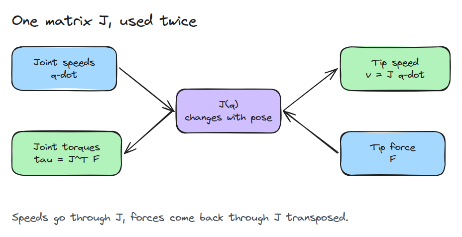
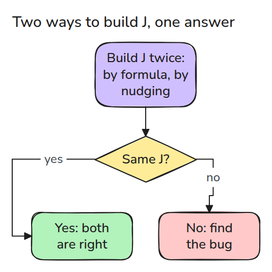
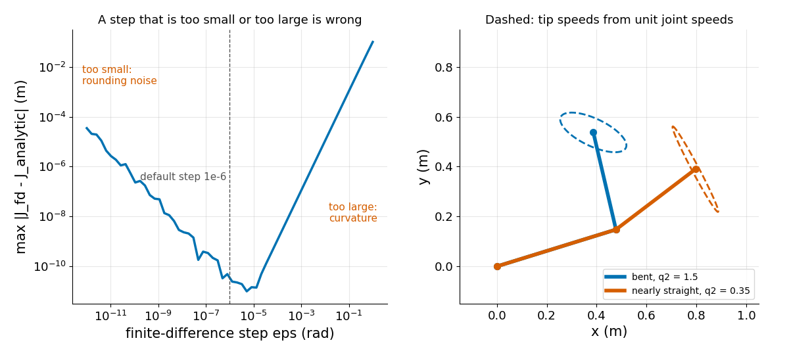
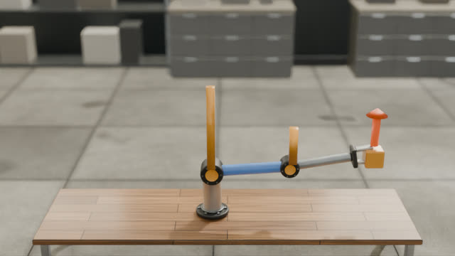

# Jacobian: joint 속도, tip 속도, 힘

> joint 속도가 손의 속도를 어떻게 정하는지, 손이 가하는 힘이 모터 torque로 어떻게 바뀌는지 알게 됩니다.

**유형:** 만들기   **선수 지식:** 02/01 DH 표와 URDF origin, 02/02 역기구학   **시간:** 약 15분

## 쉽게 말하면

작은 로봇 팔의 어깨를 일정하게 돌리면 tip은 어깨를 중심으로 원을 그리며 돌아요. 어깨에서 멀수록 더 빨리 움직여요. 그래서 tip의 속도와 방향은 자세에 따라 달라져요.

Jacobian은 현재 자세에서 이 관계를 표로 만든 것이에요. joint 속도를 넣으면 tip의 움직임이 나와요. 표를 옆으로 뒤집으면 tip이 가하는 힘을 각 모터가 내야 하는 torque로 바꿔 줘요.

## 핵심 용어

- **Jacobian (`J`)**: 현재 자세에서 joint 속도를 tip의 속도와 방향으로 바꾸는 숫자 표입니다.
- **Tip**: 손이나 도구가 달린 팔의 끝입니다.
- **Torque (`tau`)**: 비트는 힘입니다. 예를 들어 모터가 joint를 미는 힘입니다.
- **Transpose (`J^T`)**: 같은 행렬의 행과 열을 맞바꾼 것입니다.
- **Finite difference**: 입력을 아주 조금 움직여 출력이 변하는 것을 보고 기울기를 추정하는 방법입니다.

## 문제

로봇 팔의 손을 직선으로 움직이고 싶고 손이 무언가를 누를 때 각 모터가 얼마나 밀어야 하는지도 알고 싶습니다. 두 질문에는 같은 숫자 표가 필요합니다. 그 표의 부호가 하나 틀려도 위치만 확인하는 테스트에서는 드러나지 않습니다.

## 개념

손을 직선으로 움직이거나 탁자를 누르려면 모든 joint가 알맞은 속도와 힘을 내야 합니다. Jacobian은 자세마다 다시 계산하는 표로 joint 속도를 손의 속도로 바꿔 줍니다. 같은 표를 옆으로 뒤집으면 손이 가하는 힘을 각 모터가 내야 할 힘으로 바꿔 줍니다.



*속도는 표를 통과하고 힘은 뒤집힌 표를 거꾸로 통과합니다.*



*표를 만드는 두 방법은 서로 맞아야 합니다.*



*굽은 팔은 손이 어느 쪽으로든 쉽게 움직입니다. 곧은 팔은 그렇지 못해서 한 방향이 어렵습니다.*

[](../assets/clip-example.mp4)

*뻗은 팔은 어깨 torque가 훨씬 많이 필요합니다.*

<details><summary>The math (optional)</summary>

`v = J @ qd`이고 `tau = J^T F`입니다(Craig 5장 5.7, 5.9, 5.10절). 손끝의 일률 `F . (J q-dot)`은 joint의 일률 `tau . q-dot`과 같습니다.
2 kg 블록을 받치려면 tip이 `F = 2 * 9.81 = 19.6` N으로 위로 밀어야 하고 `tau`는 모터가 내는 torque입니다.
팔을 수평으로 쭉 펴면 tip이 어깨에서 0.9 m 떨어져 있어서 어깨에 19.6 x 0.9 = 17.7 N m가 필요합니다.
tip이 base 거의 바로 위에 있으면 약 1 N m가 필요합니다. 가장 좋은 step 크기는 반올림 잡음과 곡률 사이에 있습니다. 영상은 N m당 막대 0.03 m를 그렸습니다.
직선 이동 속도는 0.1 m/s입니다.

</details>

## 만들기

표를 만드는 방법은 두 가지입니다. 공식을 쓰는 방법과 joint를 하나씩 조금 움직여 손이 어디로 가는지 보는 방법입니다.

```python
J = np.array([[-l1*s1 - l2*s12, -l2*s12], [l1*c1 + l2*c12, l2*c12]])
col = (fk(q + dq, L) - fk(q - dq, L)) / (2 * eps)   # one column per joint
```

그다음 속도는 `J @ qd`(`qd`: joint 속도)를 거치고 힘은 `J.T @ F`(`F`: tip이 가하는 힘)를 거칩니다.

```bash
cd robotics-engineering-from-scratch
python3 -m pytest phases/02-manipulator-kinematics/03-jacobian-and-velocity -q
python3 phases/02-manipulator-kinematics/03-jacobian-and-velocity/code/main.py
```

## 실제 도구로 보기

physics engine과 ROS 2 라이브러리는 Jacobian을 돌려줍니다. 하나를 골라 2링크 팔에서 이것과 비교해 보세요.

## 결과물

`outputs/skill-jacobian-check.md`는 모든 Jacobian에 쓸 수 있는 유한 차분 검사와 일률 균형 검사입니다.

## 연습 문제

1. 몇몇 pose에서 두 방법으로 만든 표를 비교하세요.
2. 더 무거운 블록을 달고 torque가 어떻게 변하는지 보세요.
3. 팔을 펴면서 쉽게 움직이는 방향이 줄어드는 것을 보세요.
