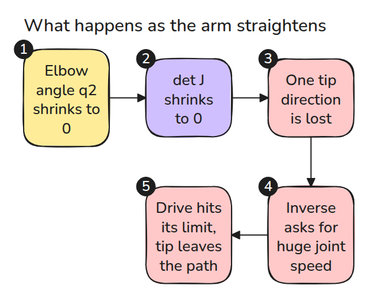
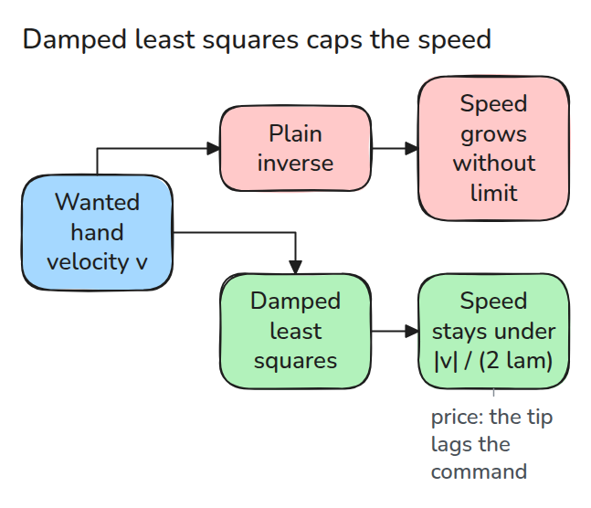
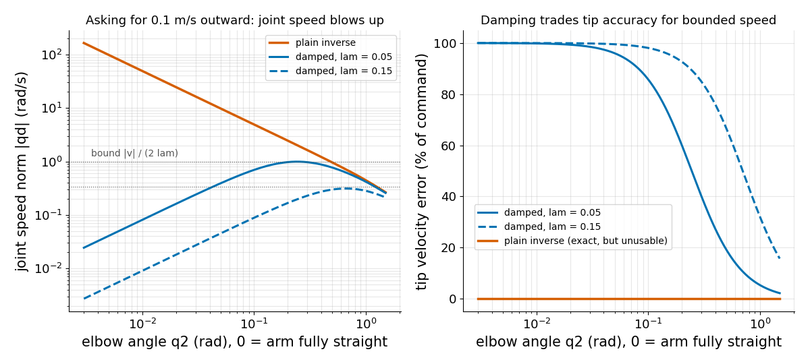

# Singularities and Damped Least Squares

> A straight arm loses one direction of tip motion, and the plain inverse then demands unbounded joint speed.

**Type:** Build   **Prerequisites:** 02/03 The Jacobian   **Time:** ~15 minutes

## In Plain Words

A bench arm moves its hand straight outward by straightening a bent elbow. Near full stretch the links line up, so an elbow turn moves the hand mostly sideways and barely outward. The elbow must spin faster for the same speed, and at full stretch no turn moves the hand outward.

That pose is a singularity, where a plain Jacobian inverse asks for a huge joint speed. Damped least squares accepts a small speed error and caps the joint speed. More damping means slower joints and more error.

## The Problem

You command the tip straight outward at 0.1 m/s. Near full stretch the controller asks the elbow for a hundred radians per second, the drive hits its limit, and the tip leaves the path. Nothing is broken: the Jacobian lost a direction and the controller still tried to invert it.

## The Concept

First, the chain of events. `det J` (the determinant) is one number that falls to 0 when `J` loses a direction.



*A shrinking elbow angle shrinks `det J`. A tip direction is lost, and the inverse asks for huge speeds.*

For this arm `det J = L1 L2 sin q2`, so the arm is singular when fully straight or fully folded (Craig, Ch. 5, Sec. 5.8). Then `J` has rank one: only one independent tip direction is left, and no joint speeds move the tip along the arm.

The manipulability `sqrt(det(J J^T))` (`J^T` swaps `J`'s rows and columns) scores how freely the tip moves, and peaks at a right-angle elbow.

Each column of `J` is where the tip goes when one joint turns. At `q2 = 1.4` rad the columns point in different directions and `det J = 0.5 * 0.4 * sin 1.4 = 0.20`. As the elbow straightens they swing together, and at `q2 = 0` they are parallel and `det J = 0`. Watch the arrows merge.


*Amber and dark: the two columns of `J`, the tip velocity per unit speed of shoulder and elbow.*

Damped least squares adds `lam^2 I` (`I` is the identity matrix) inside the inverse, which stops the inverted matrix from reaching zero.



*The speed can no longer exceed `|v| / (2 lam)`.*



*Solid lam = 0.05, dashed 0.15. Left: the plain inverse grows like `1 / q2` and the damped solutions stay under their dotted bounds. Right: damped solutions stop following the command near the singularity.*

## Build It

```python
def solve(J, v, lam):
    if lam == 0.0: return np.linalg.solve(J, v)            # plain inverse
    return J.T @ np.linalg.solve(J @ J.T + lam**2 * np.eye(len(v)), v)
```

Each singular value `s` of `J` (how much `J` stretches one direction) becomes `s / (s^2 + lam^2)`, never above `1 / (2 lam)`, the bound the tests check. Small `lam` follows the command closely and moves fast. Large `lam` moves slowly and lags.

```bash
cd robotics-engineering-from-scratch
python3 -m pytest phases/02-manipulator-kinematics/04-singularities -q
python3 phases/02-manipulator-kinematics/04-singularities/code/main.py
```

## Use It

Libraries compute pseudo-inverses with a cutoff on small singular values. Compare their output to `solve` near `q2 = 0.01` and read how they choose the cutoff or damping.

## Ship It

`outputs/skill-singularity-guard.md` is a checklist for guarding a velocity controller with a manipulability monitor and a damped solver.

## Exercises

1. Make `lam` grow only when `manipulability(J)` falls below a threshold.
2. Find the smallest `lam` that keeps joint speed below 2 rad/s at `q2 = 0.01`.
3. Show that a path through the folded pose has the same trouble as one through the stretched pose.
