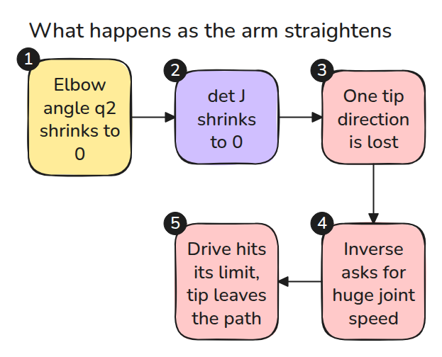
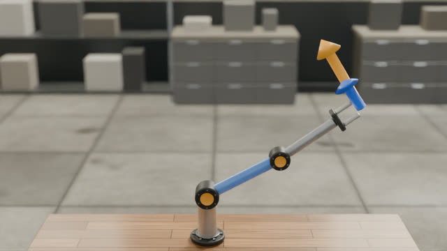
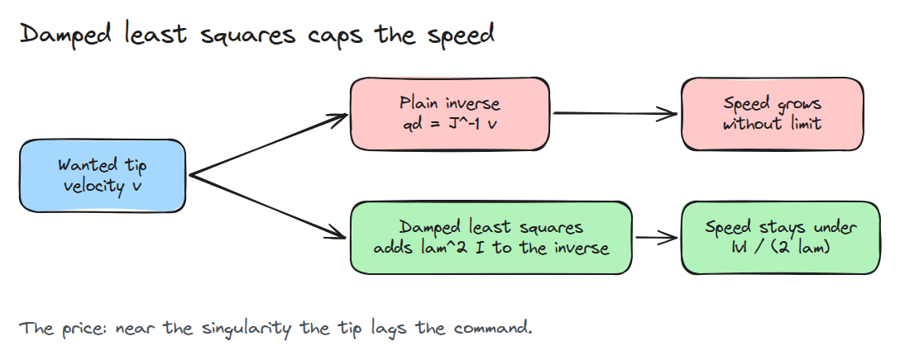
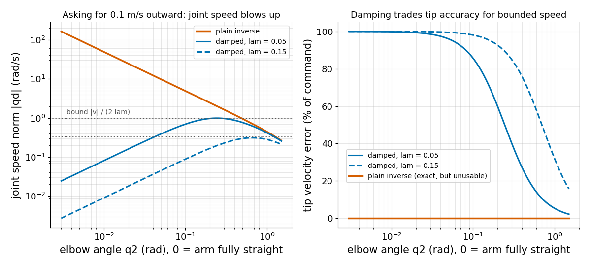

# Singularities and Damped Least Squares

> Learn why a nearly straight arm makes joints spin wildly, and the small trick that calms them.

**Type:** Build   **Prerequisites:** 02/03 The Jacobian   **Time:** ~15 minutes

## In Plain Words

A desk arm straightens its elbow to move the hand outward. Near full stretch the links line up, so an elbow turn moves the hand mostly sideways. The elbow must spin ever faster, and at full stretch no turn moves the hand outward.

That pose is a singularity. The plain way of finding joint speeds then asks for a huge speed. A trick called damped least squares caps it.

## Key Terms

- **Singularity**: a pose where the arm loses a direction of tip motion, such as a fully straight arm.
- **Jacobian inverse**: the table that turns a wanted hand motion back into joint speeds.
- **Manipulability**: a score for how freely the tip can move.
- **Damped least squares**: a way of finding joint speeds that allows a small error so the speeds never pass a cap.

## The Problem

You tell a robot's hand to move straight outward at a gentle speed. As the arm nears full stretch, the program steering the arm demands a wildly fast elbow, the motor hits its limit, and the hand leaves the path.

## The Concept

Real arms pass near poses where one direction of motion disappears. A fully straight arm cannot move its hand along its own length however fast the elbow turns, so asking for that needs an endless speed.



*As the elbow straightens, the hand loses a direction.*

[](../assets/clip-example.mp4)

*Where the hand goes when the shoulder, or the elbow, turns. At full stretch the two line up.*

The cure is damping: accept a small error so the joint speeds stay bounded.



*Speed can no longer pass a fixed limit.*



*Without damping the speed explodes. With it, a small lag.*

<details><summary>The math (optional)</summary>

The determinant `det J` is one number that is 0 when a table loses a direction; here `det J = L1 L2 sin q2`, zero when fully straight or folded (Craig, Ch. 5, Sec. 5.8). Manipulability is `sqrt(det(J J^T))` and peaks at a right-angle elbow. A singular value says how much a table stretches one direction. At `q2 = 1.4` rad `det J = 0.5 * 0.4 * sin 1.4 = 0.20`. Damped least squares adds `lam^2 I` inside the inverse, so speed is at most `|v| / (2 lam)`. Solid curves use lam = 0.05, dashed 0.15. The command is 0.1 m/s.

</details>

## Build It

`solve(J, v, lam)` takes the Jacobian `J` and the wanted hand motion `v`. It gives the plain answer when `lam` is zero and the damped answer otherwise.

```python
def solve(J, v, lam):
    if lam == 0.0: return np.linalg.solve(J, v)            # plain inverse
    return J.T @ np.linalg.solve(J @ J.T + lam**2 * np.eye(len(v)), v)
```

Small `lam` follows the command closely but moves fast; large `lam` moves gently and lags. A test checks the speed bound.

```bash
cd robotics-engineering-from-scratch
python3 -m pytest phases/02-manipulator-kinematics/04-singularities -q
python3 phases/02-manipulator-kinematics/04-singularities/code/main.py
```

## Use It

Robot libraries have their own versions of this safeguard; compare one with `solve` near `q2 = 0.01`.

## Ship It

`outputs/skill-singularity-guard.md` guards speed commands with a manipulability monitor.

## Exercises

1. Run `solve` with `lam = 0` near the straight pose and watch the speeds.
2. Try `lam` of 0.05 and 0.15.
3. Fold the arm and see the same trouble.
