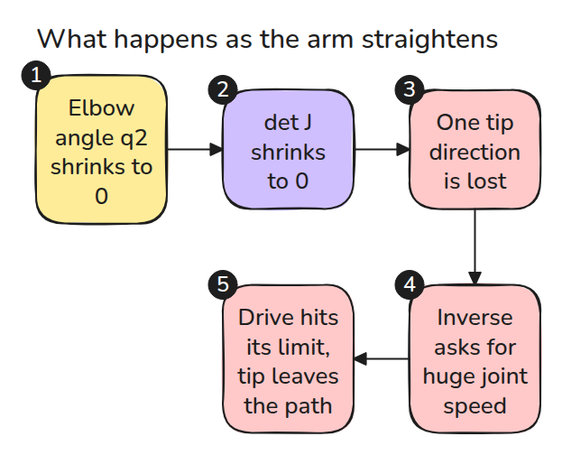
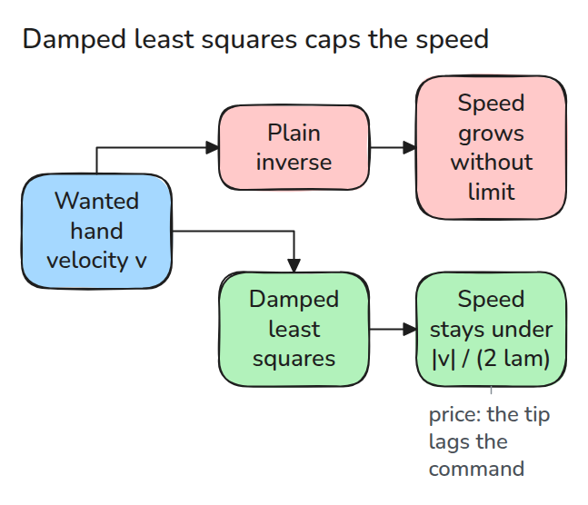
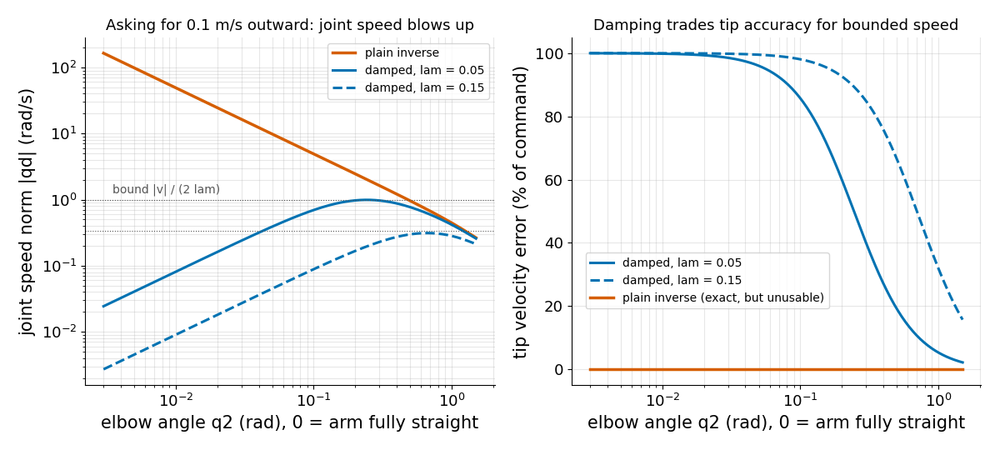

# Singularity와 damped least squares

> 팔이 펴지면 tip이 움직일 수 있는 방향이 하나 사라지고 일반 역행렬은 한없이 큰 joint 속도를 요구합니다.

**유형:** 만들기   **선수 지식:** 02/03 Jacobian   **시간:** 약 15분

## 쉽게 말하면

작업대 위 로봇 팔은 굽힌 팔꿈치를 펴면서 손을 바깥으로 곧게 보내요. 거의 다 편 상태에서는 link들이 일직선에 가까워져서 팔꿈치를 돌리면 손이 주로 옆으로 움직이고 바깥으로는 거의 가지 않아요.
그래서 같은 속도를 내려면 팔꿈치가 더 빨리 돌아야 하고 완전히 펴면 어떤 회전도 손을 바깥으로 보내지 못해요.

이 자세가 singularity이고 여기서 일반 Jacobian 역행렬은 엄청나게 큰 joint 속도를 요구해요.
damped least squares는 작은 속도 오차를 받아들이고 joint 속도에 상한을 둬요. damping이 클수록 joint가 느려지고 오차가 커져요.

## 문제

tip을 바깥쪽으로 곧게 0.1 m/s로 움직이라고 명령합니다. 팔이 거의 뻗으면 controller가 elbow에 초당 100 라디안을 요구하고 drive가 한계에 걸려 tip이 경로를 벗어납니다.
고장 난 것은 없습니다. Jacobian이 방향 하나를 잃었는데 controller가 그래도 역행렬을 구하려 했을 뿐입니다.

## 개념

먼저 일이 벌어지는 순서입니다. `det J`(행렬식)는 `J`가 방향을 잃으면 0으로 떨어지는 숫자 하나입니다.



*elbow 각이 줄면 `det J`가 줄어듭니다. tip 방향 하나가 사라지고 역행렬은 엄청난 속도를 요구합니다.*

이 팔은 `det J = L1 L2 sin q2`이므로 완전히 뻗거나 완전히 접히면 singular입니다(Craig 5장 5.8절). 그러면 `J`의 rank는 1입니다.
독립된 tip 방향이 하나뿐이어서 어떤 joint 속도로도 tip을 팔 방향으로 움직일 수 없습니다.

manipulability `sqrt(det(J J^T))`(`J^T`는 `J`의 행과 열을 맞바꾼 것)는 tip이 얼마나 자유롭게 움직이는지 나타내는 점수이고 elbow가 직각일 때 가장 큽니다.

`J`의 각 열은 joint 하나가 돌 때 tip이 가는 방향입니다. `q2 = 1.4` rad에서는 두 열이 다른 방향을 가리키고 `det J = 0.5 * 0.4 * sin 1.4 = 0.20`입니다.
팔꿈치가 펴질수록 두 화살표가 한 방향으로 모이고 `q2 = 0`에서는 평행이 되어 `det J = 0`입니다. 화살표가 합쳐지는 모습을 보세요.


*주황색과 검은색은 `J`의 두 열로 어깨와 팔꿈치가 단위 속도로 돌 때의 tip 속도입니다.*

damped least squares는 역행렬 안에 `lam^2 I`(`I`는 단위행렬)를 더해서 역행렬을 구하는 행렬이 0에 닿지 않게 합니다.



*속도는 더 이상 `|v| / (2 lam)`을 넘지 못합니다.*



*실선은 lam = 0.05이고 점선은 0.15입니다. 왼쪽은 일반 역행렬이 `1 / q2`처럼 커지고 damped 해는 점선 상한 아래에 머무는 모습입니다. 오른쪽은 damped 해가 singularity 근처에서 명령을 따라가지 못하는 모습입니다.*

## 만들기

```python
def solve(J, v, lam):
    if lam == 0.0: return np.linalg.solve(J, v)            # plain inverse
    return J.T @ np.linalg.solve(J @ J.T + lam**2 * np.eye(len(v)), v)
```

`J`의 특이값 `s`(`J`가 한 방향을 얼마나 늘리는지)는 `s / (s^2 + lam^2)`로 바뀌고 이 값은 `1 / (2 lam)`을 넘지 않습니다. 테스트가 확인하는 상한이 바로 이것입니다.
`lam`이 작으면 명령을 가깝게 따르지만 빠르게 움직이고 `lam`이 크면 느리게 움직이지만 뒤처집니다.

```bash
cd robotics-engineering-from-scratch
python3 -m pytest phases/02-manipulator-kinematics/04-singularities -q
python3 phases/02-manipulator-kinematics/04-singularities/code/main.py
```

## 실제 도구로 보기

라이브러리는 작은 특이값에 cutoff를 둔 pseudo-inverse를 계산합니다. `q2 = 0.01` 근처에서 그 출력과 `solve`를 비교하고 cutoff나 damping을 어떻게 고르는지 읽어 보세요.

## 결과물

`outputs/skill-singularity-guard.md`는 속도 controller 앞에 manipulability 감시와 damped solver를 두는 점검표입니다.

## 연습 문제

1. `manipulability(J)`가 문턱값 아래로 내려갈 때만 `lam`이 커지게 만드세요.
2. `q2 = 0.01`에서 joint 속도를 2 rad/s 아래로 유지하는 가장 작은 `lam`을 찾으세요.
3. 접힌 자세를 지나는 경로도 뻗은 자세를 지나는 경로와 같은 문제를 겪는다는 것을 보이세요.
