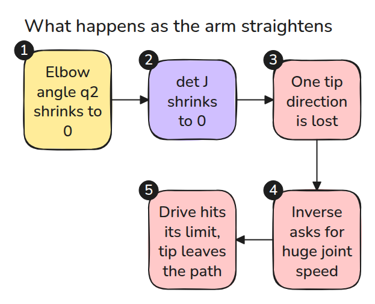
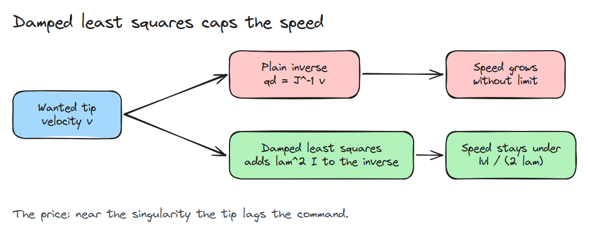
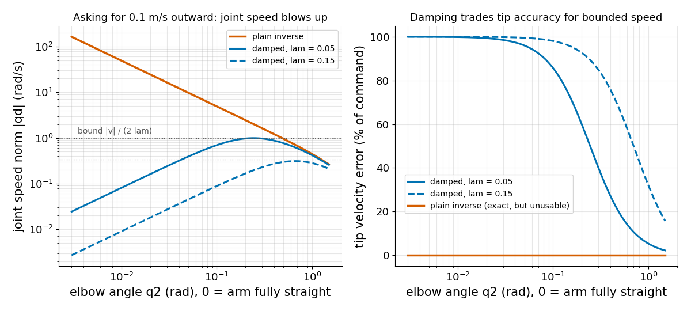

# Singularity와 damped least squares

> 거의 펴진 팔에서 관절이 왜 미친 듯이 도는지, 그리고 그것을 가라앉히는 작은 요령을 알게 됩니다.

**유형:** 만들기   **선수 지식:** 02/03 Jacobian   **시간:** 약 15분

## 쉽게 말하면

작은 로봇 팔이 팔꿈치를 펴면서 손을 바깥으로 보내요. 거의 다 편 상태에서는 link들이 일직선에 가까워져서 팔꿈치를 돌리면 손이 주로 옆으로 움직여요. 팔꿈치는 점점 더 빨리 돌아야 하고 완전히 펴면 어떤 회전도 손을 바깥으로 보내지 못해요.

이 자세가 singularity예요. 이때 일반적인 방법으로 joint 속도를 구하면 엄청나게 큰 속도를 요구해요. damped least squares라는 요령이 그 속도에 상한을 둬요.

## 핵심 용어

- **Singularity**: 완전히 곧게 뻗은 팔처럼 tip이 움직일 수 있는 방향 하나를 잃은 자세입니다.
- **Jacobian inverse**: 원하는 손의 움직임을 다시 joint 속도로 바꾸는 표입니다.
- **Manipulability**: tip이 얼마나 자유롭게 움직일 수 있는지 나타내는 점수입니다.
- **Damped least squares**: 작은 오차를 받아들여서 joint 속도가 상한을 넘지 않게 하는 joint 속도 계산법입니다.

## 문제

로봇의 손을 바깥쪽으로 느긋한 속도로 곧게 움직이라고 명령합니다. 팔이 거의 뻗으면 팔을 움직이는 프로그램이 팔꿈치에 엄청나게 빠른 속도를 요구하고 모터가 한계에 걸려 손이 경로를 벗어납니다.

## 개념

실제 팔은 한 방향의 움직임이 사라지는 자세 근처를 지나갑니다. 완전히 뻗은 팔은 팔꿈치를 아무리 빨리 돌려도 손을 팔 방향으로 움직일 수 없어서 그것을 요구하면 끝없는 속도가 필요합니다.



*팔꿈치가 펴지면 손이 방향 하나를 잃습니다.*


*어깨나 팔꿈치가 돌 때 손이 가는 방향입니다. 완전히 뻗으면 둘이 한 줄로 섭니다.*

해법은 damping입니다. 작은 오차를 받아들여서 joint 속도가 한계 안에 있게 합니다.



*속도는 더 이상 정해진 한계를 넘지 못합니다.*



*damping이 없으면 속도가 폭발하고 있으면 조금 뒤처집니다.*

<details><summary>The math (optional)</summary>

determinant `det J`는 표가 방향을 잃으면 0이 되는 숫자 하나이고 여기서는 `det J = L1 L2 sin q2`로 완전히 뻗거나 접혔을 때 0입니다(Craig 5장 5.8절).
manipulability는 `sqrt(det(J J^T))`이고 팔꿈치가 직각일 때 가장 큽니다.
singular value는 표가 한 방향을 얼마나 늘리는지입니다. `q2 = 1.4` rad에서는 `det J = 0.5 * 0.4 * sin 1.4 = 0.20`입니다.
damped least squares는 역행렬 안에 `lam^2 I`를 더해서 속도가 `|v| / (2 lam)`을 넘지 못하게 합니다. 실선은 lam = 0.05이고 점선은 0.15입니다. 명령은 0.1 m/s입니다.

</details>

## 만들기

`solve(J, v, lam)`은 Jacobian `J`와 원하는 손의 움직임 `v`를 받습니다. `lam`이 0이면 일반 답을 주고 아니면 damped 답을 줍니다.

```python
def solve(J, v, lam):
    if lam == 0.0: return np.linalg.solve(J, v)            # plain inverse
    return J.T @ np.linalg.solve(J @ J.T + lam**2 * np.eye(len(v)), v)
```

`lam`이 작으면 명령을 가깝게 따르지만 빠르게 움직이고 `lam`이 크면 느리게 움직이지만 뒤처집니다. 테스트가 속도 상한을 확인합니다.

```bash
cd robotics-engineering-from-scratch
python3 -m pytest phases/02-manipulator-kinematics/04-singularities -q
python3 phases/02-manipulator-kinematics/04-singularities/code/main.py
```

## 실제 도구로 보기

로봇 라이브러리에도 이런 안전장치의 자기 버전이 있습니다. 하나를 골라 `q2 = 0.01` 근처에서 `solve`와 비교해 보세요.

## 결과물

`outputs/skill-singularity-guard.md`는 속도 명령 앞에 manipulability 감시를 두는 점검표입니다.

## 연습 문제

1. 쭉 펴진 자세 근처에서 `lam = 0`으로 `solve`를 돌려 속도를 보세요.
2. `lam`을 0.05와 0.15로 해 보세요.
3. 팔을 접어서 같은 문제가 생기는지 보세요.
