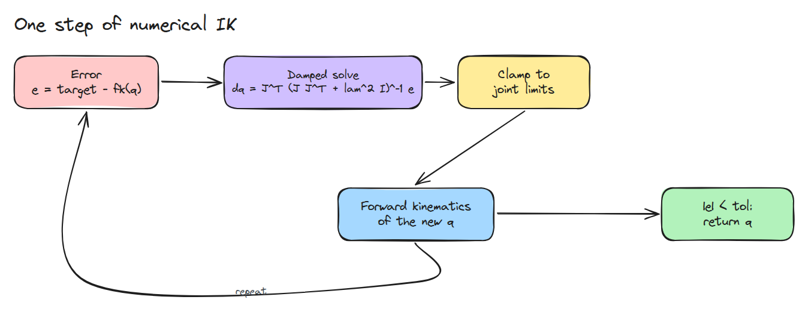
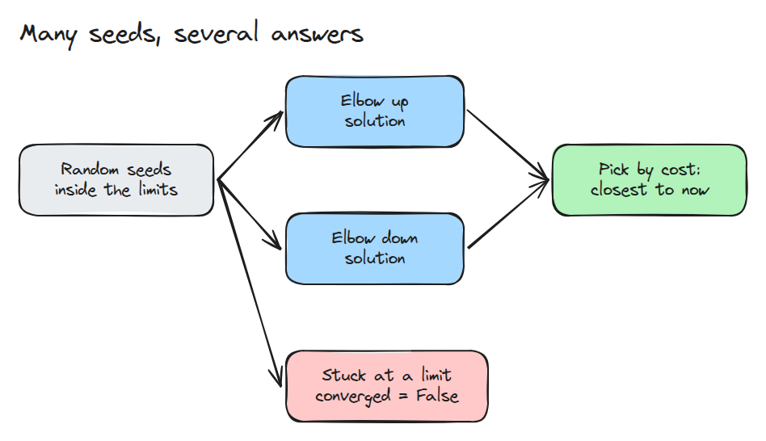
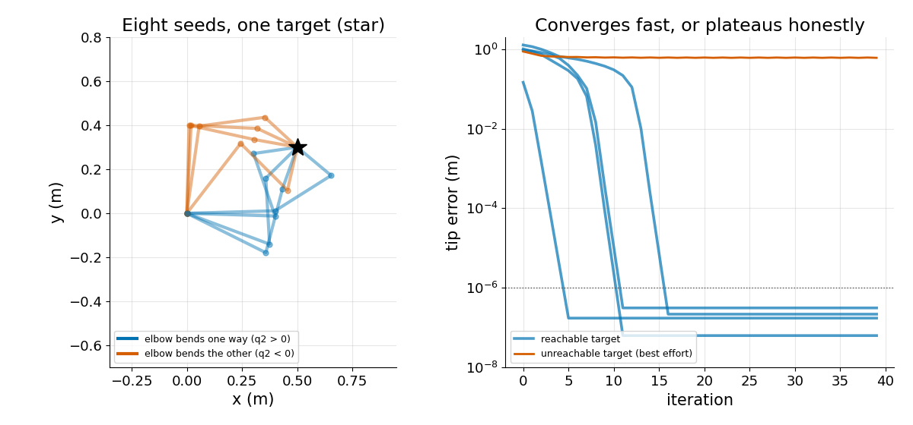

# Numerical Inverse Kinematics

> With no formula for the joints, nudge them toward the target with the Jacobian, clamp to the limits, and try several starting points.

**Type:** Build   **Prerequisites:** 02/03 Jacobian and Velocity, 02/04 Singularities   **Time:** ~15 minutes

## In Plain Words

You want a poseable toy's hand to touch a sticker. Bend a joint slightly, check where the hand went, then
adjust again. A large bend can overshoot; a joint at its stop cannot bend farther.

Numerical inverse kinematics repeats this process with a Jacobian that predicts small changes. It caps each
adjustment and respects joint limits. Different starting poses can lead to different answers or get stuck, so
restarts help. The solver reports whether the hand actually reached the sticker.

## The Problem

Lesson 02/02 solved a two-link arm with the law of cosines. Now you have a three-link arm that can reach a point in many ways, or a six-joint arm with no neat formula. You need joint angles for a target, they must respect the joint limits, and the answer should not depend on where you started.

## The Concept



*Measure the tip error, solve for a small joint step, clamp it to the limits, run forward kinematics again, and repeat until the error is tiny.*

The step is the damped solve from 02/04: `dq = J^T (J J^T + lam^2 I)^-1 e`. The damping keeps the step finite at a straight arm, where the plain inverse does not exist. A cap on the biggest joint step keeps the linear model honest.



*Each random seed slides into a nearby solution. Both elbow bends show up, and a seed pushed against a limit reports that it failed.*



*Left: eight seeds reach the same target with different arm shapes. Right: reachable targets drop below 1e-6 m within about 16 steps. An unreachable target stays flat at its best effort.*

## Build It

```python
J = jacobian(q, L)
dq = J.T @ np.linalg.solve(J @ J.T + lam**2 * np.eye(2), e)
q = np.clip(q + dq * min(1.0, max_step / np.abs(dq).max()), lo, hi)
```

`solve_ik()` returns `(q, converged)`. It never raises for a target it cannot reach. It hands back the closest pose it found and `False`. `ik_restarts()` runs it from random seeds inside the limits, so you can pick the solution nearest the current pose.

```bash
cd robotics-engineering-from-scratch
python3 -m pytest phases/02-manipulator-kinematics/05-numerical-inverse-kinematics -q
python3 phases/02-manipulator-kinematics/05-numerical-inverse-kinematics/code/main.py
```

## Use It

Compare with `scipy.optimize.least_squares` on `fk(q) - target` with `bounds=(lo, hi)`. Both should land on poses whose `fk` matches. Craig, chapter 4, covers the closed-form case that this replaces.

## Ship It

`outputs/skill-ik-solver-check.md` reviews an IK solver for limits, restarts and failure flags.

## Exercises

1. Pick the restart solution closest to a given current `q` and compare it with the first converged one.
2. Add a fourth link and count how many restarts converge.
3. Set `lam = 0` and start from the straight arm to see what happens.
