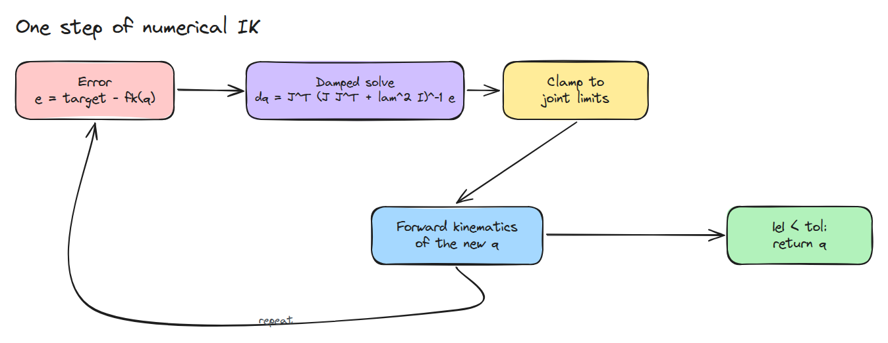
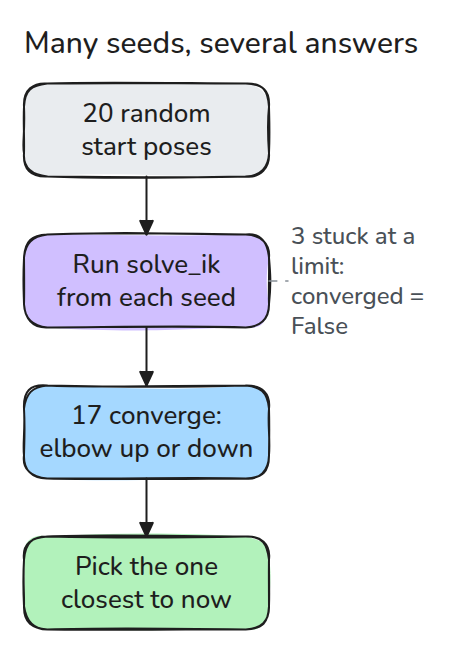
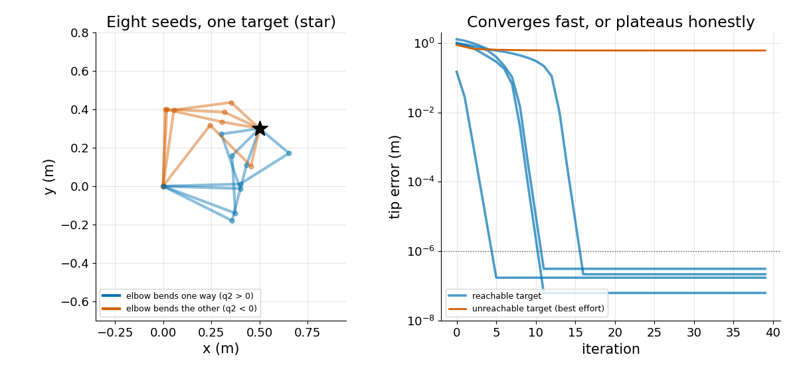

# Numerical Inverse Kinematics

> Learn how to find joint angles by trial and correction when no formula exists.

**Type:** Build   **Prerequisites:** 02/03 Jacobian and Velocity, 02/04 Singularities   **Time:** ~15 minutes

## In Plain Words

A three-link desk arm must touch a ball, and no formula gives the joint angles. Bend the joints a little, see where the hand went, and correct. A big bend can shoot past the ball; a joint at its stop cannot bend further.

Numerical inverse kinematics repeats these small corrections, using the Jacobian to predict each one. The starting pose decides which answer it finds, so it restarts from several.

## Key Terms

- **Numerical IK**: finding joint angles by repeated small corrections instead of a formula.
- **Seed**: the starting pose of one run.
- **Joint limit**: how far a joint may turn; the joint stops there.
- **Clamp**: cut a value back to the allowed range.
- **Converged**: the error has fallen below the tolerance, here one millionth of a metre.
- **Jacobian**: a table of numbers that predicts how the tip moves for a small joint change.

## The Problem

You want a robot arm's hand at a point, but a six-joint arm has no neat formula for the angles. They must respect the joint limits and not depend on where the arm started.

## The Concept

Most real arms have no angle formula, so robots find angles by trying and correcting: look where the hand is, measure the miss, nudge the joints to shrink it, and repeat until the miss is tiny.



*Measure the miss, nudge, check, repeat.*

Small nudges keep each correction accurate, and a joint at its stop is held there. The start decides which answer you find, so the robot tries several random starts.



*Each start slides into a nearby answer.*



*Faint arms are the steps. The miss shrinks, but stays flat for an unreachable target.*


*Two starts, two arm shapes, one ball.*

<details><summary>The math (optional)</summary>

Each nudge is the damped solve from 02/04, `dq = J^T (J J^T + lam^2 I)^-1 e`, where `e` is the miss, with a cap on the biggest joint step. Converged means the miss is below 1e-6 m, reached within about 16 steps for reachable targets. Links 0.4, 0.3 and 0.2 m, target (0.5, 0.3) m: 17 of 20 random starts converge; start 0 takes 6 steps (elbow up), start 2 takes 7 (elbow down).

</details>

## Build It

Each loop step is three lines: build the table, solve for a small nudge, then clamp to the joint limits.

```python
J = jacobian(q, L)
dq = J.T @ np.linalg.solve(J @ J.T + lam**2 * np.eye(2), e)
q = np.clip(q + dq * min(1.0, max_step / np.abs(dq).max()), lo, hi)
```

`solve_ik()` returns the angles and whether it converged (`False` plus the closest pose for an unreachable target). `ik_restarts()` tries random starts.

```bash
cd robotics-engineering-from-scratch
python3 -m pytest phases/02-manipulator-kinematics/05-numerical-inverse-kinematics -q
python3 phases/02-manipulator-kinematics/05-numerical-inverse-kinematics/code/main.py
```

## Use It

Compare with `scipy.optimize.least_squares` on the miss, with the joint limits as bounds. Craig, chapter 4, covers the direct formula.

## Ship It

`outputs/skill-ik-solver-check.md` reviews an IK solver for limits, restarts and failure flags.

## Exercises

1. Pick the answer closest to the current pose.
2. Add a fourth link and count how many starts succeed.
3. Start from a straight arm and say what the solver does.
