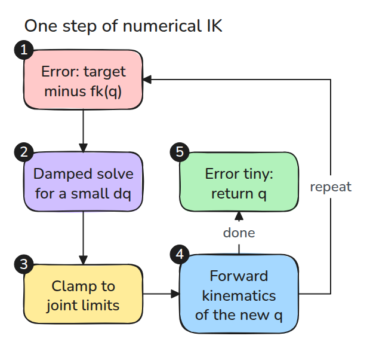
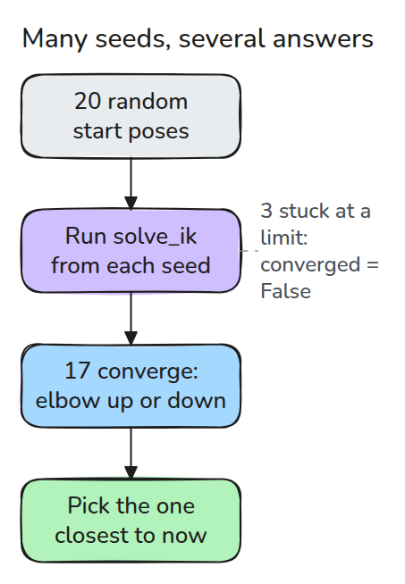
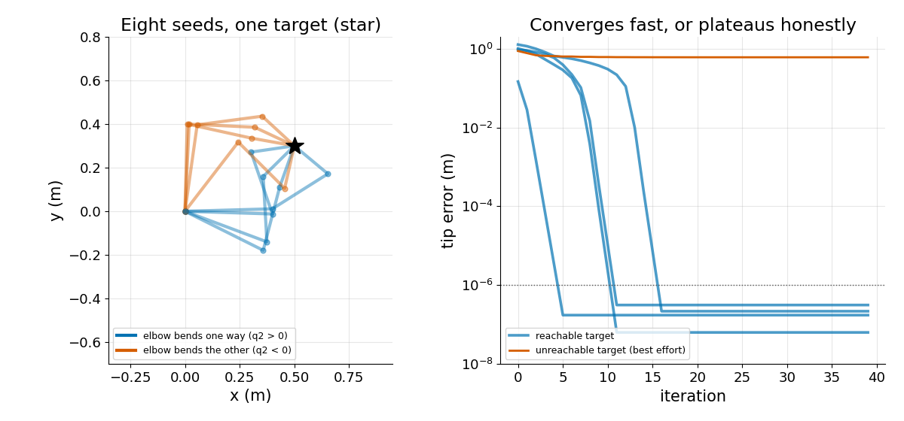

# 수치 Inverse Kinematics

> 공식이 없으면 Jacobian으로 관절을 목표 쪽으로 조금씩 움직이고 한계로 자르며 여러 자세에서 다시 시작합니다.

**유형:** 만들기   **선수 지식:** 02/03 Jacobian과 속도, 02/04 Singularity   **시간:** 약 15분

## 쉽게 말하면

link가 세 개인 작업대 팔이 공에 닿아야 하는데 관절 각도를 알려 주는 공식은 없어요. 그래서 관절을 조금 꺾어 보고 손이 어디로 갔는지 본 다음 고쳐요.
크게 꺾으면 지나칠 수 있고 끝까지 꺾인 관절은 더 꺾이지 않아요. 공이 닿지 않는 곳에 있으면 팔은 공 쪽으로 쭉 펴진 채 멈춰요.

numerical inverse kinematics는 이런 작은 수정을 반복하고 Jacobian으로 수정 한 번마다의 결과를 예측해요.
시작 자세에 따라 찾는 답이 달라져서 여러 자세에서 다시 시작해요. 손이 공에 닿았는지도 알려 줘요.

## 문제

02/02에서는 코사인 법칙으로 2링크 팔을 풀었습니다. 이제 한 점에 여러 방식으로 닿는 3링크 팔이나 깔끔한 공식이 없는 6관절 팔이 있습니다.
목표에 맞는 관절각이 필요하고 관절 한계(각 관절이 돌 수 있는 범위)를 지켜야 하며 답이 시작 자세에 좌우되지 않아야 합니다.

## 개념

첫 그림은 수정 한 걸음이고 루프가 이를 반복합니다. `e`는 tip 오차로 목표에서 tip의 현재 위치를 뺀 값입니다.



*오차를 재고 작은 관절 걸음을 풀고 한계로 자른 뒤 forward kinematics를 돌립니다. 오차가 아주 작아질 때까지 반복합니다.*

걸음은 02/04의 damped solve입니다. `dq = J^T (J J^T + lam^2 I)^-1 e`입니다. 팔이 쭉 펴진 자세에서는 일반 역행렬이 없는데 damping 덕분에 걸음이 유한하게 유지됩니다.

Jacobian은 작은 움직임만 예측하므로 큰 걸음은 예측이 틀린 곳에 닿습니다. 가장 큰 관절 걸음에 상한을 두면 이를 막습니다. 오차가 1e-6 m 아래로 내려가면 solver가 수렴한 것입니다.

seed는 시작 자세입니다. 다음은 seed 여러 개입니다.



*무작위 seed마다 가까운 해로 미끄러져 들어갑니다. 팔꿈치가 두 방향으로 꺾인 해가 모두 나오고 한계에 막힌 seed는 실패했다고 알려 줍니다.*



*왼쪽은 seed 여덟 개, 목표 하나에 서로 다른 팔 모양입니다. 오른쪽은 닿는 목표가 약 16걸음 안에 1e-6 m 아래로 떨어지고 닿지 않는 목표는 평평하게 남는 모습입니다.*

link 길이가 0.4, 0.3, 0.2 m인 팔과 목표 (0.5, 0.3) m를 잡습니다. `ik_restarts()`의 무작위 seed 20개 중 17개가 수렴합니다(tip이 1e-6 m 안으로 들어옴).
seed 0은 6걸음 만에 팔꿈치를 위로 한 채 닿습니다. seed 2는 7걸음이 걸리고 팔꿈치가 아래인 채 끝납니다. 두 손이 같은 공에 서로 다른 팔 모양으로 자리 잡는 모습을 보세요.


*각 팔은 자기 seed에서 `solve_ik()`를 한 걸음씩 실행합니다.*

## 만들기

```python
J = jacobian(q, L)
dq = J.T @ np.linalg.solve(J @ J.T + lam**2 * np.eye(2), e)
q = np.clip(q + dq * min(1.0, max_step / np.abs(dq).max()), lo, hi)
```

`solve_ik()`는 `(q, converged)`를 돌려줍니다. 닿을 수 없는 목표에도 예외를 내지 않고 찾은 가장 가까운 자세와 `False`를 줍니다.
`ik_restarts()`는 한계 안의 무작위 seed에서 반복 실행하므로 지금 자세에 가장 가까운 해를 고를 수 있습니다.

```bash
cd robotics-engineering-from-scratch
python3 -m pytest phases/02-manipulator-kinematics/05-numerical-inverse-kinematics -q
python3 phases/02-manipulator-kinematics/05-numerical-inverse-kinematics/code/main.py
```

## 실제 도구로 보기

`fk(q) - target`에 `scipy.optimize.least_squares`를 `bounds=(lo, hi)`로 적용해 비교하세요. 두 결과 모두 `fk`가 목표과 맞는 자세여야 합니다. 이 방법이 대신하는 닫힌 형태의 경우는 Craig 4장에 나옵니다.

## 결과물

`outputs/skill-ik-solver-check.md`는 IK solver의 한계 처리, 재시작, 실패 flag를 점검합니다.

## 연습 문제

1. 재시작 해 중에서 주어진 현재 `q`에 가장 가까운 것을 고르고 처음 수렴한 해와 비교하세요.
2. 네 번째 링크를 더하고 재시작 몇 번이 수렴하는지 세어 보세요.
3. `lam = 0`으로 놓고 쭉 펴진 팔에서 시작하면 어떻게 되는지 보세요.
