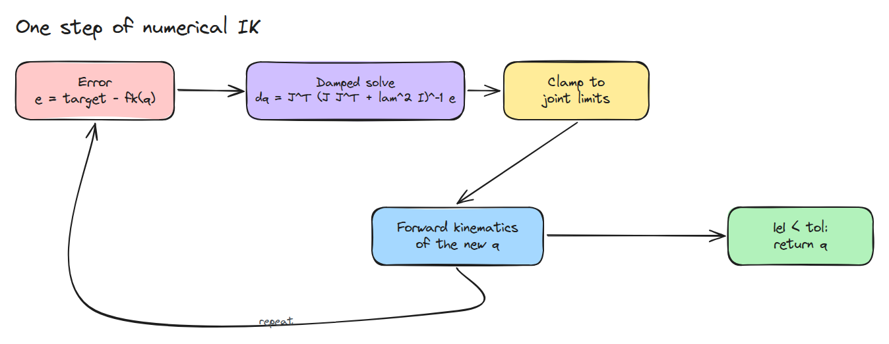
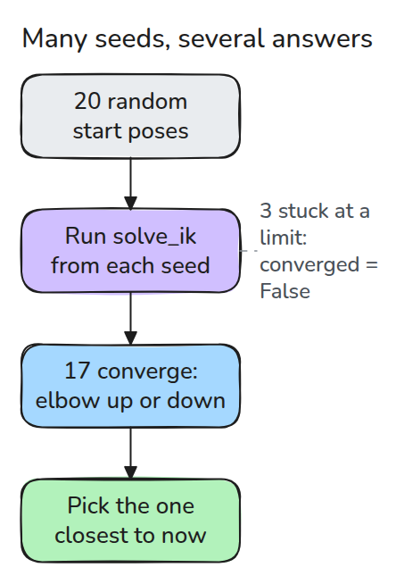
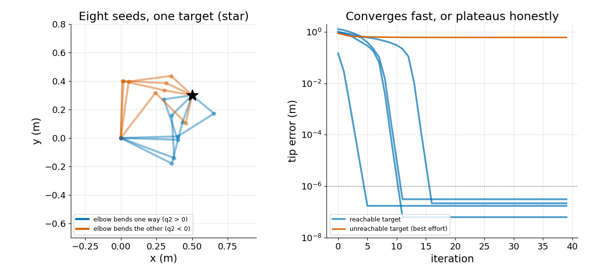

# 수치 Inverse Kinematics

> 공식이 없을 때 시도하고 고치는 방식으로 joint 각도를 찾는 법을 알게 됩니다.

**유형:** 만들기   **선수 지식:** 02/03 Jacobian과 속도, 02/04 Singularity   **시간:** 약 15분

## 쉽게 말하면

link가 세 개인 작업대 팔이 공에 닿아야 하는데 관절 각도를 알려 주는 공식은 없어요. 관절을 조금 꺾어 보고 손이 어디로 갔는지 본 다음 고쳐요. 크게 꺾으면 지나칠 수 있고 끝까지 꺾인 관절은 더 꺾이지 않아요.

numerical inverse kinematics는 이런 작은 수정을 반복하고 Jacobian으로 수정 한 번마다의 결과를 예측해요. 시작 자세에 따라 찾는 답이 달라져서 여러 자세에서 다시 시작해요.

## 핵심 용어

- **Numerical IK**: 공식 대신 작은 수정을 반복해서 관절 각도를 찾는 방법입니다.
- **Seed**: 한 번의 실행이 시작하는 자세입니다.
- **Joint limit**: 관절이 돌 수 있는 범위이고 거기서 관절이 멈춥니다.
- **Clamp**: 값을 허용 범위 안으로 잘라 내는 것입니다.
- **Converged**: 오차가 허용값 아래로 내려온 상태입니다. 여기서는 1e-6 m입니다.
- **Jacobian**: 관절을 조금 움직였을 때 tip이 어떻게 움직일지 예측하는 행렬입니다.

## 문제

로봇 팔의 손을 한 점에 놓고 싶은데 6관절 팔에는 각도를 알려 주는 깔끔한 공식이 없습니다.

관절 한계를 지키는 각도가 필요하고 답이 시작 자세에 좌우되지 않아야 합니다.

## 개념

실제 팔 대부분은 joint 각도를 알려 주는 공식이 없어서 로봇은 시도하고 고치면서 각도를 찾습니다.

`e`는 tip 오차로 목표에서 tip의 현재 위치를 뺀 값입니다.



*오차를 재고 작은 관절 걸음을 풀고 한계로 자른 뒤 FK를 돌리고 반복합니다.*

걸음은 02/04의 damped solve입니다. `dq = J^T (J J^T + lam^2 I)^-1 e`입니다. damping 덕분에 팔이 쭉 펴진 자세에서도 걸음이 유한하게 유지됩니다.

Jacobian은 작은 움직임만 예측하므로 가장 큰 관절 걸음에 상한을 두어 지나침을 막습니다. 오차가 1e-6 m 아래로 내려가면 solver가 수렴한 것입니다.



*무작위 seed마다 가까운 해로 미끄러져 들어갑니다. 팔꿈치가 두 방향으로 꺾인 해가 모두 나오고 한계에 막힌 seed는 실패했다고 알려 줍니다.*



*왼쪽은 seed 여덟 개와 목표 하나입니다. 오른쪽은 닿는 목표가 약 16걸음 안에 1e-6 m 아래로 떨어지고 닿지 않는 목표는 평평하게 남는 모습입니다.*

link 길이가 0.4, 0.3, 0.2 m이고 목표가 (0.5, 0.3) m일 때 `ik_restarts()`의 무작위 seed 20개 중 17개가 수렴합니다. seed 0은 팔꿈치를 위로 한 채 6걸음이 걸리고 seed 2는 팔꿈치를 아래로 한 채 7걸음이 걸립니다.


*각 팔은 자기 seed에서 `solve_ik()`를 한 걸음씩 실행합니다.*

## 만들기

```python
J = jacobian(q, L)
dq = J.T @ np.linalg.solve(J @ J.T + lam**2 * np.eye(2), e)
q = np.clip(q + dq * min(1.0, max_step / np.abs(dq).max()), lo, hi)
```

`solve_ik()`는 `(q, converged)`를 돌려줍니다. 닿을 수 없는 목표에는 예외 대신 찾은 가장 가까운 자세와 `False`를 줍니다. `ik_restarts()`는 한계 안의 무작위 seed에서 반복 실행하므로 지금 자세에 가장 가까운 해를 고를 수 있습니다.

```bash
cd robotics-engineering-from-scratch
python3 -m pytest phases/02-manipulator-kinematics/05-numerical-inverse-kinematics -q
python3 phases/02-manipulator-kinematics/05-numerical-inverse-kinematics/code/main.py
```

## 실제 도구로 보기

`fk(q) - target`에 `scipy.optimize.least_squares`를 `bounds=(lo, hi)`로 적용해 비교하세요. 이 방법이 대신하는 닫힌 형태의 경우는 Craig 4장에 나옵니다.

## 결과물

`outputs/skill-ik-solver-check.md`는 IK solver의 한계 처리, 재시작, 실패 flag를 점검합니다.

## 연습 문제

1. 재시작 해 중에서 현재 `q`에 가장 가까운 것을 고르고 처음 수렴한 해와 비교하세요.
2. 네 번째 링크를 더하고 재시작 몇 번이 수렴하는지 세어 보세요.
3. `lam = 0`으로 놓고 쭉 펴진 팔에서 시작해 보세요.
