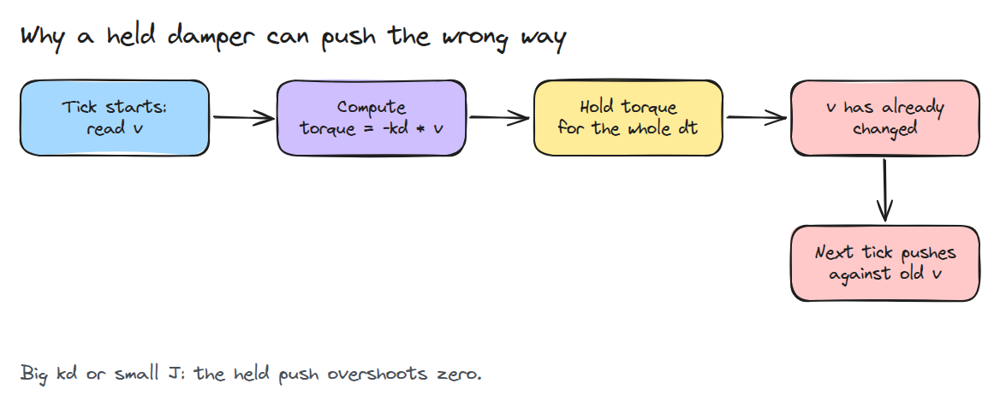
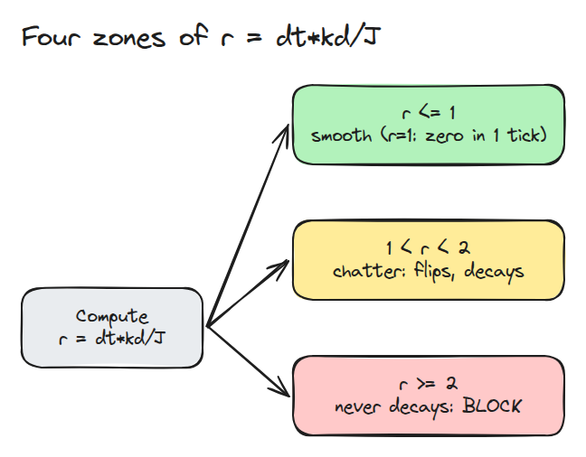
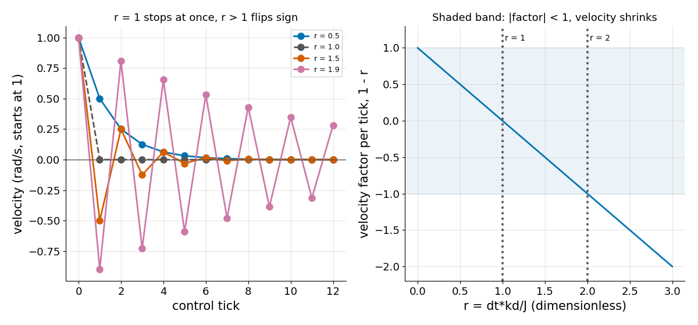

# The Sampling Limit

> A damper that is correct in continuous time can still be unstable once the controller holds its command for one tick.

**Type:** Build   **Prerequisites:** none   **Time:** ~15 minutes

## In Plain Words

A friend tries to stop a sliding puck by checking its motion, then pushing against it until the next check. If
the push lasts past the moment the puck stops, it sends the puck back the other way.

A sampled damper can do the same to a joint. It holds torque based on an earlier velocity. Stronger damping, a
longer hold, or smaller inertia makes reversal more likely. Push too hard for too long and the speed grows
with each reversal instead of fading.

## The Problem

You raise a damping gain `kd` so a joint stops oscillating, and the joint starts buzzing instead. The gain looked mild. The host computes a torque once per control period and holds it, so the damper pushes against a velocity that is already one tick old.

## The Concept



*The torque is computed from the velocity at the start of the tick, but it acts for the whole tick.*

For a pure inertia `J` with torque `-kd * v` held for `dt`, one tick gives `v+ = v * (1 - r)` with `r = dt * kd / J`. The factor `1 - r` decides everything.



*Below 1 the velocity shrinks smoothly. At exactly 1 it reaches zero in one tick. Between 1 and 2 it flips sign but still shrinks. From 2 up it never decays.*



*Left: velocity for four values of `r`. Right: the factor `1 - r` crosses 0 at `r = 1` and -1 at `r = 2`.*

`J` is in the ratio, so the joint with the smallest effective inertia, often a wrist, crosses the line first at a gain that feels mild on the shoulder.

## Build It

```python
def step_damper(v, J, kd, dt):
    return v * (1.0 - dt * kd / J)

def classify(J, kd, dt):
    r = dt * kd / J
    return "smooth" if r <= 1 else "chatter" if r < 2 else "divergent"
```

Tests cover both sides of each boundary with `J = 0.02` and `dt = 0.001`, where the limits are `kd = 20` and `kd = 40`. One test checks `r = 1` exactly: velocity is zero after one tick with no sign flip.

```bash
cd robotics-engineering-from-scratch
python3 -m pytest phases/03-dynamics-and-control/01-the-sampling-limit -q
python3 phases/03-dynamics-and-control/01-the-sampling-limit/code/figure.py
```

## Use It

Many drives run an inner loop at a much higher rate, which removes the limit from the host loop. When damping must stay on the host, lower `kd`, raise the loop rate, or gate gains with the inertia of the lowest-inertia pose.

## Ship It

`outputs/skill-sampling-limit-check.md` computes `r` for every damped joint in a gain file.

## Exercises

1. Add a spring term and find the stable region in the `(kp, kd)` plane by simulation.
2. Add one tick of delay to the held command. Where do the limits move?
3. Estimate the effective inertia of a two-link wrist from lesson 03/02.
