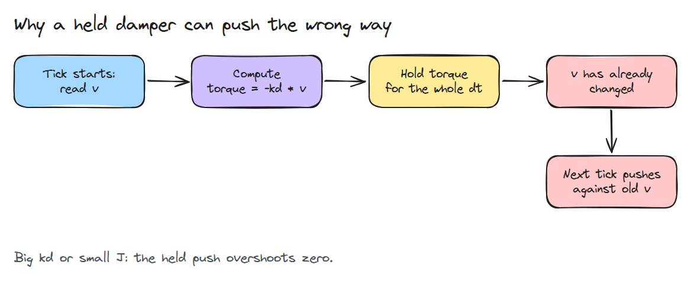
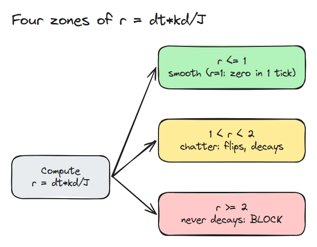
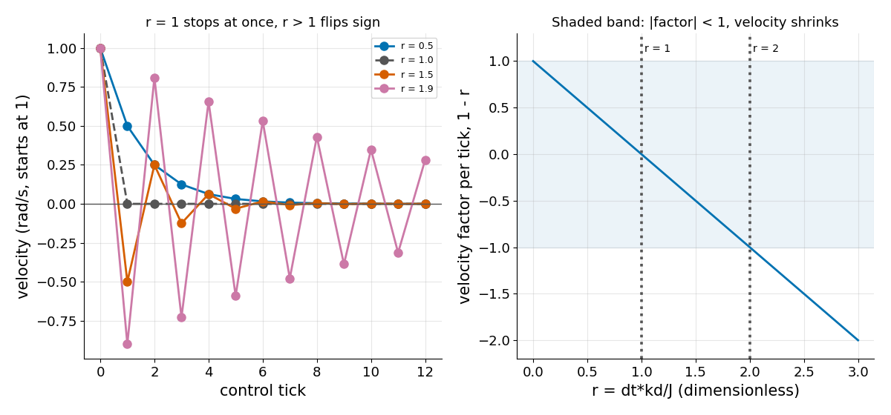

# The Sampling Limit

> Learn why a brake that works on paper can make a robot joint buzz, and how to tell in advance.

**Type:** Build   **Prerequisites:** none   **Time:** ~15 minutes

## In Plain Words

Picture a bench arm swinging at the elbow, with a motor that brakes the swing. The controller reads the speed once, then pushes against it with a steady force until its next reading.

A gentle push slows the arm. A strong push, a light arm or a long wait lets the push outlast the stop and shove the arm back, faster than before.

## Key Terms

- **Damper**: a brake that pushes against speed with a torque proportional to it.
- **Damping gain (`kd`)**: how strongly the damper brakes.
- **Tick (`dt`)**: one control step, the time between two controller readings.
- **Inertia (`J`)**: how hard a joint is to speed up or slow down.
- **Host**: the computer that runs the controller loop.
- **Torque**: the twisting force a motor applies to a joint.

## The Problem

A robot joint shakes, so you turn up the brake, and now it buzzes. The controller reads the speed once per step and holds its push, so the brake keeps pushing against a speed that is already one step old.

## The Concept

A controller acts in steps, and that delay can turn a brake into a shove.



*The push uses the speed from the start of the step.*

The key number is how much of the speed one step of braking removes. Below one, the speed shrinks smoothly. Between one and two it flips sign each step but still shrinks, which is the buzzing. Above two it grows.



*Three zones: smooth, buzzing, blowing up.*



*In the buzzing zone the sign flips but the swings shrink.*


*Same brake: the light arm buzzes, the heavy one glides.*

<details><summary>The math (optional)</summary>

Hold the torque `-kd * v` for one tick `dt` on inertia `J`: `v+ = v * (1 - r)` with `r = dt * kd / J`. Smooth for `r <= 1` (exactly 1 gives zero speed), chatter for `1 < r < 2`, divergent above 2. With `J = 0.02`, `dt = 0.001`, `kd = 30`: `r = 1.5`, speeds 1, -0.5, 0.25. Tripling `J` gives `r = 0.5`: 1, 0.5, 0.25. At that `J` and `dt` the limits are `kd = 20` and `40`.

</details>

## Build It

`step_damper` applies one step of braking, and `classify` says smooth, chatter or divergent.

```python
def step_damper(v, J, kd, dt):
    return v * (1.0 - dt * kd / J)

def classify(J, kd, dt):
    r = dt * kd / J
    return "smooth" if r <= 1 else "chatter" if r < 2 else "divergent"
```

Tests check both sides of each boundary.

```bash
cd robotics-engineering-from-scratch
python3 -m pytest phases/03-dynamics-and-control/01-the-sampling-limit -q
python3 phases/03-dynamics-and-control/01-the-sampling-limit/code/figure.py
```

## Use It

Many drives run an inner loop much faster, which removes the limit. Otherwise lower `kd`, raise the loop rate, or cap gains using the lightest pose.

## Ship It

`outputs/skill-sampling-limit-check.md` computes `r` for every damped joint in a gain file.

## Exercises

1. Change `kd` until `classify` says chatter, then divergent.
2. Make the joint heavier and see the limits move.
3. Add one step of delay and see where the limits go.
