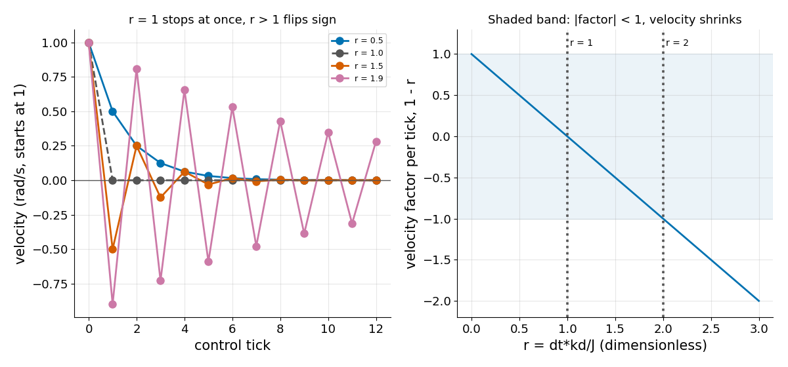
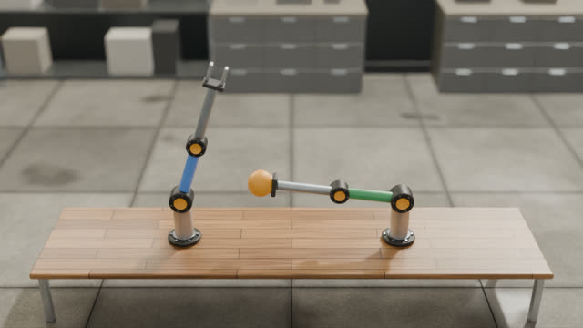

# 샘플링 한계 (The Sampling Limit)

> 종이 위에서는 잘 되는 브레이크가 왜 로봇 관절을 윙윙거리게 하는지, 그리고 그것을 미리 알아내는 방법을 배웁니다.

**유형:** 만들기   **선수 지식:** 없음   **시간:** 약 15분

## 쉽게 말하면

작은 로봇 팔이 팔꿈치에서 흔들리고 모터가 브레이크를 건다고 해 보세요. 컨트롤러(팔을 움직이는 프로그램)는 속도를 한 번 읽고 다음에 읽을 때까지 그 속도의 반대쪽으로 같은 힘을 계속 줘요.

힘이 약하면 팔이 서서히 멈춰요. 힘이 세거나 팔이 가볍거나 다음에 읽을 때까지 오래 기다리면 팔이 멈춘 뒤에도 힘이 이어져서 팔을 반대쪽으로 밀어 버려요.

## 핵심 용어

- **Torque**: 모터가 관절을 돌리는 힘입니다.
- **Damper**: 속도에 비례하는 torque로 속도를 거슬러 미는 브레이크입니다.
- **Damping gain (`kd`)**: damper가 얼마나 세게 브레이크를 거는지입니다.
- **Tick (`dt`)**: 제어 한 단계로 00/06의 time step과 같습니다.
- **Inertia (`J`)**: 관절의 속도를 올리거나 줄이기가 얼마나 어려운지입니다.
- **Host**: 컨트롤러 loop를 돌리는 컴퓨터입니다.

## 문제

로봇 관절이 흔들려서 브레이크를 올렸더니 이번에는 관절이 윙윙거립니다. 컨트롤러는 한 단계에 한 번 속도를 읽고 그 힘을 그대로 유지하므로 브레이크는 이미 한 단계 지난 속도를 거슬러 계속 힘을 냅니다.

## 개념

컨트롤러는 한 단계씩 움직이고 그 지연 때문에 브레이크가 오히려 팔을 미는 힘이 될 수 있습니다.


*힘은 단계가 시작될 때의 속도로 정해집니다.*

핵심 숫자 `r`은 브레이크 한 단계가 속도를 얼마나 덜어 내느냐입니다. 1보다 작으면 속도가 부드럽게 줄어듭니다. 1과 2 사이에서는 단계마다 부호가 뒤집히지만 여전히 줄어듭니다. 이것이 윙윙거림입니다. 2를 넘으면 속도가 계속 커집니다.


*세 구간은 부드러움, 윙윙거림, 폭주입니다.*



*윙윙거리는 구간에서는 부호가 뒤집히지만 흔들림은 줄어듭니다.*

[](../assets/clip-example.mp4)

*같은 브레이크에서 가벼운 팔은 윙윙거리고 무거운 팔은 미끄러지듯 멈춥니다.*

<details><summary>The math (optional)</summary>

여기서 `J`는 Jacobian이 아니라 관성입니다. 토크 `-kd * v`를 tick 하나 `dt` 동안 관성 `J`에 그대로 걸면 `v+ = v * (1 - r)`이고 `r = dt * kd / J`입니다.
`r <= 1`이면 부드럽고(정확히 1이면 속도 0) `1 < r < 2`이면 chatter이며 2를 넘으면 발산합니다.
`J = 0.02`, `dt = 0.001`, `kd = 30`이면 `r = 1.5`이고 속도는 1, -0.5, 0.25입니다. `J`를 세 배로 하면 `r = 0.5`이고 1, 0.5, 0.25입니다. 이 `J`와 `dt`에서 한계는 `kd = 20`과 `40`입니다.

</details>

## 만들기

`step_damper`는 브레이크 한 단계를 적용하고 `classify`는 부드러움, chatter(윙윙거림), 발산(폭주) 중 무엇인지 알려 줍니다.

```python
def step_damper(v, J, kd, dt):
    return v * (1.0 - dt * kd / J)

def classify(J, kd, dt):
    r = dt * kd / J
    return "smooth" if r <= 1 else "chatter" if r < 2 else "divergent"
```

테스트는 각 경계의 양쪽을 확인합니다.

```bash
cd robotics-engineering-from-scratch
python3 -m pytest phases/03-dynamics-and-control/01-the-sampling-limit -q
python3 phases/03-dynamics-and-control/01-the-sampling-limit/code/figure.py
```

## 실제 도구로 보기

많은 모터 컨트롤러는 안쪽에서 훨씬 빠른 loop를 하나 더 돌립니다. 그 loop에서 damping을 계산하면 한계가 올라가므로 그 loop의 주기로 `r`을 다시 계산합니다. 그렇지 않으면 `kd`를 낮추거나 loop를 더 빠르게 돌리거나 가장 가벼운 자세로 `kd`의 상한을 정하세요.

## 결과물

`outputs/skill-sampling-limit-check.md`는 설정 파일의 damping이 걸린 모든 관절에 대해 `r`을 계산합니다.

## 연습 문제

1. `classify`가 chatter, 그다음 발산이라고 할 때까지 `kd`를 바꿔 보세요.
2. 관절을 더 무겁게 하고 한계가 어떻게 달라지는지 보세요.
3. 한 단계 지연을 넣고 한계가 어디로 가는지 보세요.
