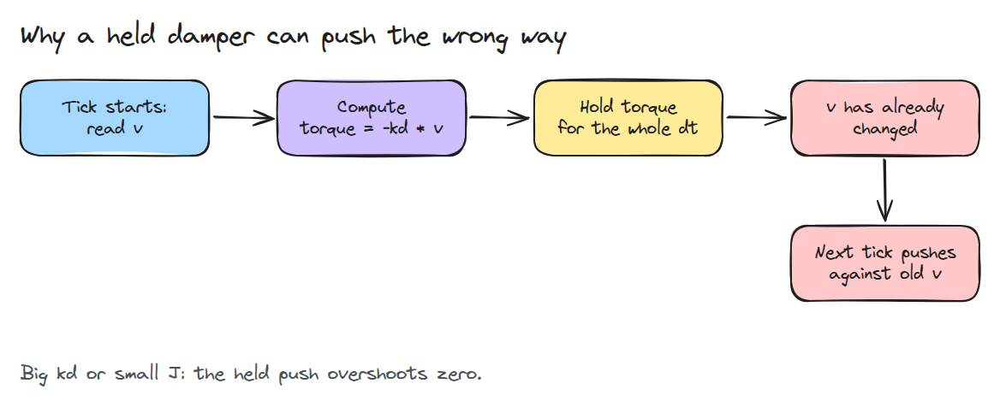
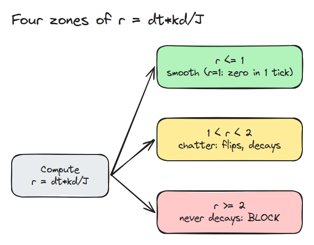

# 샘플링 한계 (The Sampling Limit)

> 종이 위에서는 잘 되는 브레이크가 왜 로봇 관절을 윙윙거리게 하는지, 그리고 미리 아는 법을 알게 됩니다.

**유형:** 만들기   **선수 지식:** 없음   **시간:** 약 15분

## 쉽게 말하면

책상 위 로봇 팔이 팔꿈치에서 흔들리고 모터가 그 흔들림에 브레이크를 건다고 해 보세요. 컨트롤러는 속도를 한 번 읽고 다음에 읽을 때까지 그 속도의 반대쪽으로 같은 힘을 계속 줘요.

힘이 약하면 팔이 서서히 멈춰요. 힘이 세거나 팔이 가볍거나 다음에 읽을 때까지 오래 기다리면 팔이 멈춘 뒤에도 힘이 이어져서 팔을 이전보다 더 빠르게 반대쪽으로 밀어 버려요.

## 핵심 용어

- **Damper**: 속도에 비례하는 torque로 속도를 거슬러 미는 브레이크입니다.
- **Damping gain (`kd`)**: damper가 얼마나 세게 브레이크를 거는지입니다.
- **Tick (`dt`)**: 제어 한 단계로 컨트롤러가 값을 읽는 간격입니다.
- **Inertia (`J`)**: 관절의 속도를 올리거나 줄이기가 얼마나 어려운지입니다.
- **Host**: 컨트롤러 loop를 돌리는 컴퓨터입니다.
- **Torque**: 모터가 관절을 돌리는 힘입니다.

## 문제

로봇 관절이 흔들려서 브레이크(damping gain `kd`)를 올렸더니 이번에는 관절이 윙윙거립니다.

host는 tick마다 torque를 한 번 계산해서 붙잡고 있으므로 damper는 이미 한 tick 지난 속도를 상대로 힘을 냅니다.

## 개념

실제 컨트롤러는 한 단계씩 움직이고 그 지연 때문에 도움이 되던 브레이크가 오히려 미는 힘이 될 수 있습니다.



*torque는 tick 시작 시점의 속도로 계산되지만 tick 내내 작용하므로 낡은 값입니다.*

순수 관성 `J`를 생각해 봅니다. torque `-kd * v`를 tick 하나 `dt` 동안 붙잡으면 속도가 `-dt * kd * v / J`만큼 바뀝니다. 그래서 한 tick 뒤의 속도는 `v+ = v * (1 - r)`이고 `r = dt * kd / J`입니다.



*1까지는 속도가 부드럽게 줄어듭니다(1이면 한 tick 만에 0). 1과 2 사이에서는 부호가 뒤집히지만 줄어듭니다. 2를 넘으면 커집니다.*


*왼쪽은 `r = 1.5`에서 부호는 뒤집히지만 흔들림이 줄어드는 모습입니다. 오른쪽은 `1 - r`이 `r = 1`에서 0을 지나는 모습입니다.*

예: `J = 0.02`, `dt = 0.001`, `kd = 30`이면 `r = 1.5`이므로 tick마다 속도에 `-0.5`가 곱해집니다(1, -0.5, 0.25). `J`를 세 배로 만들면 `r = 0.5`가 됩니다(1, 0.5, 0.25).


*같은 `kd = 30`입니다. 가벼운 파란 팔(`r = 1.5`)은 점점 줄어드는 걸음으로 덜컹거리고 무게를 단 초록 팔(`r = 0.5`)은 미끄러지듯 멈춥니다. 한 tick을 0.5초로 그렸습니다.*

## 만들기

```python
def step_damper(v, J, kd, dt):
    return v * (1.0 - dt * kd / J)

def classify(J, kd, dt):
    r = dt * kd / J
    return "smooth" if r <= 1 else "chatter" if r < 2 else "divergent"
```

테스트는 `J = 0.02`, `dt = 0.001`에서 각 경계의 양쪽을 확인합니다. 이때 한계는 `kd = 20`과 `kd = 40`입니다. 테스트 하나는 `r = 1`에서 속도가 0이 되고 부호가 뒤집히지 않는지 확인합니다.

```bash
cd robotics-engineering-from-scratch
python3 -m pytest phases/03-dynamics-and-control/01-the-sampling-limit -q
python3 phases/03-dynamics-and-control/01-the-sampling-limit/code/figure.py
```

## 실제 도구로 보기

많은 드라이브는 훨씬 빠른 내부 loop를 돌리므로 host loop의 한계가 사라집니다. damping을 host에 두어야 한다면 `kd`를 낮추거나 loop 주기를 올리거나 관성이 가장 작은 자세의 값으로 gain의 상한을 정하세요.

## 결과물

`outputs/skill-sampling-limit-check.md`는 gain 파일의 damping이 걸린 모든 관절에 대해 `r`을 계산합니다.

## 연습 문제

1. 스프링 항을 넣고 `(kp, kd)` 평면에서 안정 영역을 시뮬레이션으로 찾으세요.
2. 붙잡힌 명령에 한 tick 지연을 넣으세요. 한계는 어디로 움직입니까?
3. 레슨 03/02를 이용해 2링크 손목의 유효 관성을 추정하세요.
