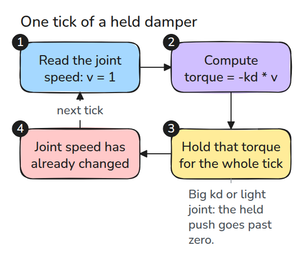
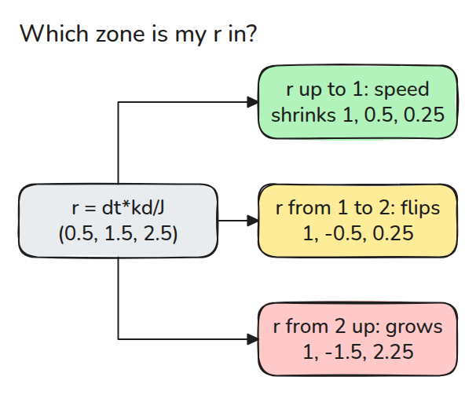
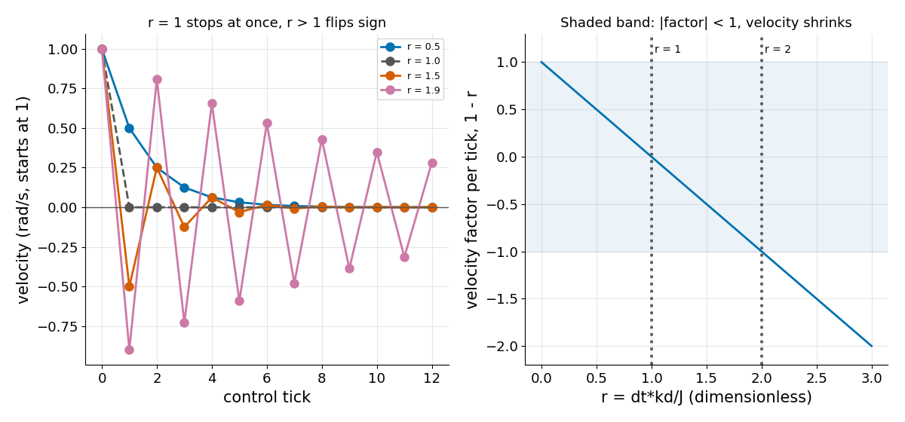

# 샘플링 한계 (The Sampling Limit)

> 연속 시간에서는 맞는 damper(속도에 브레이크를 거는 장치)도 컨트롤러가 명령을 한 tick(제어 한 단계) 동안 붙잡고 있으면 불안정해질 수 있습니다.

**유형:** 만들기   **선수 지식:** 없음   **시간:** 약 15분

## 쉽게 말하면

책상 위 로봇 팔이 팔꿈치에서 흔들리고 모터가 그 흔들림에 브레이크를 건다고 해 보세요. 컨트롤러는 흔들리는 속도를 한 번 보고 다음에 볼 때까지 그 속도의 반대쪽으로 같은 힘을 계속 줘요.

힘이 약하면 팔이 서서히 멈춰요. 힘이 세거나 팔이 가볍거나 다음에 볼 때까지 오래 기다리면 팔이 멈춘 뒤에도 힘이 이어져서 팔을 반대쪽으로 밀어 버려요. 힘이 충분히 세면 이전보다 더 빠르게 밀려서 흔들릴 때마다 점점 커져요.

## 문제

관절이 흔들리지 않게 하려고 damping gain `kd`(브레이크의 세기)를 올렸더니 이번에는 관절이 윙윙거립니다. gain은 무난해 보였습니다.

host(제어 컴퓨터)는 제어 한 단계인 tick마다 토크(모터가 관절을 돌리는 힘)를 한 번 계산해서 붙잡고 있으므로 damper는 이미 한 tick 지난 속도를 상대로 힘을 냅니다.

## 개념



*번호를 따라가 보세요. 토크는 tick 시작 시점의 속도로 계산되지만 tick 내내 작용하므로 빨간 상자에 이르면 이미 낡은 값입니다.*

순수 관성 `J`(관절의 속도를 올리거나 줄이기가 얼마나 어려운지를 나타냅니다)를 생각해 봅니다. 토크 `-kd * v`를 tick 길이 `dt` 동안 붙잡고 있으면 토크는 관성 곱하기 가속도이므로 속도가 `-dt * kd * v / J`만큼 바뀝니다. 그래서 한 tick 뒤의 속도는 `v+ = v * (1 - r)`이고 `r = dt * kd / J`입니다.



*1까지는 속도가 부드럽게 줄어듭니다(정확히 1이면 한 tick 만에 0). 1과 2 사이에서는 부호가 뒤집히지만 여전히 줄어듭니다. 정확히 2이면 크기가 그대로이고 2를 넘으면 커집니다.*



*왼쪽에서 `r = 1.5`를 보세요. 부호는 뒤집히지만 흔들림은 줄어듭니다. 오른쪽은 `1 - r`이 `r = 1`에서 0을, `r = 2`에서 -1을 지나는 모습입니다.*

비율 안에 `J`가 들어 있으므로 가장 가벼운 관절(대개 손목)이 어깨에서는 무난하게 느껴지는 gain에서 먼저 `r = 1` 선을 넘습니다.

예: `J = 0.02`, `dt = 0.001`, `kd = 30`이면 `r = 1.5`이므로 tick마다 속도에 `-0.5`가 곱해집니다(1, -0.5, 0.25). `J`를 세 배로 만드는 무게를 달면 `r = 0.5`가 됩니다(1, 0.5, 0.25).


*같은 `kd = 30`입니다. 파란 팔을 보세요. 가벼워서(`r = 1.5`) 점점 줄어드는 걸음으로 앞뒤로 덜컹거립니다. 초록 팔은 무게를 달고 있어서(`r = 0.5`) 미끄러지듯 멈춥니다. 한 tick을 3분의 1초로 그렸습니다.*

## 만들기

```python
def step_damper(v, J, kd, dt):
    return v * (1.0 - dt * kd / J)

def classify(J, kd, dt):
    r = dt * kd / J
    return "smooth" if r <= 1 else "chatter" if r < 2 else "divergent"
```

테스트는 `J = 0.02`, `dt = 0.001`에서 각 경계의 양쪽을 확인합니다. 이때 한계는 `kd = 20`과 `kd = 40`입니다. 테스트 하나는 `r = 1`을 정확히 확인합니다. 속도는 한 tick 뒤 0이 되고 부호는 뒤집히지 않습니다.

```bash
cd robotics-engineering-from-scratch
python3 -m pytest phases/03-dynamics-and-control/01-the-sampling-limit -q
python3 phases/03-dynamics-and-control/01-the-sampling-limit/code/figure.py
```

## 실제 도구로 보기

많은 드라이브는 훨씬 빠른 내부 loop(모터 드라이브 안에서 도는 더 빠른 loop)를 돌리므로 host loop의 한계가 사라집니다. damping을 host에 두어야 한다면 `kd`를 낮추거나 loop 주기를 올리거나, 관성이 가장 작은 자세의 값으로 gain의 상한을 정해야 합니다.

## 결과물

`outputs/skill-sampling-limit-check.md`는 gain 파일의 damping이 걸린 모든 관절에 대해 `r`을 계산합니다.

## 연습 문제

1. 스프링 항을 넣고 `(kp, kd)` 평면에서 안정 영역을 시뮬레이션으로 찾으세요.
2. 붙잡힌 명령에 한 tick 지연을 넣으세요. 한계는 어디로 움직입니까?
3. 레슨 03/02를 이용해 2링크 손목의 유효 관성을 추정하세요.
