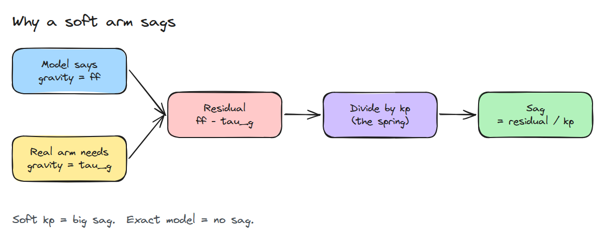
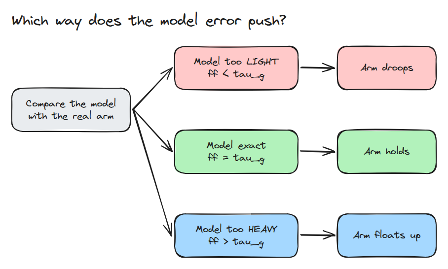
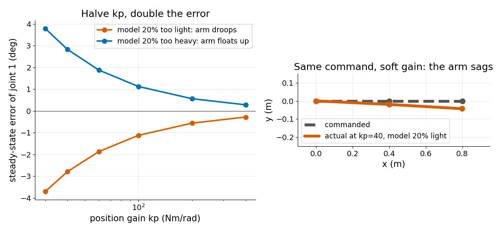

# Gravity Compensation

> A position loop pays for every error in your gravity model, and the bill is the residual divided by kp.

**Type:** Build   **Prerequisites:** 01/02 Forward Kinematics   **Time:** ~15 minutes

## The Problem

You lower the position gain `kp` to soften an arm so a person can push it. The arm now sags below its commanded pose, or floats above it, and the softer you go the worse it gets. Gravity compensation, a feedforward torque that cancels gravity, was supposed to prevent exactly this.

## The Concept



*The model's feedforward and the real gravity torque disagree by a residual. The position spring turns that residual into a visible error.*

At rest the torques balance: `kp * (q_des - q) + ff = tau_g(q)`. To first order the error is `(ff - tau_g) / kp`. The sign of the model error decides the direction.



*A light model droops, an exact model holds, a heavy model floats up.*



*Left: halving kp doubles the error, in both directions. Right: the same command at a soft kp leaves the arm below the commanded line.*

## Build It

Gravity torque of a planar two-link arm, angles from the horizontal.

```python
t2 = m2*lc2*g*np.cos(q1+q2)
t1 = (m1*lc1 + m2*l1)*g*np.cos(q1) + t2
```

`steady_state()` solves the balance equation and raises if no equilibrium exists, which happens when `kp` is below the gravity gradient. `sag()` returns `q - q_des`.

```bash
cd robotics-engineering-from-scratch
python3 -m pytest phases/03-dynamics-and-control/02-gravity-compensation -q
python3 phases/03-dynamics-and-control/02-gravity-compensation/code/figure.py
```

## Use It

Real arms take `tau_g` from a rigid-body model such as the bias force at zero velocity in MuJoCo. CAD inertias are often wrong, so measure sag at two poses and fit a scale. Droop means the model is too light.

## Ship It

`outputs/skill-gravity-comp-check.md` turns a measured sag into a model-error estimate.

## Exercises

1. Add a third joint and check that the horizontal pose is still the worst case.
2. Fit one mass scale from sag at `kp = 100` and predict the sag at `kp = 50`.
3. Show that the first-order estimate degrades when `kp` is close to the gravity gradient.
