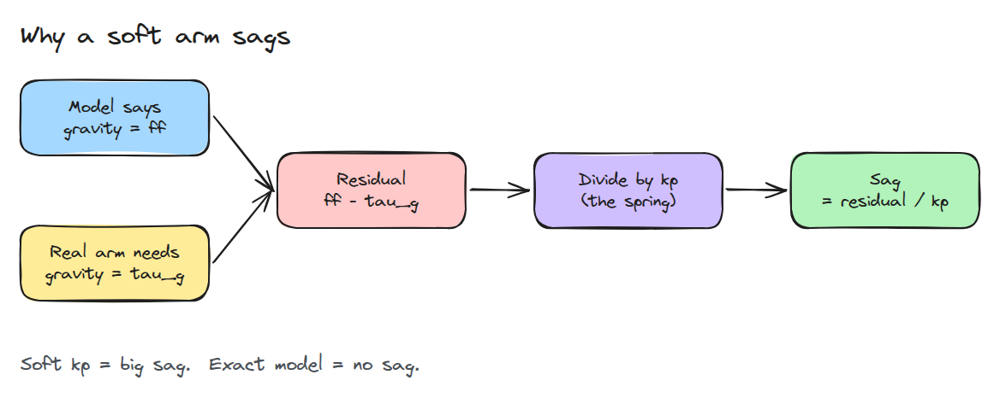
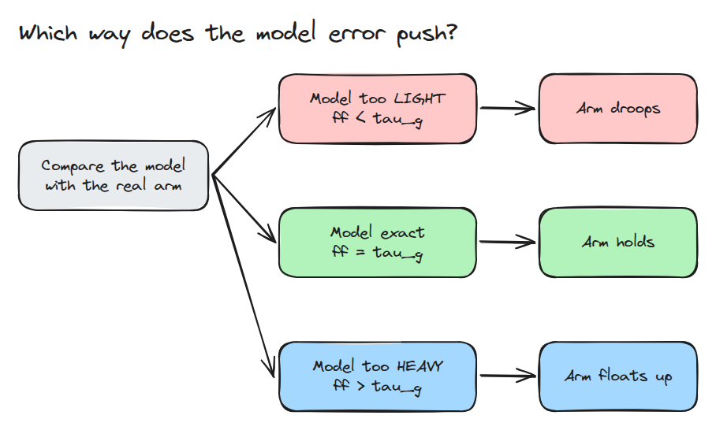
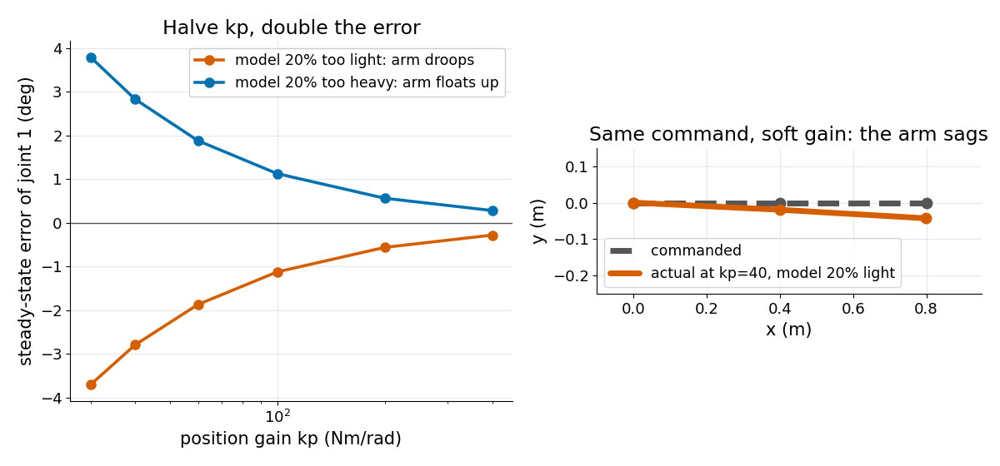

# Gravity Compensation

> Learn why a soft robot arm sags, and how the error in your weight guess decides how far.

**Type:** Build   **Prerequisites:** 01/02 Forward Kinematics   **Time:** ~15 minutes

## In Plain Words

A bench arm holding its hand out needs motor torque to carry its own weight. Gravity compensation is the motor's advance guess of that weight.

If the guess is too low the hand sags; too high, it rises. The position controller pushes back with gain kp per unit of error, so a lower kp lets the same mistake move the hand farther.

## Key Terms

- **Gravity compensation**: adding a model's estimate of the arm's weight as torque in advance.
- **Position gain (`kp`)**: how hard the motor pushes the arm back per radian of error.
- **Feedforward (`ff`)**: torque added in advance from a model, before any error appears.
- **Residual**: the model's error, the gap between `ff` and the torque gravity really needs.
- **Sag**: how far the arm ends up below (or above) its commanded angle.
- **Torque**: the twisting force a motor applies to a joint.

## The Problem

You soften a robot arm so a person can push it, by lowering the position gain `kp`. Now the arm sags below the pose you commanded, or floats above it.

## The Concept

A robot arm must hold up its own weight, and a wrong guess shows up as sag. The controller adds a guess of the weight in advance, and whatever the guess misses is left to the position spring. A soft spring covers it poorly.



*The gap between guess and real weight is left to the spring.*



*Light guess droops, exact guess holds, heavy guess floats up.*


*Same soft spring: the left arm droops, the right floats.*



*Halving the spring strength doubles the error.*

<details><summary>The math (optional)</summary>

At rest `kp * (q_des - q) + ff = tau_g(q)`, so the sag is `(ff - tau_g) / kp` to first order. The lesson's two-link arm (2 kg, 1 kg, links 0.4 m) held straight out with `kp = 30` needs 9.81 Nm at the shoulder. A model 20% too light misses 1.96 Nm and droops `1.96 / 30 = 0.065` rad, about 3.7 degrees; 20% too heavy floats it up about 3.7 degrees (exact solve: 3.70 and 3.79). The clip draws sag 6 times larger.

</details>

## Build It

The code computes the gravity torque of a two-link arm.

```python
t2 = m2*lc2*g*np.cos(q1+q2)
t1 = (m1*lc1 + m2*l1)*g*np.cos(q1) + t2
```

`steady_state()` finds where the arm settles and complains if no balance exists, and `sag()` returns the difference from the commanded angle.

```bash
cd robotics-engineering-from-scratch
python3 -m pytest phases/03-dynamics-and-control/02-gravity-compensation -q
python3 phases/03-dynamics-and-control/02-gravity-compensation/code/figure.py
```

## Use It

Real arms get the weight torque from a physics model, for example MuJoCo's bias force at zero velocity. Model weights are often wrong, so measure the sag at two poses and fit a correction.

## Ship It

`outputs/skill-gravity-comp-check.md` turns a measured sag into a model-error estimate.

## Exercises

1. Make the model 20% too light, then too heavy, and compare the sag.
2. Halve the spring strength and watch the sag double.
3. Add a third joint and check the stretched pose is still the worst.
