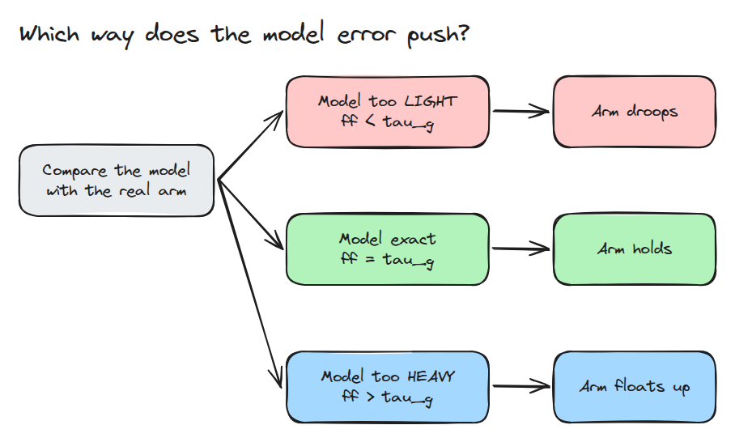

# 중력 보상 (Gravity Compensation)

> 부드럽게 만든 로봇 팔이 왜 처지는지, 그리고 무게 어림의 오차가 처짐을 얼마나 정하는지 알게 됩니다.

**유형:** 만들기   **선수 지식:** 01/02 순기구학   **시간:** 약 15분

## 쉽게 말하면

책상 위 로봇 팔이 손을 뻗고 있으면 자기 무게를 버티는 모터 torque가 필요해요. gravity compensation은 그 무게를 모터가 미리 어림해서 더해 주는 일이에요.

어림이 너무 낮으면 손이 처지고 너무 높으면 손이 올라가요. position controller는 오차 한 단위당 kp만큼 되밀어서 kp가 낮으면 같은 오차에도 손이 더 멀리 움직여요.

## 핵심 용어

- **Gravity compensation**: 팔의 무게를 모델로 어림해서 torque로 미리 더해 주는 것입니다.
- **Position gain (`kp`)**: 각도 오차 1 rad당 모터가 팔을 얼마나 세게 되돌리는지입니다.
- **Feedforward (`ff`)**: 오차가 생기기 전에 모델로 미리 더하는 torque입니다.
- **Residual**: 모델의 오차로 `ff`와 중력이 실제로 필요로 하는 torque의 차이입니다.
- **Sag**: 팔이 명령한 각도보다 얼마나 아래(또는 위)에 머무는지입니다.
- **Torque**: 모터가 관절을 돌리는 힘입니다.

## 문제

사람이 로봇 팔을 밀 수 있게 position gain `kp`를 낮춰서 부드럽게 만듭니다. 그러면 팔이 명령한 자세보다 아래로 처지거나 위로 뜹니다.

gravity compensation이 바로 이것을 막아 주어야 했습니다.

## 개념

로봇 팔은 자기 무게를 버텨야 하고 그 무게를 잘못 어림하면 처짐으로 나타납니다.


*`ff`는 모델이 넣어 주는 feedforward torque이고 `tau_g`는 중력이 실제로 필요로 하는 torque입니다. 둘의 차이인 잔차는 position 스프링이 떠안습니다.*

정지 상태에서는 torque가 균형을 이룹니다. 식은 `kp * (q_des - q) + ff = tau_g(q)`이고 각도 오차에 `kp`를 곱한 힘은 스프링처럼 작용합니다.

식을 정리하면 처짐 `q - q_des`는 1차 근사(작은 오차에서의 근사)로 `(ff - tau_g) / kp`입니다.



*모델이 가벼우면 처지고 정확하면 버티고 무거우면 위로 뜹니다.*

예: 레슨의 2링크 팔(질량 2 kg과 1 kg, 링크 0.4 m)을 수평으로 뻗고 `kp = 30`으로 두면 어깨에서 9.81 Nm가 필요합니다(`gravity_torque`).

모델이 20% 가벼우면 `0.2 * 9.81 = 1.96` Nm가 모자라고 스프링은 `1.96 / 30 = 0.065` rad, 즉 약 3.7도 처집니다.

모델이 20% 무거우면 팔이 약 3.7도 위로 뜹니다(정확히 풀면 3.70도와 3.79도입니다).


*같은 `kp = 30`입니다. 호박색 공은 정확한 모델이 손끝을 붙들어 줄 자리이고 처짐은 6배로 크게 그렸습니다.*


*왼쪽은 kp를 절반으로 낮추면 오차가 두 배가 되는 모습이며 양쪽 방향 모두 같습니다. 오른쪽은 낮은 kp에서 팔이 명령선 아래에 남는 모습입니다.*

## 만들기

수평선에서 잰 각도를 쓰는 평면 2링크 팔의 중력 torque입니다.

```python
t2 = m2*lc2*g*np.cos(q1+q2)
t1 = (m1*lc1 + m2*l1)*g*np.cos(q1) + t2
```

`steady_state()`는 균형 방정식을 풀고 평형점이 없으면 예외를 냅니다. `kp`가 중력 gradient(각도에 따라 중력 torque가 커지는 정도)보다 낮을 때 그렇습니다. `sag()`는 `q - q_des`를 돌려줍니다.

```bash
cd robotics-engineering-from-scratch
python3 -m pytest phases/03-dynamics-and-control/02-gravity-compensation -q
python3 phases/03-dynamics-and-control/02-gravity-compensation/code/figure.py
```

## 실제 도구로 보기

실제 팔은 MuJoCo의 속도 0 bias force 같은 rigid-body 모델에서 `tau_g`를 가져옵니다. CAD 관성값은 자주 틀리므로 자세 두 곳에서 처짐을 재서 배율을 맞춥니다. 처지면 모델이 너무 가벼운 것입니다.

## 결과물

`outputs/skill-gravity-comp-check.md`는 잰 처짐을 모델 오차 추정값으로 바꿔 줍니다.

## 연습 문제

1. 관절을 하나 더 넣고 수평 자세가 여전히 최악인지 확인하세요.
2. `kp = 100`에서 잰 처짐으로 질량 배율 하나를 맞추고 `kp = 50`의 처짐을 예측하세요.
3. `kp`가 중력 gradient에 가까워지면 1차 근사가 나빠지는 것을 보이세요.
