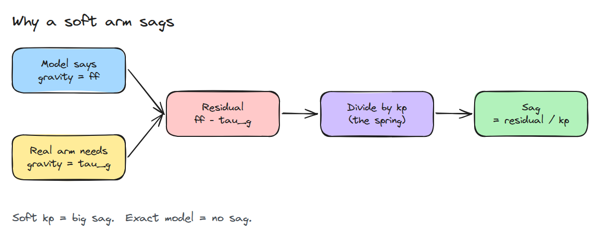
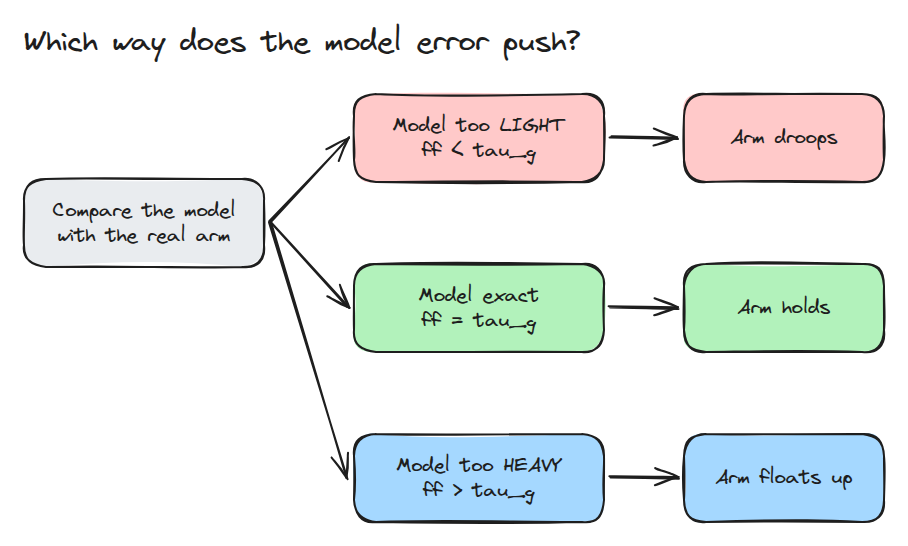
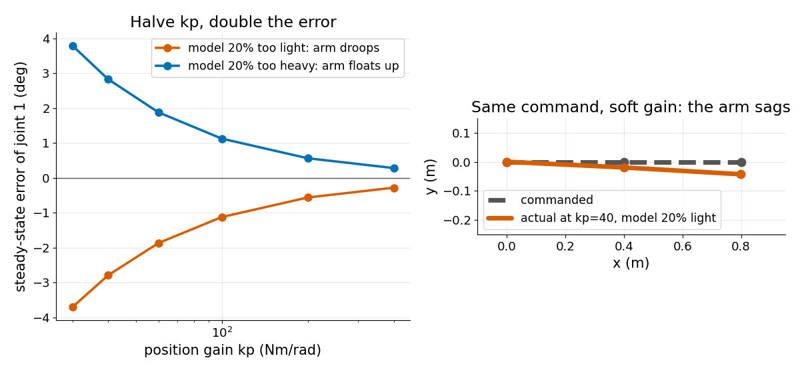

# 중력 보상 (Gravity Compensation)

> position loop는 중력 모델의 오차를 전부 떠안고 그 청구서는 잔차를 kp로 나눈 값입니다.

**유형:** 만들기   **선수 지식:** 01/02 순기구학   **시간:** 약 15분

## 문제

사람이 팔을 밀 수 있게 하려고 position gain `kp`를 낮춥니다. 그러면 팔이 명령한 자세보다 아래로 처지거나 위로 뜨고 부드럽게 만들수록 더 심해집니다. 중력을 상쇄하는 feedforward 토크(중력 보상)가 바로 이것을 막아 주어야 했습니다.

## 개념



*모델의 feedforward와 실제 중력 토크 사이에 잔차가 생깁니다. position 스프링이 그 잔차를 눈에 보이는 오차로 바꿉니다.*

정지 상태에서는 토크가 균형을 이룹니다. 식은 `kp * (q_des - q) + ff = tau_g(q)`입니다. 1차 근사로 오차는 `(ff - tau_g) / kp`이고 모델 오차의 부호가 방향을 정합니다.



*모델이 가벼우면 처지고 정확하면 버티고 무거우면 위로 뜹니다.*



*왼쪽은 kp를 절반으로 낮추면 오차가 두 배가 되는 모습으로, 양쪽 방향 모두 같습니다. 오른쪽은 같은 명령이 낮은 kp에서 팔을 명령선 아래에 남기는 모습입니다.*

## 만들기

수평선에서 잰 각도를 쓰는 평면 2링크 팔의 중력 토크입니다.

```python
t2 = m2*lc2*g*np.cos(q1+q2)
t1 = (m1*lc1 + m2*l1)*g*np.cos(q1) + t2
```

`steady_state()`는 균형 방정식을 풀고 평형점이 없으면 예외를 냅니다. `kp`가 중력 gradient보다 낮을 때 그렇습니다. `sag()`는 `q - q_des`를 돌려줍니다.

```bash
cd robotics-engineering-from-scratch
python3 -m pytest phases/03-dynamics-and-control/02-gravity-compensation -q
python3 phases/03-dynamics-and-control/02-gravity-compensation/code/figure.py
```

## 실제 도구로 보기

실제 팔은 MuJoCo의 속도 0 bias force 같은 rigid-body 모델에서 `tau_g`를 가져옵니다. CAD 관성값은 자주 틀리므로 자세 두 곳에서 처짐을 재서 배율을 맞춥니다. 처지면 모델이 너무 가벼운 것입니다.

## 결과물

`outputs/skill-gravity-comp-check.md`는 잰 처짐을 모델 오차 추정값으로 바꿔 줍니다.

## 연습 문제

1. 관절을 하나 더 넣고 수평 자세가 여전히 최악인지 확인하세요.
2. `kp = 100`에서 잰 처짐으로 질량 배율 하나를 맞추고 `kp = 50`의 처짐을 예측하세요.
3. `kp`가 중력 gradient에 가까워지면 1차 근사가 나빠지는 것을 보이세요.
