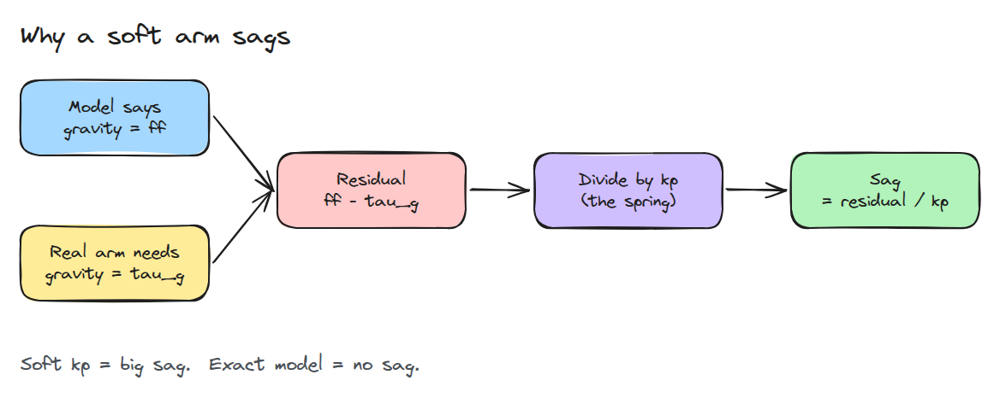
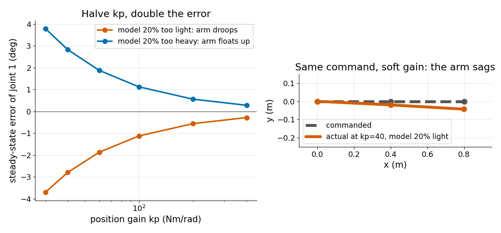

# 중력 보상 (Gravity Compensation)

> 부드럽게 만든 로봇 팔이 왜 처지는지, 그리고 무게 어림의 오차가 처짐을 얼마나 정하는지 알게 됩니다.

**유형:** 만들기   **선수 지식:** 01/02 순기구학   **시간:** 약 15분

## 쉽게 말하면

작은 로봇 팔이 손을 뻗고 있으면 자기 무게를 버티는 모터 torque가 필요해요. gravity compensation은 그 무게를 모터가 미리 어림해서 더해 주는 일이에요.

어림이 너무 낮으면 손이 처지고 너무 높으면 손이 올라가요. position controller는 팔을 목표 쪽으로 spring처럼 당기고 kp는 오차 한 단위당 당기는 힘이에요. kp가 낮으면 같은 틀린 어림에도 손이 더 멀리 움직여요.

## 핵심 용어

- **Torque**: 모터가 관절을 돌리는 힘입니다.
- **Gravity compensation**: 팔의 무게를 모델로 어림해서 torque로 미리 더해 주는 것입니다.
- **Position gain (`kp`)**: 각도 오차 1 rad당 모터가 팔을 얼마나 세게 되돌리는지입니다.
- **Feedforward (`ff`)**: 오차가 생기기 전에 모델로 미리 더하는 torque입니다.
- **Residual**: 모델의 오차로 feedforward와 중력이 실제로 필요로 하는 torque의 차이입니다.
- **Sag**: 팔이 명령한 각도보다 얼마나 아래(또는 위)에 머무는지입니다.

## 문제

사람이 로봇 팔을 밀 수 있게 position gain `kp`를 낮춰서 부드럽게 만듭니다. 그러면 팔이 명령한 자세보다 아래로 처지거나 위로 뜹니다.

## 개념

로봇 팔은 자기 무게를 버텨야 하고 무게를 잘못 어림하면 처짐으로 나타납니다. 컨트롤러는 무게의 어림을 미리 더해 주고 어림이 놓친 만큼은 팔을 spring처럼 되당기는 position controller가 떠안습니다. 약한 spring은 그것을 제대로 감당하지 못합니다.

쭉 뻗은 팔이 가장 많이 처집니다.



*어림과 실제 무게의 차이는 스프링이 떠안습니다.*


*가벼운 어림은 처지고 정확한 어림은 버티고 무거운 어림은 뜹니다.*


*같은 낮은 kp에서 왼쪽 팔은 처지고 오른쪽 팔은 뜹니다.*



*kp를 절반으로 하면 오차가 두 배가 됩니다.*

<details><summary>The math (optional)</summary>

정지 상태에서는 `kp * (q_des - q) + ff = tau_g(q)`이므로 처짐은 1차 근사로 `(ff - tau_g) / kp`입니다. 레슨의 2링크 팔(2 kg과 1 kg, 링크 0.4 m)을 수평으로 뻗고 `kp = 30`으로 두면 어깨에서 9.81 Nm가 필요합니다.
모델이 20% 가벼우면 1.96 Nm가 모자라고 `1.96 / 30 = 0.065` rad, 약 3.7도 처집니다. 20% 무거우면 약 3.7도 뜹니다(정확히 풀면 3.70도와 3.79도입니다). 영상은 처짐을 6배로 크게 그렸습니다.

</details>

## 만들기

코드는 2링크 팔의 중력 torque를 계산합니다.

```python
t2 = m2*lc2*g*np.cos(q1+q2)
t1 = (m1*lc1 + m2*l1)*g*np.cos(q1) + t2
```

`steady_state()`는 팔이 멈추는 자리를 찾고 균형이 없으면 예외를 내며 `sag()`는 명령한 각도와의 차이를 돌려줍니다.

```bash
cd robotics-engineering-from-scratch
python3 -m pytest phases/03-dynamics-and-control/02-gravity-compensation -q
python3 phases/03-dynamics-and-control/02-gravity-compensation/code/figure.py
```

## 실제 도구로 보기

실제 팔은 물리 모델에서 무게 torque를 가져오고 MuJoCo는 한 자세의 중력 torque를 계산해 줍니다. 모델의 질량은 자주 틀리므로 자세 두 곳에서 처짐을 재서 모델을 고치세요.

## 결과물

`outputs/skill-gravity-comp-check.md`는 잰 처짐을 모델 오차 추정값으로 바꿔 줍니다.

## 연습 문제

1. 모델이 20% 가벼울 때와 무거울 때의 처짐을 비교하세요.
2. `kp`를 절반으로 하고 처짐이 두 배가 되는 것을 보세요.
3. 관절을 하나 더 넣고 쭉 뻗은 자세가 여전히 최악인지 확인하세요.
