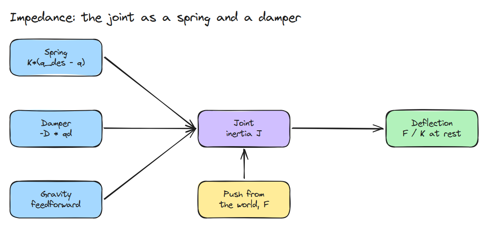
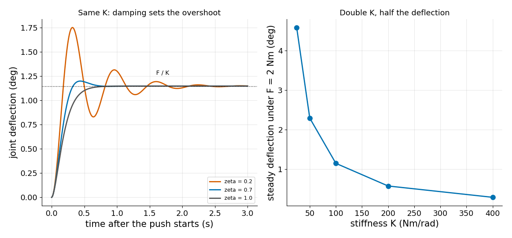

# Impedance Control

> Learn how to make a robot joint push back like a spring and damper, so a touch is gentle.

**Type:** Build   **Prerequisites:** 03/01 The Sampling Limit, 03/02 Gravity Compensation   **Time:** ~15 minutes

## In Plain Words

Push the hand of a bench arm with one finger. The motor makes the joint act like a spring with a damper, which resists motion. That behaviour is impedance.

A stiffer spring balances the same push with less movement. The damper does not change where the arm stops; it changes whether the arm rings or glides in.

## Key Terms

- **Impedance**: how a joint pushes back when pushed, like a spring plus a damper.
- **Stiffness (`K`)**: push back per unit of deflection.
- **Damping (`D`)**: resistance to speed.
- **Deflection**: how far a push moves the joint from its rest pose.
- **Damping ratio (`zeta`)**: how strongly the damper settles the joint; 1 glides in, below 1 rings.
- **Overshoot**: passing the final position before coming back.

## The Problem

A stiff robot arm fights every touch with full force. A robot handing you a cup should give a little when you take it, so a push moves the arm a small, known amount.

## The Concept

A robot near people must give way when touched, so we choose how hard each joint pushes back. The joint acts like a spring with a shock absorber: the farther you push, the harder it pushes back, and the absorber decides whether it rings or settles smoothly.



*The controller adds a spring and a damper; yellow is the outside push.*

A stiffer spring moves less for the same push. The absorber changes how the arm gets there, not where it stops.



*Three absorber strengths end at the same place.*


*Same push: the stiff arm moves half as far.*


*Pick stiffness, then damping, then check the step limit.*

<details><summary>The math (optional)</summary>

`tau = K (q_des - q) - D qd + tau_g`. A constant push `F` settles the joint at `F / K`. The damping ratio is `zeta = D / (2 sqrt(K J))`: no overshoot at 1, ringing below 1, overshoot `exp(-pi zeta / sqrt(1 - zeta^2))`, about 0.53 at 0.2. With `F = 2` Nm and `J = 1`: `K = 100` settles at 0.02 rad, `K = 200` at 0.01 rad, using `D` of 20 and 28.3. Choose `K = F_max / x_max`. The clip draws the push 15 times larger.

</details>

## Build It

The controller is one line, and a helper picks the damping for a chosen damping ratio.

```python
def impedance_torque(q, qd, q_des, K, D, tau_g):
    return K*(q_des - q) - D*qd + tau_g

def damping_for_zeta(K, J, zeta):
    return 2*zeta*np.sqrt(K*J)
```

`simulate()` pushes one joint with a constant torque. Tests check the push-in, that doubling the stiffness halves it, and that there is no overshoot at ratio one.

```bash
cd robotics-engineering-from-scratch
python3 -m pytest phases/03-dynamics-and-control/03-impedance-control -q
python3 phases/03-dynamics-and-control/03-impedance-control/code/figure.py
```

## Use It

Choose the spring from the largest push you expect and the largest push-in you accept.

## Ship It

`outputs/skill-impedance-check.md` checks a `K`, `D` choice against the deflection budget.

## Exercises

1. Double the stiffness and watch the push-in halve.
2. Try a damping ratio of 0.2 and of 1 and compare.
3. Add friction and find the new resting point.
