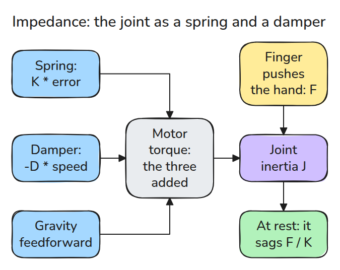
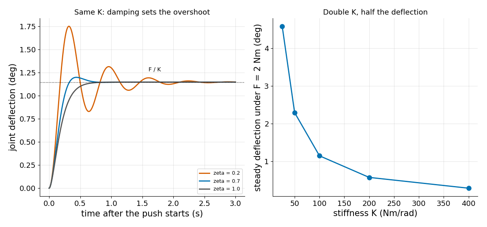
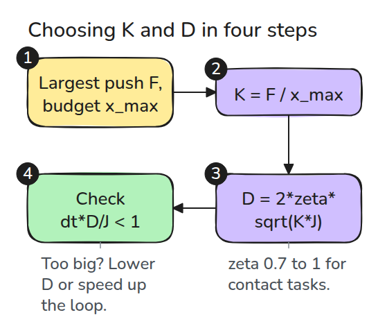

# Impedance Control

> Impedance control does not track a position. It decides how the joint pushes back.

**Type:** Build   **Prerequisites:** 03/01 The Sampling Limit, 03/02 Gravity Compensation   **Time:** ~15 minutes

## In Plain Words

Push the hand of a bench arm with one finger. The motor makes the joint act like a spring with a damper, a shock absorber that resists motion. That behaviour is called impedance. The farther you push the hand from its rest pose, the harder the spring pushes back.

A stiffer spring needs less movement to balance the same push. The damper does not change where the arm stops under a steady push. It changes how the arm settles: whether it rings back and forth or glides in.

## The Problem

A stiff position loop fights every touch with maximum force. A robot that hands over a cup needs the opposite: a chosen stiffness (push back per unit of deflection) and damping (resistance to speed). A push then causes a bounded deflection, the distance it moves the joint, instead of a fight.

## The Concept



*Blue boxes are what the controller adds. The yellow box is the outside push `F`.*

The law is `tau = K (q_des - q) - D qd + tau_g`, where `K` is the stiffness, `D` the damping, `q_des - q` how far the joint is from its rest pose, `qd` its speed and `tau_g` cancels gravity. With a constant push `F` the joint settles at `F / K`.

The damping ratio `zeta = D / (2 sqrt(K J))`, with `J` the joint's inertia, sets how it settles. Overshoot means passing the final position before coming back. At `zeta = 1` there is none, a glide. For `zeta < 1` the joint rings, and the overshoot fraction is `exp(-pi zeta / sqrt(1 - zeta^2))`, about 0.53 at `zeta = 0.2`.



*Left: three `zeta` values end at the same `F / K`, and only the overshoot differs. Right: doubling `K` halves the deflection.*

Example: `F = 2` Nm and `J = 1`. `K = 100` settles at `2 / 100 = 0.02` rad, and `K = 200` at 0.01 rad. Each uses `D = 2 sqrt(K J)` (20, 28.3) so that `zeta = 1`, and neither overshoots.


*Watch the amber balls, the resting deflections: the blue arm (`K = 100`) is pushed twice as far as the green arm (`K = 200`). Drawn 15 times larger, one-third speed.*



*`K` from the deflection budget (the most movement you accept), `D` from the damping ratio, then the sampling limit of lesson 03/01.*

## Build It

```python
def impedance_torque(q, qd, q_des, K, D, tau_g):
    return K*(q_des - q) - D*qd + tau_g

def damping_for_zeta(K, J, zeta):
    return 2*zeta*np.sqrt(K*J)
```

`simulate()` pushes a 1-DOF joint with a constant external torque using semi-implicit Euler. Tests check the deflection against `F / K`, that doubling `K` halves it, that `zeta = 1` never overshoots, and that `zeta = 0.2` matches the formula.

```bash
cd robotics-engineering-from-scratch
python3 -m pytest phases/03-dynamics-and-control/03-impedance-control -q
python3 phases/03-dynamics-and-control/03-impedance-control/code/figure.py
```

## Use It

Torque-controlled arms expose joint impedance as `K` and `D` per joint, sometimes with Cartesian impedance on top through the Jacobian transpose. To choose `K`, take the largest push you expect and the largest deflection you accept: `K = F_max / x_max`.

## Ship It

`outputs/skill-impedance-check.md` checks a `K`, `D` choice against a deflection budget and the sampling limit.

## Exercises

1. Add friction and find the new steady state under a small force.
2. Replace the constant force with a step that reverses. Compare the settling time for `zeta` of 0.7 and 1.
3. Use the sampling-limit check to find the largest `D` a 1 kHz loop allows for `J = 0.05`.
