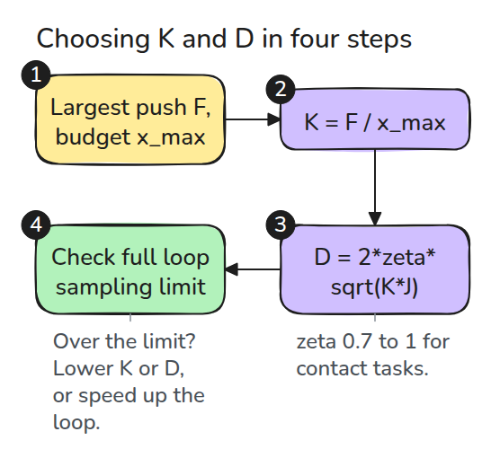

# Impedance Control

> Learn how to make a robot joint push back like a spring and damper, so a touch is gentle.

**Type:** Build   **Prerequisites:** 03/01 The Sampling Limit, 03/02 Gravity Compensation   **Time:** ~15 minutes

## In Plain Words

Push the hand of a bench arm with one finger. The motor makes the joint act like a spring with a damper, which resists motion. That behaviour is impedance.

A stiffer spring balances the same push with less movement. The damper does not change where the arm stops; it changes whether the arm rings or glides in.

## Key Terms

- **Impedance**: how a joint pushes back when pushed, like a spring plus a damper.
- **Stiffness (`K`)**: push back per unit of deflection.
- **Damping (`D`)**: resistance to speed.
- **Deflection**: how far a push moves the joint from its rest pose.
- **Damping ratio (`zeta`)**: how strongly the damper settles the joint; 1 glides in, below 1 rings.
- **Overshoot**: passing the final position before coming back.

## The Problem

A stiff robot arm fights every touch with full force. A robot handing over a cup needs a chosen stiffness and damping, so a push causes a bounded deflection instead of a fight.

## The Concept

A robot near people must give way when touched, so we choose how hard each joint pushes back.


*Blue: the controller. Yellow: the outside push `F`.*

The law is `tau = K (q_des - q) - D qd + tau_g` (`qd` speed, `tau_g` cancels gravity). A constant push `F` settles the joint at `F / K`.

The damping ratio `zeta = D / (2 sqrt(K J))` (`J` is inertia) sets how it settles: no overshoot at `zeta = 1`; below 1 it rings, with overshoot fraction `exp(-pi zeta / sqrt(1 - zeta^2))`, about 0.53 at `zeta = 0.2`.


*Left: all three `zeta` end at `F / K`; only overshoot differs. Right: doubling `K` halves the deflection.*

Example: `F = 2` Nm and `J = 1`. `K = 100` settles at `2 / 100 = 0.02` rad, and `K = 200` at 0.01 rad. Both use `zeta = 1` (`D` = 20, 28.3).


*Amber balls: resting points. Blue (`K = 100`) is pushed twice as far as green (`K = 200`). Drawn 15 times larger.*



*Choose `K`, then `D`, then check lesson 03/01's limit.*

## Build It

```python
def impedance_torque(q, qd, q_des, K, D, tau_g):
    return K*(q_des - q) - D*qd + tau_g

def damping_for_zeta(K, J, zeta):
    return 2*zeta*np.sqrt(K*J)
```

`simulate()` pushes one joint. Tests check deflection against `F / K`, halving under doubled `K`, no overshoot at `zeta = 1`, and the formula at `zeta = 0.2`.

```bash
cd robotics-engineering-from-scratch
python3 -m pytest phases/03-dynamics-and-control/03-impedance-control -q
python3 phases/03-dynamics-and-control/03-impedance-control/code/figure.py
```

## Use It

Choose `K` from the largest push you expect and the largest deflection you accept: `K = F_max / x_max`.

## Ship It

`outputs/skill-impedance-check.md` checks a `K`, `D` choice against the deflection budget.

## Exercises

1. Add friction and find the new steady state.
2. Use a reversing step; compare settling time for `zeta` of 0.7 and 1.
3. Find the largest `D` a 1 kHz loop allows for `J = 0.05`.
