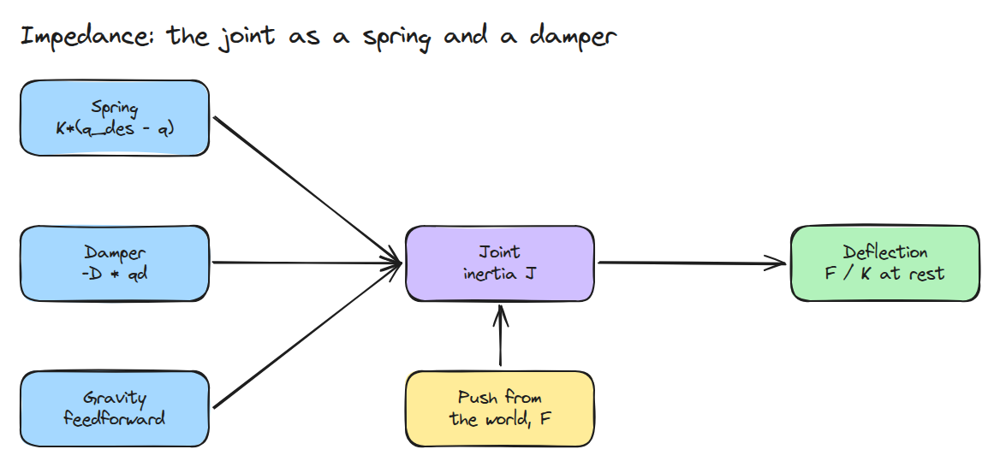
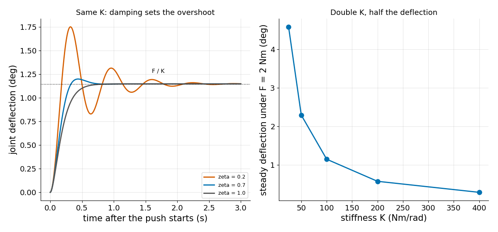
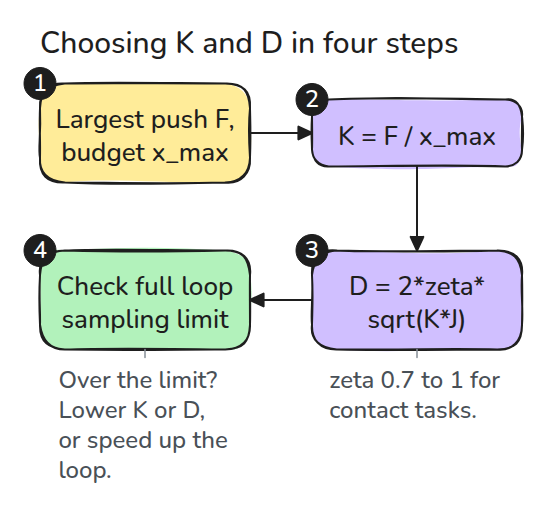

# 임피던스 제어 (Impedance Control)

> 로봇 관절이 spring과 damper처럼 되밀게 해서 닿았을 때 부드럽게 반응하게 하는 법을 알게 됩니다.

**유형:** 만들기   **선수 지식:** 03/01 샘플링 한계, 03/02 중력 보상   **시간:** 약 15분

## 쉽게 말하면

책상 위 로봇 팔의 손을 손가락 하나로 밀어 보세요. 모터는 관절이 움직임을 거스르는 damper가 달린 spring처럼 반응하게 해요. 그런 반응을 impedance라고 해요.

spring이 뻣뻣할수록 같은 힘을 더 조금만 움직이고도 버텨요. damper는 팔이 멈추는 자리를 바꾸지 않고 출렁이며 자리를 잡을지 미끄러지듯 자리를 잡을지를 바꿔요.

## 핵심 용어

- **Impedance**: 관절을 밀었을 때 spring과 damper처럼 되미는 방식입니다.
- **Stiffness (`K`)**: 처짐 한 단위당 되미는 힘입니다.
- **Damping (`D`)**: 속도를 거스르는 저항입니다.
- **Deflection**: 힘에 밀려 관절이 원래 자세에서 움직인 거리입니다.
- **Damping ratio (`zeta`)**: damper가 관절을 얼마나 세게 가라앉히는지입니다. 1이면 미끄러지듯 멈추고 1보다 작으면 출렁입니다.
- **Overshoot**: 최종 위치를 지나쳤다가 돌아오는 것입니다.

## 문제

뻣뻣한 로봇 팔은 손이 닿을 때마다 최대 힘으로 맞섭니다. 컵을 건네주는 로봇은 받을 때 조금 물러나야 하고 그러면 밀었을 때 팔이 작고 알려진 만큼만 움직입니다.

## 개념

사람 가까이에 있는 로봇은 닿으면 물러나야 하므로 각 joint가 얼마나 세게 되밀지를 직접 정합니다. joint는 충격 흡수 장치가 달린 스프링처럼 움직입니다. 밀수록 더 세게 되밀고 흡수 장치는 출렁일지 부드럽게 자리 잡을지를 정합니다.



*컨트롤러가 스프링과 damper를 더하고 노란색은 바깥에서 미는 힘입니다.*

스프링이 뻣뻣할수록 같은 힘에 덜 움직입니다. 흡수 장치는 멈추는 자리가 아니라 거기 가는 모양을 바꿉니다.



*세 가지 damper 세기가 모두 같은 자리에서 끝납니다.*


*같은 힘에 뻣뻣한 팔은 절반만 움직입니다.*



*stiffness를 고르고 damping을 고른 뒤 step 한계를 확인합니다.*

<details><summary>The math (optional)</summary>

`tau = K (q_des - q) - D qd + tau_g`입니다. 일정한 힘 `F`로 밀면 관절은 `F / K`에서 멈춥니다.
damping ratio는 `zeta = D / (2 sqrt(K J))`이고 1이면 overshoot가 없으며 1보다 작으면 출렁이고 overshoot 비율은 `exp(-pi zeta / sqrt(1 - zeta^2))`로 `zeta = 0.2`에서 약 0.53입니다.
`F = 2` Nm이고 `J = 1`일 때 `K = 100`이면 0.02 rad, `K = 200`이면 0.01 rad에서 멈추며 `D`는 20과 28.3입니다. `K = F_max / x_max`로 고릅니다. 영상은 힘을 15배로 크게 그렸습니다.

</details>

## 만들기

컨트롤러는 한 줄이고 도우미 함수가 원하는 damping ratio에 맞는 damping을 골라 줍니다.

```python
def impedance_torque(q, qd, q_des, K, D, tau_g):
    return K*(q_des - q) - D*qd + tau_g

def damping_for_zeta(K, J, zeta):
    return 2*zeta*np.sqrt(K*J)
```

`simulate()`는 관절 하나를 일정한 torque로 밉니다. 테스트는 밀려난 거리, stiffness를 두 배로 하면 절반이 되는지, ratio 1에서 overshoot가 없는지 확인합니다.

```bash
cd robotics-engineering-from-scratch
python3 -m pytest phases/03-dynamics-and-control/03-impedance-control -q
python3 phases/03-dynamics-and-control/03-impedance-control/code/figure.py
```

## 실제 도구로 보기

예상되는 가장 큰 힘과 허용하는 가장 큰 밀려남으로 스프링을 고르세요.

## 결과물

`outputs/skill-impedance-check.md`는 `K`, `D` 선택을 처짐 예산과 샘플링 한계에 대해 점검합니다.

## 연습 문제

1. stiffness를 두 배로 하고 밀려난 거리가 절반이 되는 것을 보세요.
2. damping ratio를 0.2와 1로 해서 비교하세요.
3. 마찰을 넣고 새 정지 자리를 찾으세요.
