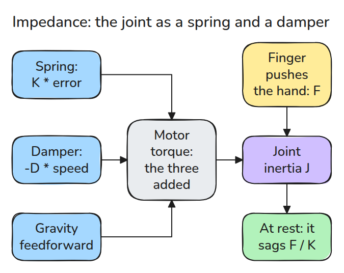
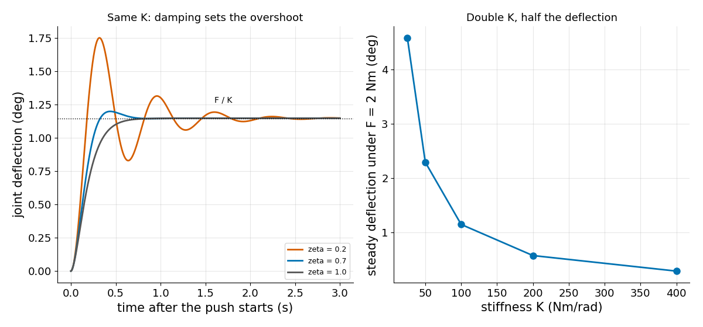
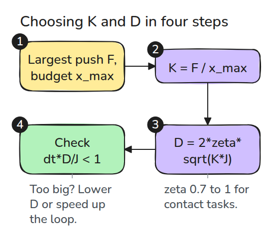

# 임피던스 제어 (Impedance Control)

> 임피던스 제어는 위치를 추종하지 않습니다. 관절이 어떻게 밀어낼지를 정합니다.

**유형:** 만들기   **선수 지식:** 03/01 샘플링 한계, 03/02 중력 보상   **시간:** 약 15분

## 쉽게 말하면

책상 위 로봇 팔의 손을 손가락 하나로 밀어 보세요. 모터는 관절이 spring과 damper(움직임을 거스르는 충격 흡수 장치)처럼 반응하게 해요. 손을 원래 자세에서 멀리 밀수록 spring이 더 세게 되밀어요. 그런 반응을 impedance라고 해요.

spring이 뻣뻣할수록 같은 힘을 더 조금만 움직이고도 버텨요. 일정하게 밀 때 팔이 멈추는 자리는 damper와 상관이 없어요. damper는 팔이 출렁이며 자리를 잡을지 미끄러지듯 자리를 잡을지를 바꿔요.

## 문제

뻣뻣한 position loop는 손이 닿을 때마다 최대 힘으로 맞섭니다. 컵을 건네주는 로봇에게는 반대가 필요합니다.

stiffness(처짐 한 단위당 얼마나 세게 되미는지)와 damping(속도를 얼마나 세게 거스르는지)을 직접 고르면 밀었을 때 싸움이 아니라 예측 가능하고 한계가 있는 deflection(밀려서 관절이 움직인 거리)이 생깁니다.

## 개념



*파란 상자는 컨트롤러가 더하는 것이고 노란 상자는 바깥에서 미는 힘 `F`입니다.*

제어 법칙은 `tau = K (q_des - q) - D qd + tau_g`입니다. `K`는 stiffness이고 `D`는 damping입니다. `q_des - q`는 관절이 원래 자세에서 벗어난 정도이고 `qd`는 관절 속도이며 `tau_g`는 중력을 상쇄합니다. 일정한 힘 `F`로 밀면 관절은 `F / K`에서 멈춥니다.

damping ratio `zeta = D / (2 sqrt(K J))`는 관절이 자리를 잡는 모양을 정합니다. `J`는 관절의 관성입니다. overshoot는 최종 위치를 지나쳤다가 돌아오는 것입니다. `zeta = 1`이면 overshoot 없이 미끄러지듯 멈춥니다. `zeta < 1`이면 출렁이고 overshoot 비율은 `exp(-pi zeta / sqrt(1 - zeta^2))`이고 `zeta = 0.2`에서는 약 0.53입니다.



*왼쪽은 세 가지 `zeta`가 모두 같은 `F / K`에서 끝나고 overshoot만 다르다는 것을 보여 줍니다. 오른쪽은 `K`를 두 배로 하면 처짐이 절반이 되는 모습입니다.*

예: `F = 2` Nm이고 `J = 1`입니다. `K = 100`이면 `2 / 100 = 0.02` rad에서 멈추고 `K = 200`이면 0.01 rad에서 멈춥니다. 둘 다 `zeta = 1`이 되도록 `D = 2 sqrt(K J)`(20과 28.3)를 쓰므로 어느 쪽도 overshoot가 없습니다.


*같은 힘으로 밉니다. 호박색 공(멈출 자리)을 보세요. 파란 팔(`K = 100`)은 초록 팔(`K = 200`)보다 두 배 더 내려갑니다. 처짐은 15배로 크게 그렸고 3분의 1 속도로 렌더했습니다.*



*번호를 따라가 보세요. 처짐 예산(받아들일 수 있는 가장 큰 움직임)에서 `K`를, damping ratio에서 `D`를 고른 뒤 레슨 03/01의 샘플링 한계를 확인합니다.*

## 만들기

```python
def impedance_torque(q, qd, q_des, K, D, tau_g):
    return K*(q_des - q) - D*qd + tau_g

def damping_for_zeta(K, J, zeta):
    return 2*zeta*np.sqrt(K*J)
```

`simulate()`는 semi-implicit Euler로 1자유도 관절을 일정한 외부 토크로 밉니다.

테스트는 처짐이 `F / K`와 1% 안에서 맞는지, `K`를 두 배로 하면 절반이 되는지, `zeta = 1`에서 overshoot가 없는지, `zeta = 0.2`가 공식과 3%p 안에서 맞는지 확인합니다.

```bash
cd robotics-engineering-from-scratch
python3 -m pytest phases/03-dynamics-and-control/03-impedance-control -q
python3 phases/03-dynamics-and-control/03-impedance-control/code/figure.py
```

## 실제 도구로 보기

토크 제어 팔은 관절별 `K`와 `D`로 임피던스를 설정하게 해 주고 그 위에 Jacobian transpose로 Cartesian 임피던스를 얹기도 합니다. `K`는 예상되는 가장 큰 힘과 허용하는 가장 큰 처짐으로 고릅니다. `K = F_max / x_max`입니다.

## 결과물

`outputs/skill-impedance-check.md`는 `K`, `D` 선택을 처짐 예산과 샘플링 한계에 대해 점검합니다.

## 연습 문제

1. 마찰을 넣고 작은 힘에서 새 정상상태를 찾으세요.
2. 일정한 힘을 방향이 뒤집히는 step으로 바꾸세요. `zeta`가 0.7일 때와 1일 때의 settling time을 비교하세요.
3. 샘플링 한계 점검으로 `J = 0.05`일 때 1 kHz loop가 허용하는 가장 큰 `D`를 찾으세요.
